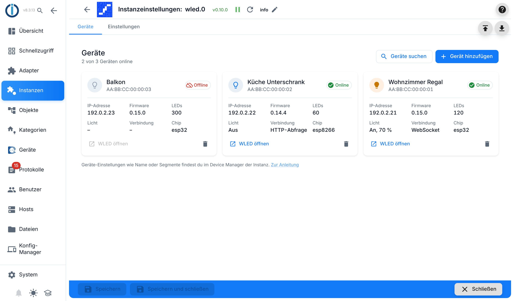
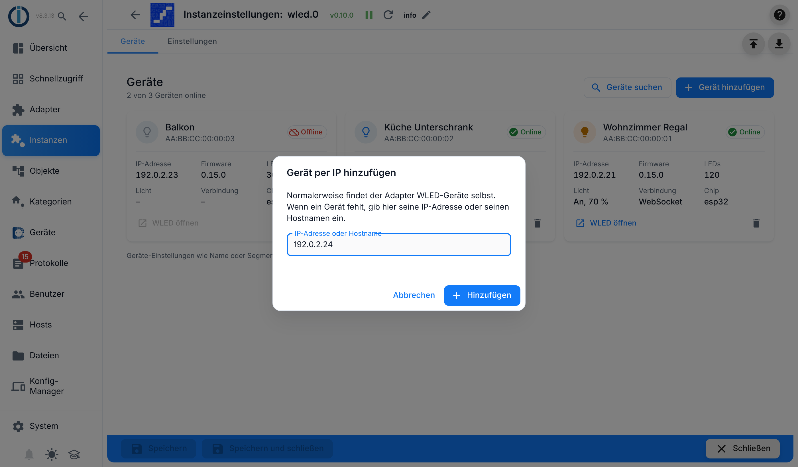
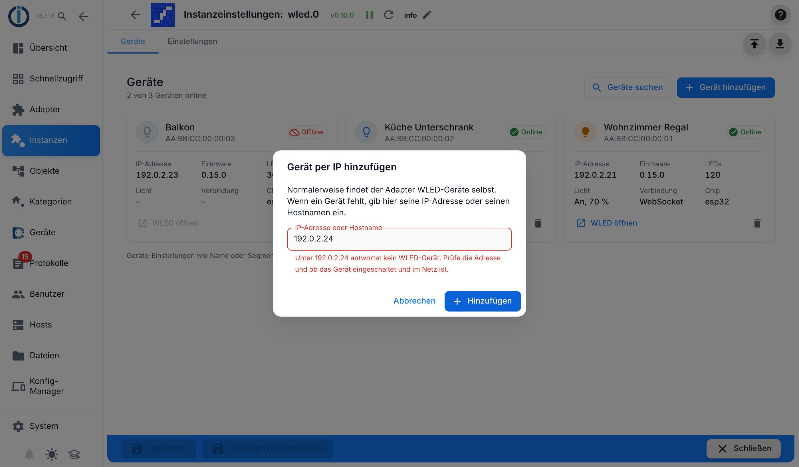

# Das erste Gerät einrichten

<!-- seite: gewicht=7; en=en/01.erste-schritte/02.erstes-geraet.md -->

<a id="adapter-wled-devices-automatically"></a>

## Wie und wann findet der Adapter meine WLED-Geräte automatisch?

<!-- abschnitt: prio=B; gewicht=3; readme=partial; cluster=discovery-connection-12; features=device-bonjour-autodiscovery,device-known-reconnect,req-wled-firmware,admin-add-device -->
<!-- muss beantworten: Beschreibt, dass die Bonjour-Erkennung beim Start einmal läuft, was dafür nötig ist (Multicast, selbes Netz) und was man tut, wenn ein Gerät fehlt. -->

**Kurz:** Der Adapter sucht beim Start der Instanz einmal per Bonjour (mDNS) nach WLED-Geräten. Vorher verbindet er sich mit allen Geräten, die er schon kennt, über ihre gespeicherte IP-Adresse. Einen regelmäßigen Suchlauf gibt es nicht. Fehlt ein Gerät, startest du die Suche von Hand neu oder fügst es per IP-Adresse hinzu.
<!-- quelle: code=main.js:64-70@v0.9.2; code=main.js:1455-1482@v0.9.2; code=main.js:1488-1520@v0.9.2; interview=4 -->

### Was beim Start passiert

1. Der Adapter liest alle Geräte, die unter `wled.<Instanz>` schon angelegt sind, und verbindet sich mit jedem über die gespeicherte IP-Adresse. Im Log steht `Try to contact <Anzahl> known devices`.
2. Danach startet er die Bonjour-Suche nach dem Dienst `wled`. Im Log steht `Bonjour service started, new  devices  will  be detected automatically`.
3. Jedes Gerät, das sich meldet und das der Adapter noch nicht kennt, legt er an. Im Log steht `New WLED  device found <Name> on IP 192.168.x.y`. Das Geräteobjekt heißt nach der MAC-Adresse des Geräts.
<!-- quelle: code=main.js:1455-1482@v0.9.2; code=main.js:1488-1520@v0.9.2; code=main.js:843-856@v0.9.2 -->

Die Suche bleibt danach geöffnet, bis die Instanz stoppt. Meldet sich ein Gerät später von selbst im Netz, etwa nach dem Einschalten, kann der Adapter es dadurch auch dann noch aufnehmen. Darauf verlassen solltest du dich nicht: Aktiv fragt der Adapter nur beim Start und bei einer Suche von Hand.
<!-- quelle: code=main.js:1492-1515@v0.9.2; code=main.js:113-124@v0.9.2; interview=4 -->

### Was die Suche braucht

- **mDNS ist in WLED eingeschaltet.** In WLED unter „WiFi Setup“ steht im Feld „mDNS address“ ein Name. Ist das Feld leer, meldet sich das Gerät nicht per Bonjour.
- **Gleiches Netz.** ioBroker und WLED liegen im selben Netz, und Multicast kommt durch. In Netzen mit VLAN-Trennung oder mit getrenntem Gäste-WLAN findet die Suche das Gerät meist nicht.
- **Das Gerät läuft.** Ein ausgeschaltetes Gerät meldet sich nicht.
<!-- quelle: extern=WLED:wled00/data/settings_wifi.htm:161@v0.15.0; extern=WLED:wled00/wled.cpp:886-897@v0.15.0; code=README.md:24-27@v0.9.2; forum=375895; forum=386242 -->

### Wenn ein Gerät fehlt

1. Prüfe, ob du die WLED-Oberfläche unter `http://192.168.x.y` vom selben Netz aus öffnen kannst.
2. Starte die Suche neu: im Admin im „Konfig-Manager“ (in älteren Admin-Versionen „Geräte“) bei der Instanz `wled.<Instanz>` über „Neue Geräte suchen“. Das Ergebnis siehst du nach einigen Sekunden in der Liste. Ein Neustart der Instanz löst dieselbe Suche aus.
3. Findet die Suche das Gerät nicht, füge es per IP-Adresse hinzu.
<!-- quelle: code=lib/devicemgmt.js:48-64@v0.9.2; code=lib/devicemgmt.js:76-82@v0.9.2; code=main.js:64-70@v0.9.2; forum=387597 -->

<!-- bild: screenshot Konfig-Manager mit Knopf „Neue Geräte suchen“ (Phase 5) -->

**Bis v0.9.2:** Geräte, die erst nach dem Start dazukommen, über die laufende Suche, „Neue Geräte suchen“ oder per IP-Adresse, überwacht der Adapter nicht. Fällt so ein Gerät aus, verbindet es sich bis zum nächsten Neustart der Instanz nicht neu. Starte die Instanz deshalb neu, wenn ein neu gefundenes Gerät nicht mehr reagiert.
<!-- quelle: code=main.js:75-88@v0.9.2; issue=#901 -->

**Ab v0.9.3:** Auch später gefundene Geräte werden überwacht und verbinden sich nach einem Ausfall von selbst neu ([#901](https://github.com/DrozmotiX/ioBroker.wled/issues/901)). „Neue Geräte suchen“ beendet zuerst die laufende Suche und startet dann eine neue ([#905](https://github.com/DrozmotiX/ioBroker.wled/issues/905)).
<!-- quelle: issue=#901; code=main.js:980-984@v0.9.3; issue=#905; code=main.js:1660-1669@v0.9.3 -->

**Ab v0.10.0:** Die automatische Suche beim Start lässt sich abschalten, in den Instanzeinstellungen im Reiter „Einstellungen“, Bereich „Erkennung“, mit dem Haken „Geräte automatisch per Bonjour/mDNS suchen“. Ist sie aus, nutzt der Adapter nur die bekannten und die per IP-Adresse hinzugefügten Geräte. Im Log steht dann `Automatic discovery (Bonjour/mDNS) is switched off, only known and manually added devices are used`. Die Suche von Hand funktioniert weiterhin ([#897](https://github.com/DrozmotiX/ioBroker.wled/issues/897)).
<!-- quelle: issue=#897; code=main.js:89-97@v0.10.0; code=admin/jsonConfig.json:76-98@v0.10.0; code=admin/i18n/de/translations.json:11-13@v0.10.0 -->

**Ab v0.10.0:** In den Instanzeinstellungen gibt es im Reiter „Geräte“ zusätzlich den Knopf „Geräte suchen“. Er sucht einige Sekunden lang und meldet dann „Neue Geräte gefunden: <Anzahl>“ oder „Keine neuen Geräte gefunden.“ ([#266](https://github.com/DrozmotiX/ioBroker.wled/issues/266)).
<!-- quelle: issue=#266; code=main.js:1108-1121@v0.10.0; code=src-admin/src/i18n/de.json:31-32@v0.10.0; code=src-admin/src/i18n/de.json:49-50@v0.10.0 -->



**Ab v0.10.0:** Steht zwischen ioBroker und WLED ein mDNS-Relay, etwa zwischen zwei VLANs, übernimmt der Adapter die IP-Adresse, die das Gerät selbst meldet, und nicht mehr die Adresse des Relays ([#897](https://github.com/DrozmotiX/ioBroker.wled/issues/897)).
<!-- quelle: issue=#897; code=main.js:2480-2490@v0.10.0 -->

**Siehe auch:** [Wie füge ich ein Gerät manuell per IP hinzu?](#add-device-manually-ip-if) · [Wo stelle ich Polling-Intervall und Auto-Erkennung ein?](../03.referenz/01.instanz-einstellungen.md#polling-interval-auto-discovery) · [Warum taucht ein gelöschtes Gerät wieder auf?](../02.anleitungen/05.geraete-verwalten.md#remove-wled-device-adapter)

<a id="add-device-manually-ip-if"></a>

## Wie füge ich ein Gerät manuell per IP hinzu, und was tue ich, wenn es trotzdem nicht erscheint?

<!-- abschnitt: prio=B; gewicht=1; readme=covered; cluster=discovery-connection-13; features=admin-add-device,msg-addDevice,conn-watchdog-start-gap,device-known-reconnect -->
<!-- muss beantworten: Führt Schritt für Schritt durch "Gerät hinzufügen" und nennt die häufigsten Gründe, warum ein Gerät danach nicht in der Tabelle steht. -->

**Kurz:** Du trägst die IP-Adresse des Geräts in den Instanzeinstellungen über „Gerät hinzufügen“ ein oder im „Konfig-Manager“ (in älteren Admin-Versionen „Geräte“) über „Neues Gerät zu WLED hinzufügen“. Der Adapter liest das Gerät sofort ein und legt es an. Steht es danach nicht in der Liste, war das Gerät unter dieser Adresse nicht erreichbar, es läuft keine WLED-Firmware darauf, oder die Liste ist noch nicht neu geladen.
<!-- quelle: code=admin/index_m.html:121-132@v0.9.2; code=admin/index_m.html:250-254@v0.9.2; code=lib/devicemgmt.js:26-45@v0.9.2; code=lib/devicemgmt.js:84-164@v0.9.2; code=main.js:512-523@v0.9.2 -->

Du brauchst das vor allem, wenn die automatische Suche das Gerät nicht findet, zum Beispiel in Netzen mit VLAN-Trennung.
<!-- quelle: code=README.md:24-33@v0.9.2; forum=691174 -->

### So gehst du vor: in den Instanzeinstellungen

**Bis v0.9.3:** So sieht es in den alten Instanzeinstellungen aus. Für v0.10.0 siehe weiter unten.

1. Öffne im Admin unter „Instanzen“ die Einstellungen von `wled.<Instanz>`.
2. Klicke auf „Gerät hinzufügen“.
3. Trage im Dialog „Gerät manuell hinzufügen“ im Feld „IP“ die Adresse ein, zum Beispiel `192.168.x.y`, und klicke auf „Hinzufügen“.
4. Hat es geklappt, lädt die Gerätetabelle neu und zeigt das Gerät mit seinem Namen aus WLED. Hat es nicht geklappt, erscheint „Das Hinzufügen des Geräts ist fehlgeschlagen. Geben Sie die richtige IP ein und stellen Sie sicher, dass das Gerät erreichbar ist“.
<!-- quelle: code=admin/index_m.html:121-132@v0.9.2; code=admin/index_m.html:250-254@v0.9.2; code=admin/index_m.html:292-327@v0.9.2; code=admin/words.js:11-17@v0.9.2 -->

### So gehst du vor: im Konfig-Manager

1. Öffne im Admin den „Konfig-Manager“ (in älteren Admin-Versionen „Geräte“) und wähle die Instanz `wled.<Instanz>`.
2. Klicke auf „Neues Gerät zu WLED hinzufügen“.
3. Trage im Dialog „Neues Gerät hinzufügen“ im Feld „IP-Adresse“ die Adresse ein und bestätige.
4. Die Liste lädt neu. Ist die Adresse kein gültiges Format, erscheint „IP-Adresse <Adresse> ist ungültig“.
<!-- quelle: code=lib/devicemgmt.js:26-45@v0.9.2; code=lib/devicemgmt.js:84-164@v0.9.2 -->

### Per Skript

Mit `sendTo` fügst du ein Gerät aus einem Skript hinzu. Die Antwort ist `success` oder `failed`:

```js
sendTo('wled.0', 'addDevice', '192.168.x.y', (result) => {
    log(`Gerät hinzufügen: ${result}`);
});
```
<!-- quelle: code=main.js:512-523@v0.9.2 -->

### Wenn das Gerät danach nicht in der Liste steht

| Ursache | Woran du es erkennst | Was du tust |
|---|---|---|
| Das Gerät ist unter der Adresse nicht erreichbar, ausgeschaltet oder in einem anderen Netz. | Die WLED-Oberfläche unter `http://192.168.x.y` öffnet sich vom ioBroker-Netz aus nicht. Der Adapter wartet höchstens 3 Sekunden auf eine Antwort. | Prüfe Adresse, Stromversorgung und WLAN des Geräts und versuche es erneut. |
| Auf dem Gerät läuft keine WLED-Firmware. | Unter `http://192.168.x.y/json/info` kommt kein WLED-JSON zurück. | Siehe [Funktionieren Magic Home und fertige WLED-Controller mit dem Adapter?](01.installation.md#magic-home-ready-made-wled) |
| Das Gerät ist schon angelegt und verbunden. | Die Antwort ist `failed`, obwohl das Gerät läuft. Es steht schon in der Liste, unter seinem Namen aus WLED. | Nichts, das Gerät ist schon da. |
| Die Liste ist nicht aktuell. | Das Gerät erscheint erst, wenn der Adapter es vollständig eingelesen hat. Die Anzeige „In Verbindung gebracht“ liest die Tabelle nur beim Öffnen der Einstellungen. | Schließe die Instanzeinstellungen und öffne sie erneut. |
<!-- quelle: code=main.js:1318-1330@v0.9.2; code=main.js:1336-1347@v0.9.2; code=admin/index_m.html:28-95@v0.9.2; code=admin/words.js:15@v0.9.2; forum=691174 -->

**Bis v0.9.2:** Ein Gerät, das du nach dem Start der Instanz hinzufügst, überwacht der Adapter nicht. Fällt es aus, verbindet es sich bis zum nächsten Neustart der Instanz nicht neu. Starte die Instanz nach dem Hinzufügen einmal neu. Im Konfig-Manager erscheint außerdem keine Meldung, wenn das Gerät nicht antwortet.
<!-- quelle: code=main.js:75-88@v0.9.2; code=lib/devicemgmt.js:159-163@v0.9.2; issue=#901; issue=#916 -->

**Ab v0.9.3:** Auch nachträglich hinzugefügte Geräte werden überwacht ([#901](https://github.com/DrozmotiX/ioBroker.wled/issues/901)). Im Konfig-Manager meldet der Dialog „Gerät <Adresse> antwortet nicht. Bitte prüfe die IP-Adresse und ob das Gerät eingeschaltet ist.“ ([#916](https://github.com/DrozmotiX/ioBroker.wled/issues/916)) oder „Gerät <Adresse> ist bereits hinzugefügt“. Adressen mit Zahlen über 255 lehnt er als ungültig ab ([#915](https://github.com/DrozmotiX/ioBroker.wled/issues/915)).
<!-- quelle: issue=#901; code=main.js:980-984@v0.9.3; issue=#916; issue=#915; code=lib/devicemgmt.js:150-195@v0.9.3 -->

**Ab v0.10.0:** Die Instanzeinstellungen sind neu aufgebaut. Im Reiter „Geräte“ der Einstellungen klickst du auf „Gerät hinzufügen“ und trägst im Dialog „Gerät per IP hinzufügen“ im Feld „IP-Adresse oder Hostname“ die Adresse oder den Hostnamen des Geräts ein. Der Dialog meldet „<Gerät> wurde hinzugefügt.“ oder sagt, was nicht stimmt: „Unter <Adresse> antwortet kein WLED-Gerät. Prüfe die Adresse und ob das Gerät eingeschaltet und im Netz ist.“, „<Adresse> ist bereits als Gerät vorhanden.“ oder „Das ist keine gültige IP-Adresse und kein gültiger Hostname.“ ([#266](https://github.com/DrozmotiX/ioBroker.wled/issues/266)).
<!-- quelle: issue=#266; code=main.js:768-782@v0.10.0; code=main.js:1061-1081@v0.10.0; code=lib/admin-api.js:19-46@v0.10.0; code=src-admin/src/i18n/de.json:2-6@v0.10.0; code=src-admin/src/i18n/de.json:24-28@v0.10.0; code=src-admin/src/i18n/de.json:35@v0.10.0 -->





**Siehe auch:** [Wie und wann findet der Adapter meine WLED-Geräte automatisch?](#adapter-wled-devices-automatically) · [Wie entferne ich ein WLED-Gerät aus dem Adapter?](../02.anleitungen/05.geraete-verwalten.md#remove-wled-device-adapter) · [Woran sehe ich, ob ein Gerät wirklich online ist?](../05.hintergrund/01.verbindung-und-aktualisierung.md#tell-whether-device-really-online)

<a id="device-show-only-wled-mac"></a>

## Warum zeigt mein Gerät nur "WLED" oder die MAC-Adresse als Namen, und kann ich es umbenennen?

<!-- abschnitt: prio=B; gewicht=3; readme=missing; cluster=logs-install-15,control-basics-24; features=device-object,dm-rename-device,state-attribute-library -->
<!-- muss beantworten: Erklärt, woher der Gerätename kommt, dass er in WLED gesetzt wird und dass ein Umbenennen in ioBroker beim Neustart überschrieben werden kann. -->

*Dieser Abschnitt wird noch geschrieben.*
