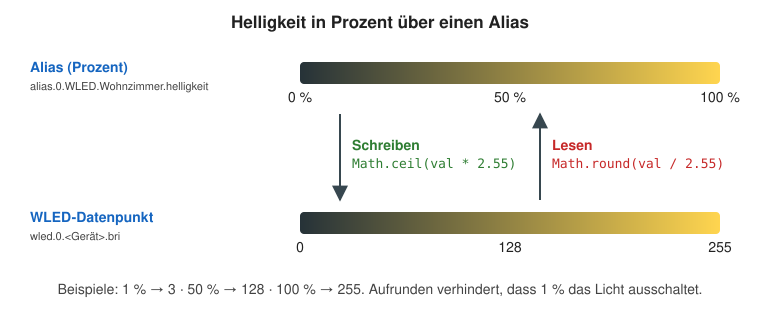
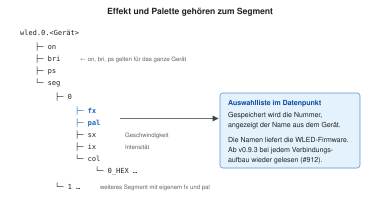

# Das Gerät zum ersten Mal steuern

<!-- seite: gewicht=14; en=en/01.erste-schritte/03.erste-steuerung.md -->

<a id="state-use-switch-off-whole"></a>

## Welchen Datenpunkt nehme ich zum Ein- und Ausschalten, das ganze Gerät oder nur ein Segment?

<!-- abschnitt: prio=B; gewicht=2; readme=missing; cluster=control-basics-17,segments-commands-11; features=state-root-light,state-segments -->
<!-- muss beantworten: Unterscheidet den Geräte-Datenpunkt on von seg.N.on und zeigt, welchen man in Skripten, Selektoren und Visualisierungen wählt. -->

*Dieser Abschnitt wird noch geschrieben.*

<a id="use-brightness-percent-0-100"></a>

## Wie nutze ich die Helligkeit in Prozent (0 bis 100), zum Beispiel für Alexa?

<!-- abschnitt: prio=A; gewicht=6; readme=missing; cluster=control-basics-01,scripts-viz-09; features=state-root-light -->
<!-- muss beantworten: Erklärt, dass bri von 0 bis 255 läuft, und zeigt einen Alias oder eine Umrechnung auf 0 bis 100 Prozent. -->

**Kurz:** `bri` arbeitet wie WLED selbst mit Werten von 0 bis 255, nicht in Prozent. Für 0 bis 100 % legst du einen Alias auf `bri` an, der beim Lesen durch 2,55 teilt und beim Schreiben mit 2,55 malnimmt.
<!-- quelle: code=lib/stateAttr.js:57-63@v0.9.3; issue=#12; forum=1326315 -->

Der Adapter stellt `bri` nicht auf Prozent um, weil 255 Stufen feiner sind und eine Umstellung bestehende Skripte und Visualisierungen brechen würde. Der Datenpunkt hat die Rolle `level.brightness` mit Minimum 0 und Maximum 255. Das gilt für die Gesamthelligkeit `wled.0.<Gerät>.bri` und genauso für die Segmenthelligkeit `wled.0.<Gerät>.seg.<Segment>.bri`.
<!-- quelle: code=lib/stateAttr.js:57-63@v0.9.3; code=main.js:1136-1141@v0.9.3; code=main.js:1731-1736@v0.9.3; issue=#12; issue=#237 -->


<!-- quelle: code=lib/stateAttr.js:57-63@v0.9.3; issue=#12; forum=1326315 -->

### Brauchst du überhaupt eine Umrechnung?

Für Alexa und Google Home über den iot-Adapter meist nicht: Weil `bri` Minimum und Maximum mitbringt, kann der iot-Adapter eine Prozentangabe selbst auf 0 bis 255 umrechnen. Den Alias brauchst du, wenn du Prozent in VIS, in Skripten oder in einer anderen Integration sehen oder schreiben willst, oder wenn die Umrechnung im iot-Adapter bei dir nicht greift.
<!-- quelle: issue=#237; forum=845845 -->

### So legst du einen Prozent-Alias an

1. Öffne im Admin den Reiter „Objekte“ und lege unter `alias.0` einen Datenpunkt an, zum Beispiel `alias.0.WLED.Wohnzimmer.helligkeit`.
2. Gib ihm den Typ `number`, die Rolle `level.dimmer`, Minimum `0`, Maximum `100` und die Einheit `%`.
3. Trag als Ziel des Alias den WLED-Datenpunkt ein: `wled.0.<Gerät>.bri`.
4. Trag die Umrechnung ein. Lesen: `Math.round(val / 2.55)`. Schreiben: `Math.ceil(val * 2.55)`.
5. Speichere und setze den Alias testweise auf `50`. `bri` muss dann auf `128` springen, und der Streifen leuchtet mit halber Helligkeit.
<!-- quelle: issue=#12; forum=1326315 -->

Im Objekt sieht der Alias-Teil so aus:

```json
"common": {
  "name": "Helligkeit Wohnzimmer",
  "type": "number",
  "role": "level.dimmer",
  "min": 0,
  "max": 100,
  "unit": "%",
  "read": true,
  "write": true,
  "alias": {
    "id": "wled.0.<Gerät>.bri",
    "read": "Math.round(val / 2.55)",
    "write": "Math.ceil(val * 2.55)"
  }
}
```
<!-- quelle: issue=#12; forum=1326315 -->

<!-- bild: screenshot Objekt-Dialog eines Alias mit Ziel wled.0.<Gerät>.bri und den beiden Umrechnungen (nach Admin-Neubau) -->

> [!TIP]
> Beim Schreiben rundest du auf (`Math.ceil`). Sonst wird aus 1 % der Wert 0 und das Licht geht aus, obwohl du es nur sehr dunkel haben wolltest.
<!-- quelle: forum=1326315 -->

> [!WARNING]
> Bau die Umrechnung nicht mit zwei Skripten, die sich gegenseitig auslösen (Prozent-Datenpunkt schreibt `bri`, `bri` schreibt den Prozent-Datenpunkt). Durch das Runden können die beiden Werte hin- und herspringen. Ein Alias hat dieses Problem nicht, weil es nur einen echten Wert gibt.
<!-- quelle: forum=1326315 -->

**Siehe auch:** [Wie binde ich WLED in den iot-Adapter ein und schalte Effekte, Presets und Farbe per Alexa oder Google Home?](../02.anleitungen/07.vis-und-smarthome.md#connect-wled-iot-adapter-switch)

<a id="choose-effect-palette"></a>

## Wo wähle ich Effekt und Palette aus?

<!-- abschnitt: prio=A; gewicht=6; readme=missing; cluster=effects-presets-08; features=state-effect-palette-dropdown,state-segments -->
<!-- muss beantworten: Nennt die Datenpunkte fx und pal, erklärt die Auswahllisten mit Namen und dass neue Effekte nach einem Firmware-Update erst nach Neustart erscheinen. -->

**Kurz:** Effekt und Palette stellst du je Segment ein: `wled.0.<Gerät>.seg.<Segment>.fx` für den Effekt und `wled.0.<Gerät>.seg.<Segment>.pal` für die Palette. Beide Datenpunkte haben eine Auswahlliste mit den Namen, die dein WLED-Gerät meldet.
<!-- quelle: code=lib/stateAttr.js:170-174@v0.9.3; code=lib/stateAttr.js:200-204@v0.9.3; code=main.js:1798-1815@v0.9.3; issue=#4; forum=645461 -->

Das erste Segment hat die Nummer `0`. Hast du in WLED mehrere Segmente angelegt, hat jedes eigene Datenpunkte `fx` und `pal`. Gespeichert wird jeweils die Nummer des Effekts oder der Palette; die Auswahlliste zeigt dazu den Namen an.
<!-- quelle: code=main.js:1100-1141@v0.9.3; code=main.js:939-958@v0.9.3; forum=534831 -->


<!-- quelle: code=main.js:1100-1141@v0.9.3; code=main.js:1798-1815@v0.9.3; code=main.js:960-966@v0.9.3; issue=#912 -->

### So gehst du vor

1. Öffne im Admin den Reiter „Objekte“ und gehe zu `wled.0.<Gerät>.seg.0`.
2. Klick beim Datenpunkt `fx` auf den Wert. Es öffnet sich eine Liste mit den Effektnamen deines Geräts. Wähle einen aus.
3. Mach dasselbe bei `pal` für die Palette.
4. Der Streifen wechselt sofort. Im Datenpunkt steht danach die Nummer des gewählten Eintrags.
<!-- quelle: code=main.js:1798-1815@v0.9.3; code=main.js:379-387@v0.9.3; issue=#4 -->

Daneben gehören zum Effekt `seg.<Segment>.sx` (Geschwindigkeit) und `seg.<Segment>.ix` (Intensität).
<!-- quelle: code=lib/stateAttr.js:190-199@v0.9.3; forum=377748 -->

<!-- bild: screenshot Objektbaum mit seg.0.fx und geöffneter Auswahlliste der Effekte (nach Admin-Neubau) -->

Im Skript schreibst du die Nummer, zum Beispiel `setState('wled.0.<Gerät>.seg.0.fx', 9)`. Welche Nummer zu welchem Namen gehört, steht in der Auswahlliste im Objekt (`common.states`).
<!-- quelle: code=main.js:1798-1815@v0.9.3; code=main.js:379-387@v0.9.3 -->

### Neue Effekte nach einem Firmware-Update fehlen in der Liste

Die Namen liest der Adapter aus dem Gerät, die Liste hängt also von deiner WLED-Firmware ab.
<!-- quelle: code=main.js:939-958@v0.9.3; code=main.js:860-879@v0.9.2 -->

**Bis v0.9.2:** Der Adapter setzt die Auswahlliste nur einmal je Adapterlauf. Effekte und Paletten, die mit einem Firmware-Update dazugekommen sind, erscheinen erst, wenn du die Adapter-Instanz neu startest.
<!-- quelle: code=main.js:860-879@v0.9.2; code=main.js:1617-1632@v0.9.2; issue=#912 -->

**Ab v0.9.3:** Der Adapter schreibt die Listen bei jedem Verbindungsaufbau mit dem Gerät neu. Weil WLED beim Firmware-Update neu startet und sich danach wieder verbindet, erscheinen neue Effekte ohne Neustart des Adapters ([#912](https://github.com/DrozmotiX/ioBroker.wled/issues/912)).
<!-- quelle: code=main.js:960-966@v0.9.3; code=main.js:1571@v0.9.3; issue=#912; interview=18 -->

> [!TIP]
> Fehlt die Auswahlliste ganz oder ist sie veraltet, starte die Instanz `wled.0` einmal neu. Das hilft in jeder Version.
<!-- quelle: code=main.js:1798-1815@v0.9.3; code=main.js:1617-1632@v0.9.2 -->

**Siehe auch:**

- [Wo finde ich die Nummern und Namen von Effekten und Paletten für Skripte?](../02.anleitungen/02.effekte-und-presets.md#numbers-names-effects-palettes-scripts)
- [Wie wähle ich Effekt und Palette in VIS als Dropdown?](../02.anleitungen/07.vis-und-smarthome.md#choose-effect-palette-vis-as)
