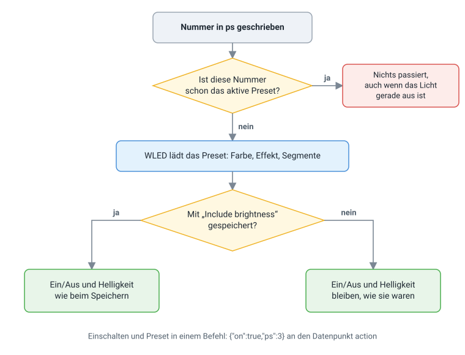

# Effekte und Presets nutzen

<!-- seite: gewicht=24; en=en/02.anleitungen/02.effekte-und-presets.md -->

<a id="switch-wled-presets-via-ps"></a>

## Wie schalte ich WLED-Presets per Datenpunkt (ps) in VIS, Blockly oder Skript?

<!-- abschnitt: prio=A; gewicht=6; readme=missing; cluster=effects-presets-01,effects-presets-03; features=state-root-light,state-extra-set-commands -->
<!-- muss beantworten: Zeigt, wie man ps setzt, welche Presets man braucht, und warum das Gerät beim Preset-Wechsel an oder aus gehen kann. -->

**Kurz:** Leg das Preset in der WLED-Oberfläche an und schreib seine Nummer als Zahl in `wled.0.<MAC>.ps`, und zwar als Steuerbefehl (`ack=false`). Ob das Licht dabei an- oder ausgeht, entscheidet das Preset selbst, nicht der Adapter.
<!-- quelle: code=main.js:148@v0.9.2; code=main.js:220@v0.9.2; code=lib/stateAttr.js:69@v0.9.2; forum=771230; forum=638540 -->

Der Adapter reicht den Wert unverändert als `{"ps":3}` an das Gerät weiter, per WebSocket oder HTTP. Die Presets selbst liegen nur in WLED. Der Adapter kennt ihre Nummern, aber nicht ihre Namen, und legt auch keine Liste der Presets an.
<!-- quelle: code=main.js:218-222@v0.9.2; code=main.js:405-427@v0.9.2; forum=376469; forum=631812 -->

### Welche Presets du brauchst

1. Öffne die WLED-Oberfläche des Geräts im Browser und stell Farbe, Effekt und Helligkeit so ein, wie das Preset aussehen soll.
2. Speichere den Zustand mit „Create Preset“. Die Nummer unter „Save to ID“ ist die Zahl, die du später in `ps` schreibst. Erlaubt sind 1 bis 250.
3. Entscheide beim Speichern, ob „Include brightness“ an sein soll. Davon hängt ab, ob das Preset das Licht ein- oder ausschaltet (siehe unten).
<!-- quelle: extern=WLED-Docs:docs/features/presets.md; extern=WLED-Docs:docs/interfaces/json-api.md -->

<!-- bild: screenshot WLED-Oberfläche, Dialog „Create Preset“ mit „Save to ID“ und „Include brightness“ -->

### So setzt du ps

| Wo | So geht es |
|---|---|
| Objektbaum im Admin | Bei `wled.0.<MAC>.ps` die Nummer eintragen und speichern. |
| JavaScript | `setState('wled.0.<MAC>.ps', 3);` (ohne drittes Argument ist das ein Steuerbefehl) |
| Blockly | Block „steuere“ mit dem Objekt `ps` und der Zahl als Wert. Nicht „aktualisiere“ nehmen. |
| VIS | Ein Widget, das einen festen Wert schreibt, zum Beispiel ein Knopf mit der Preset-Nummer, oder eine Auswahlliste mit den Preset-Nummern als Werten und den Namen als Texten. |
<!-- quelle: code=main.js:148@v0.9.2; forum=382563; forum=771230; forum=638540; extern=ioBroker.javascript:src-editor/src/Components/blockly-plugins/blocks/words.json -->

<!-- bild: screenshot Objektbaum mit wled.0.<MAC>.ps, Wert eintragen (nach Admin-Neubau) -->
<!-- bild: screenshot VIS-Knopf, der eine Preset-Nummer in ps schreibt (nach Admin-Neubau) -->

Der Adapter schickt nur Werte mit `ack=false` an das Gerät. Ein Wert mit `ack=true` („aktualisiere“ in Blockly) gilt als Rückmeldung vom Gerät und wird nicht gesendet.
<!-- quelle: code=main.js:148@v0.9.2; forum=382563 -->

`ps` ist ein Datenpunkt vom Typ Zahl. Schreib deshalb `3` und nicht `"3"`. WLED versteht zwar auch den Text, aber ioBroker meldet dann eine Warnung zum falschen Datentyp.
<!-- quelle: code=main.js:1559@v0.9.2; extern=WLED:wled00/util.cpp:56-69@v0.15.0 -->

Hat es geklappt, zeigt `ps` kurz darauf die Nummer, die das Gerät zurückmeldet. Hast du danach in WLED etwas von Hand verändert, meldet WLED `-1`, weil kein Preset mehr aktiv ist.
<!-- quelle: code=main.js:1591@v0.9.2; extern=WLED:wled00/json.cpp:595@v0.15.0; extern=WLED:wled00/led.cpp:99@v0.15.0 -->

### Warum geht das Licht beim Preset-Wechsel an oder aus?

Ein Preset speichert mit „Include brightness“ auch den Ein/Aus-Zustand und die Helligkeit zum Zeitpunkt des Speicherns. Wurde es bei ausgeschaltetem Licht gespeichert, schaltet es beim Aufruf aus. Wurde es bei eingeschaltetem Licht gespeichert, schaltet es ein. Ohne „Include brightness“ bleibt das Licht so, wie es ist, also auch aus, wenn es vorher aus war.
<!-- quelle: extern=WLED:wled00/json.cpp:586-587@v0.15.0; extern=WLED-Docs:docs/features/presets.md; forum=1310363; forum=1111167 -->


<!-- quelle: extern=WLED:wled00/json.cpp:470@v0.15.0; extern=WLED:wled00/json.cpp:586-587@v0.15.0; extern=WLED:wled00/json.cpp:333@v0.15.0 -->

So bekommst du das gewünschte Verhalten:

- **Preset soll immer einschalten:** Preset bei eingeschaltetem Licht mit „Include brightness“ neu speichern.
- **Preset soll nur Effekt und Farbe ändern:** ohne „Include brightness“ speichern und das Licht getrennt über `wled.0.<MAC>.on` schalten.
- **Einschalten und Preset in einem Befehl:** `{"on":true,"ps":3}` in den Datenpunkt `wled.0.<MAC>.action` schreiben. WLED wertet `on` vor `ps` aus.
<!-- quelle: code=main.js:162-171@v0.9.2; extern=WLED:wled00/json.cpp:333@v0.15.0; extern=WLED:wled00/json.cpp:470@v0.15.0; interview=10 -->

> [!IMPORTANT]
> WLED lädt ein Preset nicht noch einmal, wenn es schon das aktive Preset ist. Das gilt auch, wenn du das Licht zwischendurch über `on` ausgeschaltet hast: `ps` zeigt dann weiter dieselbe Nummer, und dieselbe Nummer noch einmal zu schreiben, bewirkt nichts. Schalte in diesem Fall mit `on` ein oder schick `{"on":true,"ps":3}` über `action`.
<!-- quelle: extern=WLED:wled00/json.cpp:470@v0.15.0; extern=WLED:wled00/json.cpp:449@v0.14.0; extern=WLED:wled00/led.cpp:98-99@v0.15.0 -->

> [!TIP]
> Den aktuellen Zustand speicherst du aus ioBroker als Preset, indem du die gewünschte Nummer in `wled.0.<MAC>.psave` schreibst.
<!-- quelle: code=main.js:883@v0.9.2; code=lib/stateAttr.js:138-142@v0.9.2; extern=WLED-Docs:docs/interfaces/json-api.md -->

**Siehe auch:** [Presets per Bewegungsmelder schalten](06.skripte.md#switch-wled-presets-automatically-example) · [Nacheinander durch Presets schalten](#step-through-presets-button-script) · [Playlist starten](#start-wled-playlist-through-adapter) · [Skript setzt ps oder on nicht](../04.fehlerbehebung/02.befehle-wirken-nicht.md#script-not-ps-wled-ignores) · [ps springt auf -1](../04.fehlerbehebung/02.befehle-wirken-nicht.md#ps-jump-1-not-show)

<a id="step-through-presets-button-script"></a>

## Wie wechsle ich per Taste oder Skript nacheinander durch Presets?

<!-- abschnitt: prio=B; gewicht=4; readme=missing; cluster=effects-presets-04; features=state-root-light -->
<!-- muss beantworten: Zeigt ein Muster mit Zähler im Skript und verweist auf WLED-Playlists als Alternative. -->

**Kurz:** Für einen Taster ist der einfachste Weg ein einziger Befehl an `wled.0.<MAC>.action`: `{"ps":"1~4~"}` schaltet bei jedem Druck zum nächsten Preset im Bereich 1 bis 4 und nach dem letzten wieder zum ersten. Für eine feste Abfolge mit festen Zeiten nimmst du eine WLED-Playlist. Ein Skript mit Zähler brauchst du nur, wenn die Reihenfolge nicht in einen Nummernbereich passt oder ioBroker den Takt vorgeben soll.
<!-- quelle: code=main.js:162-171@v0.9.2; extern=WLED:wled00/util.cpp:40-50@v0.15.0; extern=WLED:wled00/json.cpp:468-476@v0.15.0; interview=12; forum=760933; forum=667903 -->

Der Adapter kennt kein Weiterschalten. Er schreibt nur, was du ihm gibst, an das Gerät. Das Durchschalten erledigt entweder WLED selbst oder dein Skript.
<!-- quelle: code=main.js:148@v0.9.2; code=main.js:218-222@v0.9.2; interview=12 -->

### Weg 1: WLED schaltet weiter (für Taster)

WLED versteht in `ps` einen Bereich als Text: `"1~4~"` heißt „das nächste Preset von 1 bis 4“, `"1~4~-"` heißt „das vorige“. WLED rechnet vom gerade aktiven Preset aus. Ist keines aktiv (`ps` zeigt `-1`), beginnt es beim ersten des Bereichs.
<!-- quelle: extern=WLED:wled00/util.cpp:20-50@v0.15.0; extern=WLED:wled00/json.cpp:468-476@v0.15.0 -->

1. Leg die Presets in WLED mit fortlaufenden Nummern an, zum Beispiel 1 bis 4.
2. Lass deinen Taster in ioBroker diesen Text in `wled.0.<MAC>.action` schreiben:
   ```json
   {"ps":"1~4~"}
   ```
3. In JavaScript: `on({ id: '<ID des Tasters>', val: true }, () => setState('wled.0.<MAC>.action', JSON.stringify({ ps: '1~4~' })));`. In Blockly: „Falls Objekt“ auf den Taster, darin „steuere“ `wled.0.<MAC>.action` mit dem Text `{"ps":"1~4~"}`.
<!-- quelle: code=main.js:162-171@v0.9.2; extern=WLED:wled00/util.cpp:20-50@v0.15.0; extern=ioBroker.javascript:src-editor/src/Components/blockly-plugins/blocks/words.json -->

Schreib den Bereich über `action` und nicht direkt in `ps`. `ps` ist im Adapter ein Datenpunkt vom Typ Zahl, ein Text dort führt zu einer Warnung zum falschen Datentyp.
<!-- quelle: code=lib/stateAttr.js:69-73@v0.9.2; code=main.js:1559@v0.9.2 -->

### Weg 2: WLED-Playlist (feste Abfolge mit Zeiten)

Soll das Licht von selbst alle paar Minuten weiterschalten, leg in WLED eine Playlist an und starte sie über ihre Nummer in `ps`. Wie das geht, steht unter [Playlist starten](#start-wled-playlist-through-adapter). Mit `{"np":true}` an `action` springt eine laufende Playlist zum nächsten Eintrag, ab WLED-Firmware 0.15.
<!-- quelle: interview=12; extern=WLED-Docs:docs/interfaces/json-api.md; extern=WLED:wled00/json.cpp:494@v0.15.0 -->

### Weg 3: Skript mit Zähler

Das Skript merkt sich, welches Preset als Nächstes dran ist, und schreibt die Nummer in `ps`. Dieses Beispiel schaltet per Taster weiter und läuft zusätzlich alle 30 Sekunden von selbst, solange ein Schalter-Datenpunkt `true` ist. Den Schalter legst du selbst an, zum Beispiel unter `0_userdata.0`.

```javascript
const WLED = 'wled.0.<MAC>';
const TASTER = '<ID des Tasters>';
const AUTOMATIK = '0_userdata.0.wledDurchschalten'; // selbst angelegter Schalter
const PRESETS = [2, 5, 7, 3];   // beliebige Reihenfolge
const ABSTAND_MS = 30 * 1000;   // 30 Sekunden

let index = -1;
let ablauf = null;

function naechstesPreset() {
    index = (index + 1) % PRESETS.length;
    setState(`${WLED}.ps`, PRESETS[index]); // Steuerbefehl (ack=false)
}

// Ein Tastendruck = ein Preset weiter
on({ id: TASTER, val: true }, naechstesPreset);

// Automatik ein- und ausschalten
on({ id: AUTOMATIK, change: 'ne' }, obj => {
    if (ablauf) { clearInterval(ablauf); ablauf = null; }
    if (obj.state.val) {
        naechstesPreset();
        ablauf = setInterval(naechstesPreset, ABSTAND_MS);
    }
});
```
<!-- quelle: code=main.js:148@v0.9.2; code=main.js:218-222@v0.9.2; forum=760933; forum=656088; forum=1031911; extern=ioBroker.javascript:docs/en/javascript.md -->

In Blockly baust du dasselbe mit einer Variablen für den Zähler und dem Block „Ausführen“ mit dem Namen „Intervall“ und „alle“ 30000 ms aus der Gruppe „Timeouts“. Zum Anhalten nimmst du „stop zyklische Ausführung“.
<!-- quelle: extern=ioBroker.javascript:src-editor/src/Components/blockly-plugins/blocks/words.json; forum=667903 -->

<!-- bild: screenshot Blockly: Zähler-Variable, Ausführen Intervall alle 30000 ms, steuere ps mit dem Listeneintrag -->

> [!WARNING]
> Bau das Durchschalten nicht als Schleife mit dem Block „Pause“ oder mit mehreren „steuere … mit Verzögerung“ hintereinander. Eine Endlosschleife blockiert die Skript-Instanz. Verzögerungen zählen alle ab dem Auslöser und nicht ab dem vorigen Schritt, und „löschen falls läuft“ bricht frühere Schritte ab. Nimm einen Zähler mit Intervall wie oben.
<!-- quelle: forum=760933; forum=667903; forum=656088; extern=ioBroker.javascript:src-editor/src/Components/blockly-plugins/blocks/words.json -->

> [!NOTE]
> Steht `ps` schon auf der Nummer, die dein Skript schreibt, lädt WLED das Preset nicht noch einmal. Bei einem Durchlauf mit wechselnden Nummern stört das nicht. Hat die Liste nur einen Eintrag, oder hast du das Licht zwischendurch über `on` ausgeschaltet, schick `{"on":true,"ps":2}` an `action`.
<!-- quelle: extern=WLED:wled00/json.cpp:470@v0.15.0; code=main.js:162-171@v0.9.2 -->

**Siehe auch:** [Presets per Datenpunkt ps schalten](#switch-wled-presets-via-ps) · [Playlist starten](#start-wled-playlist-through-adapter) · [Presets per Bewegungsmelder schalten](06.skripte.md#switch-wled-presets-automatically-example) · [Kompletten JSON-Befehl senden](04.befehle-an-wled.md#send-complete-json-command-wled)

<a id="start-wled-playlist-through-adapter"></a>

## Wie starte ich eine WLED-Playlist über den Adapter?

<!-- abschnitt: prio=B; gewicht=2; readme=partial; cluster=effects-presets-06; features=state-root-light,state-action-json -->
<!-- muss beantworten: Erklärt, ob und wie man Playlists über ps, pl oder den action-Datenpunkt startet. -->

**Kurz:** Eine Playlist ist in WLED ein Preset mit eigener Nummer. Du startest sie deshalb wie jedes Preset, indem du ihre Nummer in `wled.0.<MAC>.ps` schreibst. Der Datenpunkt `pl` zeigt nur an, welche Playlist gerade läuft. Ihn zu beschreiben, startet keine Playlist.
<!-- quelle: code=lib/stateAttr.js:69-78@v0.9.2; code=main.js:218-222@v0.9.2; extern=WLED-Docs:docs/interfaces/json-api.md; extern=WLED:wled00/json.cpp:596@v0.15.0 -->

### Playlist über ps starten

1. Leg die Playlist in der WLED-Oberfläche an. Sie bekommt beim Speichern eine Nummer wie jedes Preset.
   <!-- bild: screenshot WLED-Oberfläche, Playlist anlegen mit Presets und Dauer -->
2. Schreib diese Nummer in `wled.0.<MAC>.ps`, zum Beispiel per JavaScript `setState('wled.0.<MAC>.ps', 9);` oder in Blockly mit „steuere“.
3. Während die Playlist läuft, zeigt `pl` ihre Nummer und `ps` das gerade aktive Preset daraus. Läuft keine Playlist, zeigt `pl` den Wert `-1`.
<!-- quelle: code=main.js:148@v0.9.2; extern=WLED-Docs:docs/interfaces/json-api.md; extern=WLED:wled00/json.cpp:595-596@v0.15.0 -->

Wie `ps` genau funktioniert, steht unter [Presets per Datenpunkt ps schalten](#switch-wled-presets-via-ps).

### Playlist ohne gespeichertes Preset über action starten

Über den Datenpunkt `wled.0.<MAC>.action` kannst du eine Playlist auch direkt als JSON schicken, ohne sie vorher in WLED zu speichern. Dieses Beispiel zeigt die Presets 1, 2 und 3 je 30 Sekunden lang, wiederholt das endlos und schaltet dabei ein:

```json
{"on":true,"playlist":{"ps":[1,2,3],"dur":[300,300,300],"transition":0,"repeat":0}}
```
<!-- quelle: code=main.js:162-171@v0.9.2; extern=WLED-Docs:docs/interfaces/json-api.md; extern=WLED:wled00/json.cpp:478-479@v0.15.0; interview=10 -->

| Schlüssel | Bedeutung |
|---|---|
| `ps` | Die Preset-Nummern in der Reihenfolge, in der sie laufen sollen |
| `dur` | Wie lange jedes Preset bleibt, in Zehntelsekunden (`300` = 30 Sekunden) |
| `transition` | Überblendzeit zum nächsten Preset, in Zehntelsekunden |
| `repeat` | Wie oft die ganze Playlist läuft; `0` heißt endlos |
| `end` | Preset, das nach dem letzten Durchlauf geladen wird; wirkt nicht bei `repeat` = `0` |
<!-- quelle: extern=WLED-Docs:docs/interfaces/json-api.md -->

### Playlist weiterschalten oder beenden

- **Zum nächsten Preset springen:** `{"np":true}` an `action` schicken. Das gibt es ab WLED-Firmware 0.15.
- **Beenden:** Setz ein anderes Preset über `ps` oder ändere ein Segment direkt, zum Beispiel den Effekt. Damit endet die Playlist.
<!-- quelle: extern=WLED-Docs:docs/interfaces/json-api.md; extern=WLED:wled00/json.cpp:494@v0.15.0; extern=WLED:wled00/presets.cpp:128@v0.15.0; extern=WLED:wled00/json.cpp:234@v0.15.0 -->

> [!NOTE]
> Der Adapter legt `pl` als beschreibbaren Datenpunkt an. WLED wertet einen geschriebenen Wert aber nicht aus, die WLED-JSON-API führt `pl` als „read-only“. Nutze zum Starten deshalb `ps` oder `action`.
<!-- quelle: code=lib/stateAttr.js:74-78@v0.9.2; extern=WLED-Docs:docs/interfaces/json-api.md -->

**Siehe auch:** [Nacheinander durch Presets schalten](#step-through-presets-button-script) · [Kompletten JSON-Befehl senden](04.befehle-an-wled.md#send-complete-json-command-wled)

<a id="numbers-names-effects-palettes-scripts"></a>

## Wo finde ich die Nummern und Namen von Effekten und Paletten für Skripte?

<!-- abschnitt: prio=B; gewicht=3; readme=missing; cluster=effects-presets-09; features=state-effect-palette-dropdown -->
<!-- muss beantworten: Zeigt, wie man die Zuordnung Nummer zu Name aus den Objekten ausliest und in welcher Reihenfolge sie erscheint. -->

**Kurz:** Die Zuordnung steht im Objekt der Datenpunkte `wled.0.<MAC>.seg.<Segment>.fx` (Effekte) und `wled.0.<MAC>.seg.<Segment>.pal` (Paletten), in der Wertliste `common.states`. Der Schlüssel ist die Nummer, der Wert der englische Name aus WLED. Die Liste ist nach Nummer geordnet, nicht alphabetisch wie in der WLED-Oberfläche.
<!-- quelle: code=main.js:860-879@v0.9.2; code=main.js:1631-1648@v0.9.2; forum=650079; forum=946015 -->

Der Adapter liest beim Verbinden die Listen `effects` und `palettes` aus dem Gerät und hängt sie an jeden `fx`- und `pal`-Datenpunkt. Einen eigenen Datenpunkt mit dem Namen des aktiven Effekts gibt es nicht. Die Nummer, die du in `fx` oder `pal` schreibst, ist die Stelle in der Liste von WLED, beginnend bei `0`.
<!-- quelle: code=main.js:860-879@v0.9.2; code=main.js:1631-1648@v0.9.2; extern=WLED:wled00/json.cpp:1039-1053@v0.15.0; forum=618580 -->

### So siehst du die Liste an

1. Öffne im Admin den Objektbaum und such `wled.0.<MAC>.seg.0.fx`.
2. Öffne das Objekt mit dem Stift und wechsle in die JSON-Ansicht. Unter `common.states` stehen die Paare, zum Beispiel `"0": "Solid"`, `"1": "Blink"`, `"9": "Rainbow"`.
3. Für Paletten dasselbe bei `seg.0.pal`.
<!-- quelle: code=main.js:1631-1648@v0.9.2; extern=WLED:wled00/FX.h:124-133@v0.15.0 -->

<!-- bild: screenshot Objektbaum, Objektdaten von seg.0.fx mit common.states (nach Admin-Neubau) -->

Direkt beim Gerät bekommst du dieselben Listen im Browser unter `http://192.168.x.y/json/effects` und `http://192.168.x.y/json/palettes`. Die Position in der Liste ist die Nummer, der erste Eintrag hat die Nummer `0`.
<!-- quelle: extern=WLED-Docs:docs/interfaces/json-api.md; extern=WLED:wled00/json.cpp:1142-1144@v0.15.0 -->

### So nutzt du die Liste im Skript

```javascript
const FX = 'wled.0.<MAC>.seg.0.fx';
const effekte = getObject(FX).common.states; // { "0": "Solid", "1": "Blink", ... }

// Nummer -> Name: welcher Effekt läuft gerade?
const nr = getState(FX).val;
log(`Aktiver Effekt: ${nr} = ${effekte[nr]}`);

// Name -> Nummer: Effekt per Name setzen
function setzeEffekt(name) {
    const nummer = Object.keys(effekte).find(k => effekte[k] === name);
    if (nummer === undefined) {
        log(`Effekt ${name} gibt es auf diesem Gerät nicht`, 'warn');
        return;
    }
    setState(FX, Number(nummer));
}
setzeEffekt('Rainbow');
```
<!-- quelle: code=main.js:148@v0.9.2; code=main.js:1631-1648@v0.9.2; code=lib/stateAttr.js:170-174@v0.9.2; extern=ioBroker.javascript:docs/en/javascript.md -->

Für eine Auswahlliste in VIS kannst du dieselbe Wertliste nutzen, siehe [Effekt und Palette in VIS als Dropdown](07.vis-und-smarthome.md#choose-effect-palette-vis-as).

### Worauf du achten solltest

- **Namen sind englisch** und stehen genau so da, wie WLED sie liefert. Vergleiche im Skript deshalb mit dem englischen Namen.
- **Lücken in der Nummerierung:** Einträge mit dem Namen `RSVD` sind in WLED freigehaltene Plätze. Sie bleiben in der Liste, damit die Nummern stimmen. Wähl sie nicht aus.
- **Eigene Paletten**, die du in WLED angelegt hast, stehen nicht in der Liste. WLED vergibt für sie Nummern von `255` abwärts. Du kannst sie in `pal` schreiben, ihr Name fehlt aber in `common.states`.
- **Je Gerät verschieden:** Die Liste kommt vom jeweiligen Gerät und hängt von dessen Firmware ab. Schlag die Nummer deshalb am Gerät nach, das du steuerst, und nicht bei einem anderen.
<!-- quelle: code=main.js:860-879@v0.9.2; extern=WLED:wled00/FX.cpp:7791@v0.15.0; extern=WLED:wled00/FX_fcn.cpp:560@v0.15.0; extern=WLED:wled00/json.cpp:896-899@v0.15.0 -->

> [!NOTE]
> **Bis v0.9.2** hängt der Adapter die Listen nur beim ersten Anlegen des Datenpunkts nach dem Adapterstart an. Neue Effekte nach einem WLED-Firmware-Update erscheinen erst nach einem Neustart des Adapters. **Ab v0.9.3:** Die Listen werden bei jedem Verbinden neu geschrieben ([#912](https://github.com/DrozmotiX/ioBroker.wled/issues/912)).
<!-- quelle: code=main.js:1631-1648@v0.9.2; code=main.js:959-966@v0.9.3; issue=#912 -->

**Siehe auch:** [Wo wähle ich Effekt und Palette aus](../01.erste-schritte/03.erste-steuerung.md#choose-effect-palette) · [Effekt-Parameter c1 bis c3](../03.referenz/02.datenpunkte.md#write-effect-parameters-c1-c3)

<a id="control-percent-effect-show-value"></a>

## Wie steuere ich den Effekt "Percent" und zeige einen Wert als Balken an?

<!-- abschnitt: prio=B; gewicht=4; readme=missing; cluster=effects-presets-12,scripts-viz-15; features=state-segments -->
<!-- muss beantworten: Zeigt, welcher Datenpunkt den Balkenwert steuert, mit Beispiel für Akkustand oder Prozentwerte. -->

**Kurz:** Wähl im Segment den Effekt „Percent“ (`wled.0.<MAC>.seg.0.fx`, in WLED 0.15 die Nummer `98`) und schreib den Wert als ganze Zahl von 0 bis 100 in `wled.0.<MAC>.seg.0.ix`. Die Intensität `ix` ist bei diesem Effekt der Füllstand des Balkens in Prozent.
<!-- quelle: code=lib/stateAttr.js:170-174@v0.9.2; code=lib/stateAttr.js:195-199@v0.9.2; code=main.js:376-391@v0.9.2; extern=WLED:wled00/FX.cpp:3877-3923@v0.15.0; extern=WLED:wled00/FX.h:222@v0.15.0; forum=649315; forum=1151726 -->

Den Balken zeichnet die WLED-Firmware, der Adapter reicht nur die Werte an das Segment weiter. Welche Nummer „Percent“ auf deinem Gerät hat, siehst du in der Wertliste von `fx`, siehe [Nummern und Namen von Effekten](#numbers-names-effects-palettes-scripts).
<!-- quelle: code=main.js:376-391@v0.9.2; code=main.js:1631-1648@v0.9.2 -->

### Was die Werte bewirken

| Datenpunkt | Wirkung bei „Percent“ |
|---|---|
| `seg.0.ix` | Füllstand: `0` bis `100` füllt den Balken vom Anfang des Segments an. `101` bis `200` füllt ihn vom Ende her, dabei leuchten `200 − ix` Prozent. Werte über 200 wirken wie 200. |
| `seg.0.sx` | Wie schnell der Balken zum neuen Wert läuft. `255` springt sofort. |
| `seg.0.pal` | Farbe der leuchtenden LEDs. Ohne Option „One color“ folgt die Farbe der Palette entlang des Streifens. |
| `seg.0.col.1` | Farbe 2: Farbe der LEDs, die nicht zum Balken gehören. Schwarz (`[0,0,0]`) heißt aus. |
| `o1` („One color“) | Der ganze Balken hat eine Farbe, die sich mit dem Füllstand ändert (Stelle in der Palette). Im Adapter nicht schreibbar, nur über `action`. |
<!-- quelle: extern=WLED:wled00/FX.cpp:3877-3923@v0.15.0; code=lib/stateAttr.js:190-204@v0.9.2; code=lib/stateAttr.js:518-522@v0.9.2; code=main.js:162-171@v0.9.2 -->

> [!TIP]
> Leuchten alle LEDs oder sieht der Rest bunt aus, liegt es an Farbe 2: Sie füllt alles außerhalb des Balkens. Setz Farbe 2 auf Schwarz. Für einen einfarbigen Balken nimmst du die Palette „* Color 1“ (Nummer `2`), dann leuchtet der Balken in Farbe 1.
<!-- quelle: extern=WLED:wled00/FX.cpp:3890-3893@v0.15.0; extern=WLED:wled00/FX_fcn.cpp:1862-1863@v0.15.0; forum=650248; forum=650537 -->

### Beispiel: Akkustand als Balken

Das Skript zeigt einen Akkustand von 0 bis 100 % an: grün ab 50 %, gelb ab 20 %, darunter rot. Alles geht als ein Befehl über `action`, damit Effekt, Palette, Farben und Wert gemeinsam ankommen.

```javascript
const WLED = 'wled.0.<MAC>';
const AKKU = '<ID des Akkustands in Prozent>';

function zeigeAkku(prozent) {
    const wert = Math.max(0, Math.min(100, Math.round(prozent))); // ganze Zahl 0..100
    const farbe = wert >= 50 ? [0, 255, 0] : wert >= 20 ? [255, 180, 0] : [255, 0, 0];
    setState(`${WLED}.action`, JSON.stringify({
        on: true,
        seg: { id: 0, fx: 98, pal: 2, sx: 255, ix: wert, col: [farbe, [0, 0, 0]] },
    }));
}

on({ id: AKKU, change: 'ne' }, obj => zeigeAkku(obj.state.val));
zeigeAkku(getState(AKKU).val); // beim Skriptstart einmal anzeigen
```
<!-- quelle: code=main.js:162-171@v0.9.2; extern=WLED:wled00/FX.cpp:3877-3923@v0.15.0; extern=WLED-Docs:docs/interfaces/json-api.md; interview=10; forum=649315 -->

Ist der Effekt schon eingestellt, reicht für jede neue Anzeige `setState('wled.0.<MAC>.seg.0.ix', wert);`.
<!-- quelle: code=main.js:376-391@v0.9.2; code=lib/stateAttr.js:195-199@v0.9.2 -->

### Andere Werte umrechnen

Hat dein Wert eine andere Spanne, rechne ihn vorher auf 0 bis 100 um und runde auf eine ganze Zahl: `Math.round((wert - min) / (max - min) * 100)`. Ein Füllstand von 0 bis 3000 Litern ergibt bei 1200 Litern also `40`. WLED speichert die Intensität als ganze Zahl von 0 bis 255, Nachkommastellen gehen verloren.
<!-- quelle: extern=WLED:wled00/FX.cpp:3879-3882@v0.15.0; forum=649315 -->

**Siehe auch:** [Nummern und Namen von Effekten und Paletten](#numbers-names-effects-palettes-scripts) · [Status oder Countdown anzeigen](06.skripte.md#show-status-countdown-strip) · [Kompletten JSON-Befehl senden](04.befehle-an-wled.md#send-complete-json-command-wled)

<a id="change-text-scrolling-text-effect"></a>

## Wie ändere ich den Text des Effekts "Scrolling Text" oder den Segmentnamen?

<!-- abschnitt: prio=B; gewicht=3; readme=missing; cluster=effects-presets-13,segments-commands-08; features=state-segments -->
<!-- muss beantworten: Erklärt, dass der Lauftext der Segmentname seg.N.n ist, und ab welcher Version er beschreibbar ist. -->

**Kurz:** Der Lauftext ist der Name des Segments. Du änderst ihn, indem du den Text in `wled.0.<MAC>.seg.<Segment>.n` schreibst. Der Datenpunkt ist beschreibbar, seit Pull Request [#522](https://github.com/DrozmotiX/ioBroker.wled/pull/522) in v0.7.1 kam, also auch im Grundstand v0.9.2. Er erscheint aber erst, wenn das Segment in WLED einen Namen hat.
<!-- quelle: code=lib/stateAttr.js:575-580@v0.9.2; pr=#522; issue=#519; issue=#670; extern=WLED:wled00/FX.cpp:6130-6131@v0.15.0; forum=1174386 -->

Der Adapter legt für jeden Wert, den WLED zu einem Segment meldet, einen Datenpunkt an. WLED meldet den Namen `n` nur, wenn das Segment einen hat. Ohne Namen fehlt deshalb `seg.<Segment>.n`.
<!-- quelle: code=main.js:1030-1042@v0.9.2; extern=WLED:wled00/json.cpp:539@v0.15.0; issue=#670 -->

### So setzt du den Text

1. Hat das Segment noch keinen Namen, gib ihm einen. Entweder in der WLED-Oberfläche beim Segment oder aus ioBroker mit diesem Text in `wled.0.<MAC>.action`:
   ```json
   {"seg":{"id":0,"n":"Hallo"}}
   ```
   Nach der nächsten Rückmeldung des Geräts gibt es `wled.0.<MAC>.seg.0.n`.
2. Wähl für das Segment den Effekt „Scrolling Text“ (`seg.0.fx`, in WLED 0.15 die Nummer `122`).
3. Schreib ab jetzt jeden neuen Text in `wled.0.<MAC>.seg.0.n`, zum Beispiel per JavaScript `setState('wled.0.<MAC>.seg.0.n', 'Waschmaschine fertig');`.
<!-- quelle: code=main.js:162-171@v0.9.2; code=main.js:376-391@v0.9.2; code=lib/stateAttr.js:575-580@v0.9.2; extern=WLED:wled00/json.cpp:68-85@v0.15.0; extern=WLED:wled00/FX.h:248@v0.15.0; issue=#670 -->

<!-- bild: screenshot WLED-Oberfläche, Segment mit Namen und Effekt „Scrolling Text“ auf einer Matrix -->

### Was du beim Text beachten musst

- **Nur auf einer Matrix:** „Scrolling Text“ ist ein 2D-Effekt. Auf einem einfachen Streifen zeigt WLED stattdessen eine einfarbige Fläche.
- **Nur einfache Zeichen:** WLED zeigt nur Zeichen aus dem einfachen ASCII-Bereich. Umlaute, ß und Emojis fallen weg. Schreib also „Tuer offen“ statt „Tür offen“.
- **Länge:** WLED kürzt den Namen auf 32 Zeichen (ESP8266) oder 64 Zeichen (ESP32).
- **Leerer Name:** Ohne Text zeigt der Effekt Datum und Uhrzeit.
- **Platzhalter:** Beginnt der Name mit `#TIME`, `#HHMM`, `#HH`, `#MM`, `#DATE`, `#DDMM` oder `#MMDD`, zeigt WLED stattdessen Uhrzeit oder Datum des Geräts.
- **Segmentgrenzen:** Änderst du Anfang oder Ende des Segments, ohne den Namen mitzuschicken, löscht WLED den Namen. Schick ihn dann erneut.
<!-- quelle: extern=WLED:wled00/FX.cpp:6106@v0.15.0; extern=WLED:wled00/FX.cpp:6130-6155@v0.15.0; extern=WLED:wled00/const.h:135-145@v0.15.0; extern=WLED:wled00/json.cpp:68-92@v0.15.0 -->

Geschwindigkeit, Position und Schrift stellst du über die Effekt-Parameter ein: `sx` ist die Geschwindigkeit, `ix` die senkrechte Verschiebung, `c1` die Spur, `c2` die Schriftgröße und `c3` die Drehung. Wie du `c1` bis `c3` schreibst, steht unter [Effekt-Parameter c1 bis c3](../03.referenz/02.datenpunkte.md#write-effect-parameters-c1-c3).
<!-- quelle: extern=WLED:wled00/FX.cpp:6199@v0.15.0; extern=WLED:wled00/FX.cpp:6113@v0.15.0; extern=WLED:wled00/FX.cpp:6159-6162@v0.15.0 -->

> [!NOTE]
> Für `#TIME` und `#DATE` braucht das Gerät die richtige Uhrzeit, normalerweise über NTP in den Zeiteinstellungen von WLED. **Ab v0.9.3:** Du kannst die Uhrzeit auch aus ioBroker setzen, indem du einen Unix-Zeitstempel in Sekunden in `wled.0.<MAC>.time` schreibst ([#919](https://github.com/DrozmotiX/ioBroker.wled/issues/919)). Rechne dafür `Math.floor(Date.now() / 1000)`, nicht Millisekunden. WLED übernimmt die Zeit, wenn es keine genauere Quelle wie NTP hat oder wenn sie um mindestens eine Minute abweicht.
<!-- quelle: code=lib/stateAttr.js:450-454@v0.9.2; code=lib/stateAttr.js:450-455@v0.9.3; issue=#919; extern=WLED:wled00/json.cpp:380-384@v0.15.0; extern=WLED:wled00/ntp.cpp:537-547@v0.15.0 -->

**Siehe auch:** [Nummern und Namen von Effekten](#numbers-names-effects-palettes-scripts) · [Segment-Datenpunkte erscheinen nicht](../04.fehlerbehebung/04.segmente-und-synchronisation.md#segment-states-not-appear-remain) · [Kompletten JSON-Befehl senden](04.befehle-an-wled.md#send-complete-json-command-wled)

<a id="effect-palette-survive-power-loss"></a>

## Wie bleiben Effekt und Palette nach einem Stromausfall erhalten, und wie startet WLED danach?

<!-- abschnitt: prio=B; gewicht=2; readme=missing; cluster=effects-presets-11,logs-install-18; features=info-reset-on-disconnect,info-reset-on-start -->
<!-- muss beantworten: Trennt das Startverhalten der Firmware (Preset beim Start) von den Adapter-Datenpunkten und nennt, was der Adapter beim Start zurücksetzt. -->

*Dieser Abschnitt wird noch geschrieben.*
