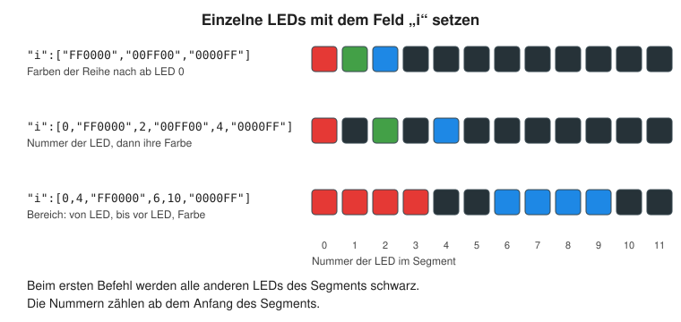

# Segmente und einzelne LEDs

<!-- seite: gewicht=12; en=en/02.anleitungen/03.segmente-und-einzelne-leds.md -->

<a id="create-delete-segments-iobroker-preset"></a>

## Wie lege ich Segmente aus ioBroker an und lösche sie, und kann ein Preset nur einen Teil des Streifens nutzen?

<!-- abschnitt: prio=B; gewicht=3; readme=covered; cluster=segments-commands-06,effects-presets-16; features=msg-addSegment,msg-deleteSegment,msg-input-validation,state-segments -->
<!-- muss beantworten: Beschreibt sendTo addSegment und deleteSegment mit den Pflichtfeldern, Grenzen und der Gerätekennung. -->

**Kurz:** Mit `sendTo('wled.0', 'addSegment', { deviceId: '<MAC>', segmentId: 1, start: 0, stop: 50 })` legst du ein Segment an, mit `sendTo('wled.0', 'deleteSegment', { deviceId: '<MAC>', segmentId: 1 })` löschst du es. Ein Preset, das nur einen Teil des Streifens nutzt, baust du mit so einem Segment und speicherst es in WLED mit seinen Grenzen.
<!-- quelle: code=main.js:557-663@v0.9.2; code=main.js:664-739@v0.9.2; forum=1235707; forum=382647; issue=#708 -->

Ein Segment ist ein Abschnitt des Streifens mit eigener Farbe, eigenem Effekt und eigener Helligkeit. Der Adapter legt für jedes Segment, das WLED meldet, einen Ordner `wled.0.<Gerät>.seg.<Segment>` an.
<!-- quelle: code=main.js:1007-1115@v0.9.2; extern=WLED-Docs:docs/interfaces/json-api.md -->

### Segment anlegen

```js
sendTo('wled.0', 'addSegment', {
    deviceId: '<MAC>',   // ID des Geräts im Objektbaum
    segmentId: 1,        // Nummer des Segments
    start: 0,            // erste LED
    stop: 50,            // erste LED, die nicht mehr dazugehört
    fx: 0,               // optional: Effekt
    col: [[255, 0, 0]],  // optional: Primärfarbe
}, (antwort) => {
    if (antwort.success) {
        log(antwort.message);
    } else {
        log(antwort.error, 'warn');
    }
});
```
<!-- quelle: code=main.js:557-663@v0.9.2; extern=ioBroker.javascript:docs/en/javascript.md -->

| Feld | Pflicht | Bedeutung |
|---|---|---|
| `deviceId` | ja | ID des Geräts im Objektbaum, also die MAC-Adresse in Kleinbuchstaben ohne Doppelpunkte, wie sie unter `wled.0` steht |
| `segmentId` | ja | Nummer des Segments. Gibt es sie schon, ändert WLED dieses Segment |
| `start` | nein | Erste LED des Segments, Standard `0` |
| `stop` | nein | Erste LED **nach** dem Segment, Standard `1`. `start: 0, stop: 50` umfasst die LEDs 0 bis 49 |
| `on`, `bri`, `fx`, `sx`, `ix`, `pal` | nein | Ein/Aus, Helligkeit, Effekt, Geschwindigkeit, Intensität, Palette. Zahlen von 0 bis 255 |
| `col` | nein | Farben als `[[r,g,b], …]`, Werte von 0 bis 255 |
<!-- quelle: code=main.js:564-598@v0.9.2; code=main.js:600-640@v0.9.2; code=main.js:487-494@v0.9.2; code=lib/validation.js:14-85@v0.9.2; code=lib/stateAttr.js:397-401@v0.9.2; extern=WLED-Docs:docs/interfaces/json-api.md -->

Der Adapter schickt das Segment an WLED, wartet eine Sekunde und liest das Gerät neu ein. Danach erscheinen die Datenpunkte unter `seg.<Segment>`. Die Antwort ist `{ success: true, message: … }` oder `{ success: false, error: … }`.
<!-- quelle: code=main.js:642-662@v0.9.2 -->

> [!IMPORTANT]
> `deviceId` muss genau so geschrieben sein wie die ID im Objektbaum. Mit Großbuchstaben oder Doppelpunkten antwortet der Adapter mit `Device with MAC … not found`.
<!-- quelle: code=main.js:487-494@v0.9.2; code=main.js:578-583@v0.9.2; code=lib/stateAttr.js:397-401@v0.9.2 -->

Optionale Werte, die keine Zahl von 0 bis 255 sind, lässt der Adapter weg und schreibt eine Warnung wie `Ignoring out-of-range bri value for addSegment: 300 (expected 0-255)` ins Log. Das Segment legt er trotzdem an. Zahlen als Text, etwa `"128"`, gelten dabei als ungültig.
<!-- quelle: code=lib/validation.js:14-26@v0.9.2; code=lib/validation.js:36-85@v0.9.2; code=main.js:600-640@v0.9.2 -->

**Bis v0.9.2:** `segmentId`, `start` und `stop` prüft der Adapter nicht. Ein `stop`, das nicht größer als `start` ist, löscht in WLED das Segment, statt es anzulegen. Die Antwort meldet trotzdem Erfolg.
<!-- quelle: code=main.js:594-598@v0.9.2; code=main.js:654-658@v0.9.2; extern=WLED-Docs:docs/interfaces/json-api.md -->

**Ab v0.9.3:** `segmentId` muss eine ganze Zahl von 0 bis 31 sein, `start` mindestens 0 und `stop` größer als `start`. Sonst antwortet der Adapter mit `success: false` und dem Grund. Diese drei Werte darfst du auch als Text angeben ([#920](https://github.com/DrozmotiX/ioBroker.wled/issues/920)).
<!-- quelle: code=main.js:604-622@v0.9.3; issue=#920 -->

### Segment löschen

```js
sendTo('wled.0', 'deleteSegment', { deviceId: '<MAC>', segmentId: 1 }, (antwort) => {
    log(JSON.stringify(antwort));
});
```
<!-- quelle: code=main.js:664-739@v0.9.2 -->

Der Adapter setzt in WLED `stop` auf `0`, damit löscht WLED das Segment. Danach löscht er den Ordner `seg.<Segment>` im Objektbaum und liest das Gerät neu ein.
<!-- quelle: code=main.js:704-728@v0.9.2; extern=WLED-Docs:docs/interfaces/json-api.md -->

> [!CAUTION]
> `deleteSegment` löscht das Segment im Gerät sofort, mit Effekt, Farben und Namen. Brauchst du die Aufteilung später wieder, speichere sie vorher in einem Preset.
<!-- quelle: code=main.js:704-728@v0.9.2; extern=WLED-Docs:docs/interfaces/json-api.md -->

### Ein Preset nur für einen Teil des Streifens

1. Leg ein Segment über den gewünschten Teil an, zum Beispiel `start: 0, stop: 100` für die ersten 100 LEDs. Das geht per `addSegment` oder direkt in der WLED-Oberfläche.
2. Stell Effekt und Farbe für dieses Segment ein. Schalte Segmente, die dunkel bleiben sollen, über `seg.<Segment>.on` aus.
3. Speichere in der WLED-Oberfläche ein Preset und setz dabei den Haken „Save segment bounds“. Nur dann merkt sich das Preset die Grenzen der Segmente.
4. Lädst du das Preset später über `ps`, stellt WLED die Aufteilung wieder her.
<!-- quelle: code=main.js:557-663@v0.9.2; extern=WLED:wled00/data/index.js:2020@v0.15.0; extern=WLED-Docs:docs/interfaces/json-api.md; forum=382647 -->

<!-- bild: screenshot WLED-Oberfläche, Preset speichern mit Haken „Save segment bounds“ -->

Wie du ein Preset per `ps` lädst, steht unter [Wie schalte ich WLED-Presets per Datenpunkt (ps) in VIS, Blockly oder Skript?](02.effekte-und-presets.md#switch-wled-presets-via-ps).
<!-- quelle: code=lib/stateAttr.js:69-73@v0.9.2 -->

**Siehe auch:** [Wie viele Segmente kann ich anlegen?](#many-segments-create-want-control) · [Segment-Datenpunkte erscheinen nicht oder bleiben bestehen](../04.fehlerbehebung/04.segmente-und-synchronisation.md#segment-states-not-appear-remain)

<a id="many-segments-create-want-control"></a>

## Wie viele Segmente kann ich anlegen, wenn ich einzelne LEDs ansteuern will?

<!-- abschnitt: prio=B; gewicht=5; readme=partial; cluster=segments-commands-04; features=state-segments,msg-addSegment -->
<!-- muss beantworten: Nennt die Segmentgrenze der Firmware und vergleicht Segmente mit dem JSON-Weg für Einzel-LEDs. -->

**Kurz:** Wie viele Segmente ein Gerät kann, legt die WLED-Firmware fest. Der Adapter zeigt den Wert in `wled.0.<Gerät>._info.leds.maxseg`. Bei WLED 0.15 sind es auf einem ESP8266 16 und auf einem ESP32 32 Segmente. Für einzelne LEDs reicht das selten. Dafür nimmst du besser den JSON-Befehl mit dem `i`-Feld, der jede LED ohne eigenes Segment setzt.
<!-- quelle: code=lib/stateAttr.js:314-317@v0.9.2; extern=WLED:wled00/FX.h:61-68@v0.15.0; extern=WLED:wled00/json.cpp:653@v0.15.0; extern=WLED-Docs:docs/interfaces/json-api.md; forum=1208516; forum=376724; forum=679728 -->

Ältere Firmware und eigene Builds können andere Grenzen haben. Verlass dich darum nicht auf Zahlen aus alten Forenbeiträgen, sondern schau in `maxseg` deines Geräts.
<!-- quelle: extern=WLED:wled00/FX.h:59-68@v0.15.0; forum=376724; forum=679728 -->

### Segmente oder JSON für einzelne LEDs?

| | Segmente | JSON mit `i` über `action` |
|---|---|---|
| Wie viele LEDs einzeln | höchstens so viele wie `maxseg` | alle LEDs des Segments |
| Datenpunkte in ioBroker | rund 30 je Segment | keine zusätzlichen |
| Effekte | je Segment ein eigener Effekt | Segment steht still, solange die LEDs einzeln gesetzt sind |
| Bleibt nach Ausschalten | ja, Segmente bleiben bestehen | nein, WLED kehrt zum Effekt zurück |
| Im Preset speicherbar | ja | nein |
<!-- quelle: code=main.js:1007-1115@v0.9.2; extern=WLED:wled00/json.cpp:515-578@v0.15.0; extern=WLED:wled00/json.cpp:262-300@v0.15.0; extern=WLED-Docs:docs/interfaces/json-api.md -->

Faustregel: Willst du wenige feste Bereiche mit eigenem Effekt, etwa Stufen einer Treppe, nimm Segmente. Willst du viele LEDs einzeln färben, etwa als Anzeige oder Lauflicht aus einem Skript, nimm den JSON-Weg.
<!-- quelle: extern=WLED-Docs:docs/interfaces/json-api.md; forum=1208516 -->

Wie das geht, steht unter [Wie steuere ich einzelne LEDs per JSON ohne Segmente?](#control-single-leds-via-json).

> [!NOTE]
> Jedes Segment bekommt im Objektbaum einen eigenen Ordner mit allen Werten, die WLED dafür meldet. Bei vielen Segmenten wird der Objektbaum entsprechend groß, und jede Änderung am Gerät aktualisiert mehr Datenpunkte.
<!-- quelle: code=main.js:1020-1111@v0.9.2; extern=WLED:wled00/json.cpp:515-578@v0.15.0 -->

**Ab v0.9.3:** `addSegment` nimmt Segmentnummern von 0 bis 31 an. Ob das Gerät so viele kann, entscheidet weiter `maxseg` ([#920](https://github.com/DrozmotiX/ioBroker.wled/issues/920)).
<!-- quelle: code=main.js:609-610@v0.9.3; issue=#920 -->

**Siehe auch:** [Segmente aus ioBroker anlegen und löschen](#create-delete-segments-iobroker-preset)

<a id="control-single-leds-via-json"></a>

## Wie steuere ich einzelne LEDs per JSON ohne Segmente?

<!-- abschnitt: prio=B; gewicht=3; readme=partial; cluster=segments-commands-05; features=state-action-json,state-rawCommand -->
<!-- muss beantworten: Zeigt das "i"-Array im action-Datenpunkt mit funktionierendem Beispiel. -->

**Kurz:** Schreib einen JSON-Befehl mit dem Feld `i` in `wled.0.<Gerät>.action`, zum Beispiel `{"seg":{"id":0,"i":[0,"FF0000",5,"00FF00"]}}`. Das färbt LED 0 rot und LED 5 grün. Der Adapter reicht den Befehl unverändert an WLED weiter. Eigene Datenpunkte je LED gibt es nicht.
<!-- quelle: code=main.js:162-171@v0.9.2; code=main.js:405-427@v0.9.2; extern=WLED:wled00/json.cpp:262-300@v0.15.0; extern=WLED-Docs:docs/interfaces/json-api.md; issue=#279; forum=628599; forum=1153060 -->

### So schreibst du das Feld i


<!-- quelle: extern=WLED:wled00/json.cpp:262-300@v0.15.0; extern=WLED-Docs:docs/interfaces/json-api.md -->

| Schreibweise | Wirkung |
|---|---|
| `"i":["FF0000","00FF00","0000FF"]` | Farben der Reihe nach ab LED 0 |
| `"i":[0,"FF0000",2,"00FF00"]` | LED 0 rot, LED 2 grün |
| `"i":[0,4,"FF0000"]` | LEDs 0 bis 3 rot, die 4 gehört nicht mehr dazu |
<!-- quelle: extern=WLED:wled00/json.cpp:277-300@v0.15.0; extern=WLED-Docs:docs/interfaces/json-api.md -->

Farben schreibst du als HEX-Text ohne `#` oder als Liste `[255,0,0]`. HEX ist kürzer und bei vielen LEDs die bessere Wahl. Die Nummern zählen ab dem Anfang des Segments, nicht des ganzen Streifens.
<!-- quelle: extern=WLED:wled00/json.cpp:287-297@v0.15.0; extern=WLED-Docs:docs/interfaces/json-api.md -->

### Beispiel in JavaScript

```js
const ziel = 'wled.0.<Gerät>.action';

// 1. Licht einschalten und Helligkeit setzen
setState(ziel, JSON.stringify({ on: true, bri: 128 }));

// 2. danach die LEDs setzen: die ersten 10 rot, LED 20 blau
setTimeout(() => {
    setState(ziel, JSON.stringify({ seg: { id: 0, i: [0, 10, 'FF0000', 20, '0000FF'] } }));
}, 1000);
```
<!-- quelle: code=main.js:162-171@v0.9.2; extern=WLED-Docs:docs/interfaces/json-api.md; extern=ioBroker.javascript:docs/en/javascript.md -->

> [!IMPORTANT]
> Schalte das Licht ein und setz die Helligkeit **vorher** in einem eigenen Befehl. Kommen Einschalten und `i` im selben Befehl, setzt WLED die LEDs nicht richtig.
<!-- quelle: extern=WLED-Docs:docs/interfaces/json-api.md -->

### Was du wissen musst

- **Der Effekt hält an.** Sobald du LEDs einzeln setzt, friert WLED das Segment ein. Beim ersten Befehl werden alle anderen LEDs des Segments schwarz. Den Effekt startest du wieder, indem du `wled.0.<Gerät>.seg.0.frz` auf `false` setzt oder einen Effekt wählst.
- **Nichts wird gespeichert.** Schaltest du das Licht aus, ist die Einzelsteuerung weg und WLED zeigt wieder den Effekt.
- **Viele LEDs in Teilen.** Setz höchstens 256 Farben in einem Befehl. Bei mehr LEDs schickst du mehrere Befehle nacheinander, zum Beispiel mit `"i":[256,"CC0000",…]` für den zweiten Teil.
- **rawCommand kann das nicht.** Die HTTP-API von WLED kennt keine einzelnen LEDs, dafür brauchst du den JSON-Weg über `action`.
<!-- quelle: extern=WLED:wled00/json.cpp:262-276@v0.15.0; extern=WLED-Docs:docs/interfaces/json-api.md; extern=WLED-Docs:docs/interfaces/http-api.md; code=lib/stateAttr.js:38-42@v0.9.2 -->

> [!WARNING]
> **Ab v0.10.0** bündelt der Adapter Befehle an dasselbe Gerät, die innerhalb der „Wartezeit zum Bündeln“ kommen (Standard 50 ms). Zwei `i`-Befehle für dasselbe Segment, die so schnell aufeinander folgen, werden dabei zu einem, und nur der zweite kommt an. Lass zwischen den Teilen eine Pause, die länger ist als die Wartezeit, oder schalte das Bündeln für das Gerät über `wled.0.<Gerät>.bundleCommands` aus ([#926](https://github.com/DrozmotiX/ioBroker.wled/issues/926)).
<!-- quelle: code=main.js:463-490@v0.10.0; code=main.js:535-603@v0.10.0; code=io-package.json:177@v0.10.0; issue=#926 -->

<!-- bild: screenshot Objektbaum, JSON-Befehl mit i in wled.0.<MAC>.action schreiben (nach Admin-Neubau) -->

**Siehe auch:** [Kompletten JSON-Befehl senden](04.befehle-an-wled.md#send-complete-json-command-wled) · [Wie viele Segmente kann ich anlegen?](#many-segments-create-want-control) · [Status oder Countdown auf dem Streifen anzeigen](06.skripte.md#show-status-countdown-strip)

<a id="control-several-segments-one-colour"></a>

## Wie steuere ich mehrere Segmente mit einem Farbregler?

<!-- abschnitt: prio=B; gewicht=1; readme=partial; cluster=scripts-viz-07; features=state-segments,state-segment-colors,msg-addSegment -->
<!-- muss beantworten: Zeigt, wie man die Segmentfarben per Skript oder VIS-Binding verknüpft. -->

*Dieser Abschnitt wird noch geschrieben.*
