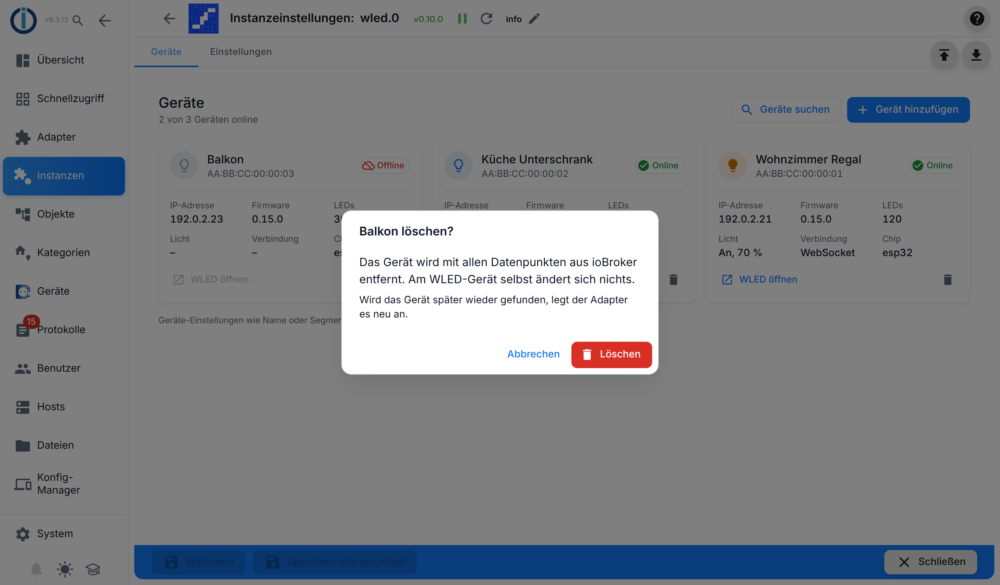
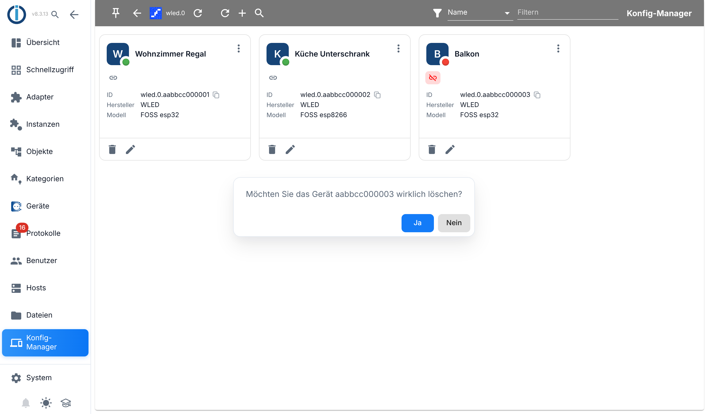

# Geräte verwalten

<!-- seite: gewicht=16; en=en/02.anleitungen/05.geraete-verwalten.md -->

<a id="remove-wled-device-adapter"></a>

## Wie entferne ich ein WLED-Gerät aus dem Adapter?

<!-- abschnitt: prio=A; gewicht=7; readme=missing; cluster=discovery-connection-01,discovery-connection-02; features=admin-delete-device,admin-device-table,msg-deleteDevice,dm-delete-device,conn-device-cleanup -->
<!-- muss beantworten: Zeigt Löschen in den Instanzeinstellungen und im Device Manager, erklärt Wiederauftauchen durch Bonjour und das Löschen offline Geräte ab der Fixversion. -->

**Kurz:** Du löschst ein Gerät in den Instanzeinstellungen über den Papierkorb auf seiner Karte oder im Device Manager des Admins. Der Adapter entfernt dabei alle Datenpunkte des Geräts und beendet Verbindung und Timer. Am WLED-Gerät selbst ändert sich nichts. Läuft das Gerät noch in deinem Netz, findet der Adapter es per Bonjour wieder und legt es neu an. **Ab v0.10.0** kannst du die automatische Suche abschalten, dann bleibt es weg.
<!-- quelle: code=src-admin/src/DevicesApp.tsx:199-207@v0.10.0; code=lib/devicemgmt.js:318-350@v0.10.0; code=main.js:1089-1099@v0.10.0; code=main.js:2733-2751@v0.10.0; code=main.js:88-97@v0.10.0; issue=#266; issue=#897; issue=#615 -->

### So gehst du vor: in den Instanzeinstellungen

**Ab v0.10.0:** Die Instanzeinstellungen zeigen jedes Gerät als Karte mit Online-Status, IP-Adresse und Firmware ([#266](https://github.com/DrozmotiX/ioBroker.wled/issues/266)).

1. Öffne im Admin unter „Instanzen“ die Einstellungen von `wled.<Instanz>`. Der Reiter „Geräte“ ist schon offen.
2. Klicke auf der Karte des Geräts unten rechts auf den Papierkorb („Gerät löschen“).
3. Der Dialog fragt „<Gerät> löschen?“ und erklärt: „Das Gerät wird mit allen Datenpunkten aus ioBroker entfernt. Am WLED-Gerät selbst ändert sich nichts.“ Klicke auf „Löschen“.
4. Unten erscheint „<Gerät> wurde gelöscht.“ und die Karte verschwindet. Gibt es das Gerät schon nicht mehr, steht im Dialog „<Gerät> gibt es nicht mehr.“, bei einem anderen Fehler „Das hat nicht geklappt. Details stehen im Log der Instanz.“
<!-- quelle: code=src-admin/src/DevicesApp.tsx:199-207@v0.10.0; code=src-admin/src/DevicesApp.tsx:295-360@v0.10.0; code=src-admin/src/DevicesApp.tsx:545-553@v0.10.0; code=src-admin/src/i18n/de.json:13-27@v0.10.0; code=main.js:783-787@v0.10.0; code=main.js:1089-1099@v0.10.0; issue=#266 -->



Ein Gerät, das offline ist, löschst du genauso. Die Instanz muss dafür laufen. Ist sie gestoppt, zeigt der Reiter „Die Instanz läuft nicht“ und einen Knopf „Instanz starten“.
<!-- quelle: code=main.js:1089-1099@v0.10.0; code=src-admin/src/DevicesApp.tsx:78-100@v0.10.0; code=src-admin/src/i18n/de.json:46-51@v0.10.0 -->

### So gehst du vor: im Device Manager

Der Device Manager ist die Geräteübersicht des Admins. In Admin 8.3 heißt der Reiter „Konfig-Manager“, in älteren Admin-Versionen „Geräte“.

1. Öffne im Admin den Reiter „Konfig-Manager“ (oder „Geräte“) und wähle die Instanz `wled.<Instanz>`.
2. Klicke auf der Karte des Geräts auf den Papierkorb („Gerät löschen“).
3. Bestätige die Frage „Möchten Sie das Gerät <MAC> wirklich löschen?“ mit „Ja“. Die Frage nennt die MAC-Adresse aus der Objekt-ID, nicht den Namen.
4. Das Gerät verschwindet aus der Liste. Im Log steht `<MAC> deleted`. Klappt das Löschen nicht, erscheint „Gerät <Gerät> kann nicht gelöscht werden“.
<!-- quelle: code=lib/devicemgmt.js:318-350@v0.10.0; code=lib/devicemgmt.js:374-420@v0.10.0; code=main.js:2733-2751@v0.10.0 -->

**Ab v0.10.1:** Die Frage nennt den Namen des Geräts und dahinter die MAC in Klammern, also „Möchten Sie das Gerät <Gerät> (<MAC>) wirklich löschen?“. Hat das Gerät keinen eigenen Namen, steht dort nur die MAC ([#965](https://github.com/DrozmotiX/ioBroker.wled/issues/965)).
<!-- quelle: code=lib/devicemgmt.js:380-395@v0.10.1; issue=#965 -->



> [!CAUTION]
> Beim Löschen entfernt der Adapter das Geräteobjekt `wled.<Instanz>.<MAC>` mit allen Datenpunkten darunter. Skripte, VIS-Ansichten und Aliase, die auf diese Datenpunkte zeigen, laufen danach ins Leere. Legt der Adapter das Gerät später neu an, entstehen die Datenpunkte wieder unter derselben MAC.
<!-- quelle: code=main.js:2733-2751@v0.10.0; code=src-admin/src/i18n/de.json:16-17@v0.10.0; code=main.js:1250-1290@v0.10.0 -->

### Was der Adapter beim Löschen aufräumt

Der Adapter stoppt für das Gerät den Watchdog und die Timer, schließt die WebSocket-Verbindung und vergisst das Gerät. Das gilt auch, wenn du das Geräteobjekt `wled.<Instanz>.<MAC>` direkt im Reiter „Objekte“ löschst. Im Log steht dann `Device <MAC> was deleted from object tree, cleaning up backend processes and objects`.
<!-- quelle: code=main.js:2733-2751@v0.10.0; code=main.js:690-715@v0.10.0; issue=#615 -->

Kennt der Adapter das Gerät beim Löschen im Reiter „Objekte“ nicht, zum Beispiel weil es noch nie verbunden war, meldet er `Device <MAC> not found in devices array, cannot clean up backend processes and objects`. Die Objekte sind trotzdem gelöscht, die Warnung kannst du ignorieren.
<!-- quelle: code=main.js:690-715@v0.10.0 -->

### Warum taucht das gelöschte Gerät wieder auf?

Der Adapter sucht WLED-Geräte per Bonjour (mDNS). Die Suche startet beim Adapterstart und wenn du in den Instanzeinstellungen auf „Geräte suchen“ oder im Device Manager auf „Neue Geräte suchen“ klickst. Danach lauscht sie weiter, bis die Instanz stoppt. Meldet sich dabei ein Gerät, das der Adapter nicht kennt, legt er es neu an. Ein gelöschtes Gerät, das noch eingeschaltet in deinem Netz läuft, erscheint deshalb wieder. Es gibt keine Liste, mit der du einzelne Geräte von der Suche ausschließt.
<!-- quelle: code=main.js:88-97@v0.10.0; code=main.js:2422-2468@v0.10.0; code=main.js:1108-1119@v0.10.0; code=lib/devicemgmt.js:162-168@v0.10.0; interview=4 -->

Lösche ein Gerät deshalb erst, wenn du es nicht mehr betreibst oder aus dem Netz genommen hast.
<!-- quelle: code=main.js:2440-2462@v0.10.0; interview=4 -->

**Ab v0.10.0:** In den Instanzeinstellungen schaltest du im Reiter „Einstellungen“ unter „Erkennung“ die Option „Geräte automatisch per Bonjour/mDNS suchen“ aus ([#897](https://github.com/DrozmotiX/ioBroker.wled/issues/897)). Dann sucht der Adapter beim Start nicht mehr und nutzt nur die Geräte, die er schon kennt oder die du per IP hinzufügst. Ein gelöschtes Gerät bleibt weg. Startest du die Suche von Hand („Geräte suchen“), lauscht sie bis zum nächsten Neustart der Instanz und findet das Gerät wieder.
<!-- quelle: code=main.js:88-97@v0.10.0; code=main.js:1108-1119@v0.10.0; code=main.js:2422-2468@v0.10.0; code=admin/jsonConfig.json:76-97@v0.10.0; code=admin/i18n/de/translations.json:12-13@v0.10.0; issue=#897 -->


<!-- quelle: code=main.js:2733-2751@v0.10.0; code=main.js:690-715@v0.10.0; code=main.js:88-97@v0.10.0; code=main.js:2422-2468@v0.10.0; interview=4 -->

### Gerät per Skript löschen

Mit `sendTo` löschst du ein Gerät über seine IP-Adresse. Die Antwort ist `success` oder `failed`:

```js
sendTo('wled.0', 'deleteDevice', '192.168.x.y', (result) => {
    log(`Gerät löschen: ${result}`);
});
```
<!-- quelle: code=main.js:783-820@v0.10.0 -->

Findet der Adapter kein Gerät mit dieser IP-Adresse, steht im Log `Device with IP 192.168.x.y not found` und die Antwort ist `failed`.
<!-- quelle: code=main.js:813-814@v0.10.0 -->

**Ab v0.10.0:** Du kannst das Gerät auch über seine MAC-Adresse löschen, so wie sie in der Objekt-ID steht. Dann ist die Antwort ein Objekt: `{ ok: true }` oder zum Beispiel `{ ok: false, error: 'notFound' }` ([#266](https://github.com/DrozmotiX/ioBroker.wled/issues/266)).

```js
sendTo('wled.0', 'deleteDevice', { id: '<MAC>' }, (result) => {
    log(`Gerät löschen: ${result.ok ? 'gelöscht' : result.error}`);
});
```
<!-- quelle: code=main.js:783-787@v0.10.0; code=main.js:1089-1099@v0.10.0; issue=#266 -->

### Ältere Versionen

**Bis v0.9.3:** Die Instanzeinstellungen zeigen eine Gerätetabelle. Zum Löschen klickst du in der Spalte „Entfernen“ auf den roten Knopf mit dem Papierkorb. Der Dialog „Gerät löschen Bestätigung“ zeigt Name und IP-Adresse, du bestätigst mit „Gerät löschen“. Danach erscheint „Gerät erfolgreich gelöscht“ oder „Gerät konnte nicht gelöscht werden“.
<!-- quelle: code=admin/index_m.html:28-47@v0.9.3; code=admin/index_m.html:135-167@v0.9.3; code=admin/index_m.html:312-371@v0.9.3; code=main.js:535-566@v0.9.3 -->

**Bis v0.9.2:** In den Instanzeinstellungen lässt sich ein Gerät, das seit dem Adapterstart offline ist, nicht löschen. Es erscheint „Gerät konnte nicht gelöscht werden“, im Log steht `Device with IP 192.168.x.y not found`. Lösche das Gerät in diesem Fall im Device Manager oder im Reiter „Objekte“.
<!-- quelle: code=main.js:524-551@v0.9.2; issue=#787 -->

**Ab v0.9.3:** Das Löschen in den Instanzeinstellungen klappt auch für Geräte, die offline sind ([#787](https://github.com/DrozmotiX/ioBroker.wled/issues/787)). Der Adapter sucht das Gerät dazu auch im Objektbaum.
<!-- quelle: issue=#787; code=main.js:541-549@v0.9.3 -->

**Bis v0.9.2:** Im Device Manager wartet der Dialog nicht auf das Ergebnis und zeigt keinen Fehler an. Bei Instanzen ab `wled.10` scheitert das Löschen dort. Nutze dann den Reiter „Objekte“.
<!-- quelle: code=lib/devicemgmt.js:254-294@v0.9.2; issue=#914 -->

**Ab v0.9.3:** Der Dialog im Device Manager wartet auf das Ergebnis, zeigt bei einem Fehler „Gerät <Gerät> kann nicht gelöscht werden“ und funktioniert auch bei Instanzen ab `wled.10` ([#914](https://github.com/DrozmotiX/ioBroker.wled/issues/914)).
<!-- quelle: issue=#914; code=lib/devicemgmt.js:288-320@v0.9.3 -->

**Ab v0.9.3:** „Neue Geräte suchen“ beendet zuerst die laufende Suche und startet dann eine neue. Es laufen keine Suchen nebeneinander ([#905](https://github.com/DrozmotiX/ioBroker.wled/issues/905)).
<!-- quelle: issue=#905; code=main.js:1660-1669@v0.9.3 -->

**Siehe auch:** [Wie und wann findet der Adapter meine WLED-Geräte automatisch?](../01.erste-schritte/02.erstes-geraet.md#adapter-wled-devices-automatically) · [Wie füge ich ein Gerät manuell per IP hinzu?](../01.erste-schritte/02.erstes-geraet.md#add-device-manually-ip-if)

<a id="deal-switched-off-offline-devices"></a>

## Wie gehe ich mit ausgeschalteten oder offline Geräten um, und wie werde ich die Log-Meldungen los?

<!-- abschnitt: prio=B; gewicht=6; readme=partial; cluster=logs-install-09,discovery-connection-03; features=conn-retry-logic,log-warn-messages,setting-max-retries,setting-retry-backoff,info-device-online-state,conn-watchdog -->
<!-- muss beantworten: Erklärt Wiederholversuche, die Logstufe nach dem Ausfall und die Einstellungen für maximale Versuche. -->

*Dieser Abschnitt wird noch geschrieben.*

<a id="happens-commands-sent-switched-off"></a>

## Was passiert mit Befehlen an ein ausgeschaltetes Gerät?

<!-- abschnitt: prio=B; gewicht=3; readme=missing; cluster=logs-install-10,discovery-connection-05; features=state-write-transport,info-device-online-state,log-error-messages,log-warn-messages -->
<!-- muss beantworten: Sagt klar, dass Befehle nicht nachgeholt werden, und erklärt die Fehlermeldung beim Senden. -->

*Dieser Abschnitt wird noch geschrieben.*
