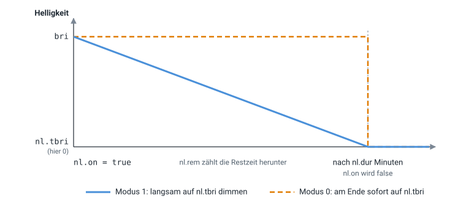
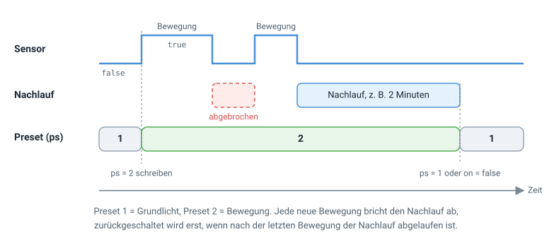

# Skripte mit Blockly und JavaScript

<!-- seite: gewicht=28; en=en/02.anleitungen/06.skripte.md -->

<a id="control-wled-javascript-periodically-step"></a>

## Wie steuere ich WLED per JavaScript, regelmäßig oder schrittweise (zum Beispiel Sonnenaufgang)?

<!-- abschnitt: prio=B; gewicht=3; readme=missing; cluster=scripts-viz-14; features=state-root-light,state-segments -->
<!-- muss beantworten: Zeigt ein Grundgerüst mit setState und Zeitsteuerung samt Hinweisen zu Mindestabständen. -->

**Kurz:** Ein Skript schreibt mit `setState()` in die Datenpunkte unter `wled.0.<MAC>` und startet sich mit `schedule()` zu einer Uhrzeit oder mit `setInterval()` in festen Abständen. Für einen weichen Verlauf wie einen Sonnenaufgang lässt du WLED die Übergänge rechnen: entweder mit dem Nightlight im Modus „Sonnenaufgang“ ganz ohne Schritte im Skript, oder mit wenigen Schritten, die jeweils eine Überblendzeit `tt` mitschicken.
<!-- quelle: code=main.js:148@v0.9.2; code=main.js:162-171@v0.9.2; code=lib/stateAttr.js:52-78@v0.9.2; code=lib/stateAttr.js:133-137@v0.9.2; extern=WLED:wled00/led.cpp:225-240@v0.15.0; extern=WLED:wled00/json.cpp:359-363@v0.15.0; forum=650122; forum=650016; forum=390532 -->

### Grundgerüst

```javascript
const WLED = 'wled.0.<MAC>';

// Lesen: .val gehört hinter getState(), nicht in die ID
const istAn = getState(`${WLED}.on`).val;

// Schreiben: ohne drittes Argument ist das ein Steuerbefehl (ack=false)
setState(`${WLED}.bri`, 128);          // ganze Zahl 0..255

// Zu einer Uhrzeit: Montag bis Freitag um 6:30
schedule('30 6 * * 1-5', () => {
    setState(`${WLED}.on`, true);
});
```
<!-- quelle: code=main.js:148@v0.9.2; code=lib/stateAttr.js:52-63@v0.9.2; extern=ioBroker.javascript:docs/en/javascript.md; forum=650122; forum=650016 -->

Leg Funktionen, die zeitgesteuert laufen, auf oberster Ebene des Skripts an und nicht innerhalb eines `on()`-Auslösers. Sonst entsteht bei jedem Auslösen ein weiterer Zeitplan. Schick Zahlen als ganze Zahlen, zum Beispiel mit `Math.round()`.
<!-- quelle: forum=650016; forum=390532; code=lib/stateAttr.js:57-63@v0.9.2 -->

### Sonnenaufgang mit dem Nightlight (ohne Schritte)

WLED hat einen eingebauten Sonnenaufgang: Startest du das Nightlight im Modus `3`, während das Licht aus ist, fährt WLED über `dur` Minuten einen Sonnenaufgang hoch, höchstens 60 Minuten. Ist das Licht an, wird es ein Sonnenuntergang.
<!-- quelle: extern=WLED:wled00/led.cpp:225-240@v0.15.0; extern=WLED-Docs:docs/interfaces/json-api.md -->

```javascript
schedule('30 6 * * 1-5', () => {
    setState('wled.0.<MAC>.action', JSON.stringify({ nl: { on: true, dur: 30, mode: 3 } }));
});
```
<!-- quelle: code=main.js:162-171@v0.9.2; code=lib/stateAttr.js:496-499@v0.9.2; extern=WLED:wled00/json.cpp:368-372@v0.15.0; interview=10 -->

Den Modus gibt es nur über `action`, weil `nl.mode` im Adapter nicht beschreibbar ist. Die übrigen Nightlight-Datenpunkte stehen unter [WLED nach einer Zeit ausschalten](#switch-wled-off-automatically-after).
<!-- quelle: code=lib/stateAttr.js:496-499@v0.9.2 -->

### Schrittweise per Skript

Willst du Farbe und Verlauf selbst bestimmen, schreibt das Skript in festen Abständen einen neuen Wert. Jeder Schritt schickt die Überblendzeit `tt` mit, damit WLED bis zum nächsten Schritt weich überblendet. So reichen wenige Schritte.

```javascript
const WLED = 'wled.0.<MAC>';
const DAUER_MIN = 30;  // Gesamtdauer
const SCHRITTE = 30;   // ein Schritt pro Minute
let schritt = 0;
let ablauf = null;

function naechsterSchritt() {
    schritt++;
    const bri = Math.round(255 * schritt / SCHRITTE);
    // tt in Zehntelsekunden: 600 = 60 s weich überblenden
    setState(`${WLED}.action`, JSON.stringify({ on: true, bri, tt: 600 }));
    if (schritt >= SCHRITTE) {
        clearInterval(ablauf);
        ablauf = null;
    }
}

function starteSonnenaufgang() {
    if (ablauf) clearInterval(ablauf);
    schritt = 0;
    // Startzustand in einem Befehl: an, ganz dunkel, warmes Orange, Effekt "Solid"
    setState(`${WLED}.action`, JSON.stringify({ on: true, bri: 1, seg: { id: 0, fx: 0, col: [[255, 120, 0]] } }));
    ablauf = setInterval(naechsterSchritt, (DAUER_MIN * 60 * 1000) / SCHRITTE);
}

schedule('30 6 * * 1-5', starteSonnenaufgang);
```
<!-- quelle: code=main.js:162-171@v0.9.2; code=main.js:148@v0.9.2; extern=WLED:wled00/json.cpp:359-363@v0.15.0; extern=WLED:wled00/FX.h:805@v0.15.0; extern=WLED-Docs:docs/interfaces/json-api.md; interview=10 -->

### Wie oft darf ein Skript schreiben?

- **Werte eines Schritts zusammen schicken.** Jeder geschriebene Datenpunkt ist ein eigener Befehl an das Gerät. Gehören mehrere Werte zu einem Schritt, schick sie als ein JSON über `action`, wie im Beispiel.
- **Wenige Schritte mit Überblendung statt vieler kleiner.** Ein Schritt pro Sekunde oder seltener reicht, den Rest erledigt `tt`. Schreibt ein Skript viele Befehle in kurzer Folge, kann WLED Befehle verlieren oder mit Zeitüberschreitung antworten, siehe [Mehrere Befehle führen zu ETIMEDOUT](../04.fehlerbehebung/02.befehle-wirken-nicht.md#several-commands-quick-succession-lead).
- **`tt` gilt nur für den einen Befehl.** Allein in `wled.0.<MAC>.tt` geschrieben, bewirkt es nichts, weil dann kein Wert mitkommt, der überblendet werden könnte. Dauerhaft änderst du die Überblendzeit mit `wled.0.<MAC>.transition`. Beide zählen in Zehntelsekunden, mehr als `655` (65,5 Sekunden) geht nicht.
<!-- quelle: code=main.js:218-222@v0.9.2; code=main.js:405-427@v0.9.2; code=lib/stateAttr.js:64-68@v0.9.2; code=lib/stateAttr.js:133-137@v0.9.2; extern=WLED:wled00/json.cpp:348-363@v0.15.0; extern=WLED:wled00/FX.h:805@v0.15.0; forum=908024; interview=14 -->

**Ab v0.10.0:** Der Adapter bündelt Befehle an dasselbe Gerät, die innerhalb von 50 ms aufeinander folgen, zu einem Befehl. Mehrere `setState()` direkt hintereinander sind damit unkritisch. Bei einer Animation, deren Schritte schneller als diese Wartezeit aufeinander folgen und trotzdem einzeln ankommen sollen, schaltest du das Bündeln für das Gerät aus: `false` in `wled.0.<MAC>.bundleCommands` schreiben oder im Device Manager (in Admin 8.3 „Konfig-Manager“, in älteren Admins „Geräte“) bei „Gerät bearbeiten“ den Haken „Kurz aufeinander folgende Befehle bündeln“ entfernen ([#926](https://github.com/DrozmotiX/ioBroker.wled/issues/926)).
<!-- quelle: code=main.js:454-489@v0.10.0; code=main.js:671-681@v0.10.0; code=lib/devicemgmt.js:68-73@v0.10.0; code=io-package.json:177@v0.10.0; issue=#926; interview=14 -->

**Siehe auch:** [WLED nach einer Zeit ausschalten](#switch-wled-off-automatically-after) · [Langsam hoch- und runterdimmen](01.farbe.md#dim-up-down-slowly-connect) · [Kompletten JSON-Befehl senden](04.befehle-an-wled.md#send-complete-json-command-wled)

<a id="wled-states-script-selector-through"></a>

## Wie finde ich WLED-Datenpunkte im Skript-Selektor über die Rolle switch.light?

<!-- abschnitt: prio=B; gewicht=1; readme=missing; cluster=scripts-viz-22; features=state-root-light,state-segments -->
<!-- muss beantworten: Erklärt die Rollen der Datenpunkte und wie man Selektoren darauf aufbaut. -->

**Kurz:** Die Rolle `switch.light` hat bei WLED nicht nur der Geräteschalter `wled.0.<MAC>.on`, sondern jeder Datenpunkt mit dem Namen `on`, also auch `seg.<Segment>.on` und `nl.on`. Ein Selektor nur auf die Rolle findet deshalb zu viel. Grenz ihn mit der Instanz in der ID ein und filtere im Skript nach der Tiefe der ID.
<!-- quelle: code=lib/stateAttr.js:52-56@v0.9.2; code=main.js:1030-1042@v0.9.2; code=main.js:1127-1138@v0.9.2; code=main.js:1558-1563@v0.9.2; forum=1129624 -->

Der Adapter vergibt Rolle, Name und Typ nach dem letzten Teil der ID. Für alle Datenpunkte, die `on` heißen, gilt derselbe Eintrag mit der Rolle `switch.light`, egal ob sie direkt unter dem Gerät, in einem Segment oder im Nightlight liegen.
<!-- quelle: code=main.js:1558-1563@v0.9.2; code=lib/stateAttr.js:52-56@v0.9.2 -->

### Welche Rollen die wichtigsten Datenpunkte haben

| Datenpunkt | Rolle |
|---|---|
| `on`, `seg.<Segment>.on`, `nl.on` | `switch.light` |
| `bri`, `seg.<Segment>.bri` | `level.brightness` |
| `ps`, `pl`, `seg.<Segment>.fx`, `seg.<Segment>.pal` | `value` |
| `seg.<Segment>.sx`, `seg.<Segment>.ix` | `level` |
| `transition` | `value.transition` |
| `seg.<Segment>.cct` | `level.color.temperature` |
<!-- quelle: code=lib/stateAttr.js:25-29@v0.9.2; code=lib/stateAttr.js:52-78@v0.9.2; code=lib/stateAttr.js:170-204@v0.9.2 -->

Die vollständige Liste steht unter [Was bedeuten die einzelnen WLED-Datenpunkte](../03.referenz/02.datenpunkte.md#individual-wled-states-mean).

### So baust du den Selektor

Die ID eines Geräteschalters hat genau vier Teile: `wled`, Instanz, MAC und `on`. Segment- und Nightlight-Schalter sind länger. Daran trennst du sie:

```javascript
// Alle Geräteschalter der Instanz wled.0, ohne Segmente und Nightlight
const geraete = $('state[id=wled.0.*][role=switch.light]')
    .toArray()
    .filter(id => id.split('.').length === 4);

// Zum Beispiel: alle WLED-Geräte ausschalten
geraete.forEach(id => setState(id, false));

// Oder: auf jedes Ein- und Ausschalten am Gerät reagieren
on({ id: geraete, change: 'ne', ack: true }, obj => {
    log(`${obj.id} ist jetzt ${obj.state.val ? 'an' : 'aus'}`);
});
```
<!-- quelle: code=lib/stateAttr.js:52-56@v0.9.2; code=main.js:148@v0.9.2; extern=ioBroker.javascript:docs/en/javascript.md; forum=1129624 -->

`toArray()` gibt es im JavaScript-Adapter ab Version 8.2.0. Willst du nur die Segmentschalter, filterst du auf `id.includes('.seg.')`. Ohne Filter erwischt ein Befehl an alle Treffer auch `nl.on` und startet damit auf jedem Gerät das Nightlight.
<!-- quelle: code=main.js:1127-1138@v0.9.2; code=lib/stateAttr.js:79-83@v0.9.2 -->

In Blockly nimmst du den Block „IDs vom Selektor“ mit demselben Text `state[id=wled.0.*][role=switch.light]`. Das Filtern nach der Länge der ID geht dort nur über eine Schleife mit einer Abfrage, einfacher ist es, die Geräteschalter einzeln oder über eine Aufzählung (Funktion oder Raum) auszuwählen.
<!-- quelle: extern=ioBroker.javascript:src-editor/src/Components/blockly-plugins/blocks/words.json -->

**Ab v0.10.0:** Der Adapter legt zusätzlich `wled.0.<MAC>.light.on` mit der Rolle `switch.light` an, zusammen mit `light.dimmer` und `light.rgb` für iot, Alexa und Google ([#328](https://github.com/DrozmotiX/ioBroker.wled/issues/328)). Diese ID hat fünf Teile, der Filter oben lässt sie also weg. Willst du stattdessen diese Lichtschalter, filterst du auf `id.endsWith('.light.on')`.
<!-- quelle: code=lib/stateAttr.js:16-21@v0.10.0; code=main.js:1896-1906@v0.10.0; issue=#328 -->

**Siehe auch:** [Welchen Datenpunkt nehme ich zum Ein- und Ausschalten](../01.erste-schritte/03.erste-steuerung.md#state-use-switch-off-whole) · [Warum bleiben nach dem Ausschalten einige LEDs an](../04.fehlerbehebung/02.befehle-wirken-nicht.md#some-leds-stay-after-switching)

<a id="build-garage-door-lighting-wled"></a>

## Wie baue ich eine Garagentor-Beleuchtung mit WLED-Presets?

<!-- abschnitt: prio=B; gewicht=10; readme=missing; cluster=scripts-viz-18; features=state-root-light,state-write-transport -->
<!-- muss beantworten: Liefert ein vollständiges Blockly- oder JavaScript-Beispiel mit Sensor, Preset und Rückfall. -->

**Kurz:** Leg die Lichtstimmungen als Presets in WLED an und lass ein Skript nur die Preset-Nummer setzen. Das Skript leitet aus den Torkontakten ab, ob das Tor fährt, offen ist oder zu, und schaltet nach dem Schließen mit Nachlauf aus. Ein Zeitlimit etwas länger als die Fahrzeit fängt ab, dass das Tor halb offen stehen bleibt.
<!-- quelle: code=main.js:148@v0.9.2; code=main.js:218-222@v0.9.2; code=lib/stateAttr.js:52-78@v0.9.2; forum=1305391; forum=1304948; forum=670800 -->

Das ist eine Anwendung des allgemeinen Musters aus [Presets per Automatik schalten](#switch-wled-presets-automatically-example): Sensor löst aus, Skript setzt `ps`, nach Ablauf geht es zurück. Der Adapter schickt jeden Steuerbefehl sofort an das Gerät, die ganze Torlogik liegt im Skript.
<!-- quelle: code=main.js:148@v0.9.2; code=main.js:405-427@v0.9.2 -->

### Was du vorbereitest

1. **Presets in WLED:** zum Beispiel Nummer `11` „Tor fährt“ (orangefarbenes Lauflicht) und Nummer `12` „Tor offen“ (helles Arbeitslicht). Speichere beide bei eingeschaltetem Licht mit „Include brightness“.
2. **Kontakte:** Am besten zwei Kontakte, einer meldet „Tor ist zu“, der andere „Tor ist ganz offen“. Such ihre IDs im Objektbaum heraus und prüf, bei welchem Zustand sie `true` melden.
3. **Zeiten:** Miss, wie lange das Tor von einer Endlage zur anderen braucht, und gib ein paar Sekunden dazu. Leg fest, wie lange das Licht nach dem Schließen an bleiben soll.
<!-- quelle: extern=WLED-Docs:docs/features/presets.md; extern=WLED:wled00/json.cpp:586-587@v0.15.0; forum=1305391; forum=642262 -->

| Kontakte | Zustand | Licht |
|---|---|---|
| „zu“ wird `false` | Tor öffnet | Preset 11, Zeitlimit startet |
| „offen“ wird `true` | Tor ist offen | Preset 12 |
| „offen“ wird `false` | Tor schließt | Preset 11, Zeitlimit startet |
| „zu“ wird `true` | Tor ist zu | Preset 12, nach dem Nachlauf aus |
| Zeitlimit abgelaufen, keine Endlage | Tor steht halb offen | Preset 12 |
<!-- quelle: forum=1305391; forum=1304948; forum=687459 -->

### Beispiel in JavaScript

```javascript
const WLED = 'wled.0.<MAC>';
const KONTAKT_ZU = '<ID Kontakt Tor zu>';       // true = Tor ist geschlossen
const KONTAKT_OFFEN = '<ID Kontakt Tor offen>'; // true = Tor ist ganz offen
const PRESET_FAEHRT = 11;
const PRESET_OFFEN = 12;
const FAHRZEIT_MS = 25 * 1000;      // etwas länger als die Fahrzeit des Tors
const NACHLAUF_MS = 2 * 60 * 1000;  // Licht nach dem Schließen

let fahrTimer = null;
let nachlauf = null;

function stoppeTimer() {
    if (fahrTimer) { clearTimeout(fahrTimer); fahrTimer = null; }
    if (nachlauf) { clearTimeout(nachlauf); nachlauf = null; }
}

// Einschalten und Preset in einem Befehl, wirkt auch, wenn das Preset schon aktiv war
function setzePreset(nummer) {
    setState(`${WLED}.action`, JSON.stringify({ on: true, ps: nummer }));
}

// Tor verlässt eine Endlage
function torFaehrt() {
    stoppeTimer();
    setzePreset(PRESET_FAEHRT);
    fahrTimer = setTimeout(() => {
        fahrTimer = null;
        setzePreset(PRESET_OFFEN); // keine Endlage erreicht: Tor steht halb offen
    }, FAHRZEIT_MS);
}

// Ein Auslöser je Kontakt
on({ id: KONTAKT_ZU, change: 'ne' }, obj => {
    if (obj.state.val) {
        stoppeTimer();
        setzePreset(PRESET_OFFEN);
        nachlauf = setTimeout(() => {
            nachlauf = null;
            setState(`${WLED}.on`, false);
        }, NACHLAUF_MS);
    } else {
        torFaehrt(); // öffnet
    }
});

on({ id: KONTAKT_OFFEN, change: 'ne' }, obj => {
    if (obj.state.val) {
        stoppeTimer();
        setzePreset(PRESET_OFFEN);
    } else {
        torFaehrt(); // schließt
    }
});
```
<!-- quelle: code=main.js:148@v0.9.2; code=main.js:162-171@v0.9.2; extern=WLED:wled00/json.cpp:470@v0.15.0; extern=ioBroker.javascript:docs/en/javascript.md; forum=1305391; forum=1304948; forum=810690; interview=10 -->

Hast du nur einen Kontakt für „Tor ist zu“, lass den zweiten Auslöser weg. Das Öffnen erkennst du dann, das Schließen erst, wenn das Tor zu ist. Nach dem Zeitlimit zeigt das Licht „offen“, bis der Kontakt „zu“ meldet.
<!-- quelle: forum=1305391; forum=833120 -->

Willst du den Torzustand auch in VIS anzeigen, schreib ihn im Skript zusätzlich in einen eigenen Datenpunkt unter `0_userdata.0`, zum Beispiel mit den Werten `zu`, `faehrt`, `offen` und `halb`.
<!-- quelle: forum=1305391; forum=1023963 -->

### Beispiel in Blockly

1. Block „Falls Objekt“ auf den Kontakt „zu“, „wurde geändert“.
2. Ist der Wert `wahr`: zuerst „stop“ für die Verzögerungen „fahrt“ und „nachlauf“, dann „steuere“ `wled.0.<MAC>.action` mit dem Text `{"on":true,"ps":12}`. Danach „Ausführen“ mit dem Namen „nachlauf“ „in“ 2 Min, darin „steuere“ `wled.0.<MAC>.on` mit `falsch`.
3. Ist der Wert `falsch`: „stop“ für beide Verzögerungen, „steuere“ `action` mit `{"on":true,"ps":11}`, dann „Ausführen“ mit dem Namen „fahrt“ „in“ 25 Sek, darin „steuere“ `action` mit `{"on":true,"ps":12}`.
4. Einen zweiten Block „Falls Objekt“ für den Kontakt „offen“: bei `wahr` „stop“ für beide Verzögerungen und `{"on":true,"ps":12}`, bei `falsch` dasselbe wie in Schritt 3.
<!-- quelle: extern=ioBroker.javascript:src-editor/src/Components/blockly-plugins/blocks/words.json; extern=ioBroker.javascript:src-editor/src/Components/blockly-plugins/blocks/blocks_timeout.ts; forum=665767; forum=706912 -->

<!-- bild: screenshot Blockly: Falls Objekt auf den Torkontakt, stop und Ausführen „fahrt“ und „nachlauf“, steuere action mit Preset -->

### Worauf du achten solltest

- **Ein Auslöser je Kontakt.** Mehrere Auslöser auf denselben Kontakt stören sich gegenseitig. Alles, was zu einem Kontakt gehört, kommt in einen Block.
- **Kein „Pause“-Block.** Verzögerungen nur mit „Ausführen … in“ und „stop“, sonst lässt sich ein Ablauf nicht abbrechen, wenn das Tor die Richtung wechselt.
- **Gerät offline:** Ist WLED gerade nicht verbunden, geht der Befehl verloren. **Ab v0.9.3** steht dann eine Warnung „Device … is offline, command for … discarded“ im Log ([#904](https://github.com/DrozmotiX/ioBroker.wled/issues/904)). **Ab v0.10.0:** Ein Befehl an ein Gerät, das offline gilt, löst sofort einen Verbindungsversuch aus und geht durch, wenn das Gerät wieder erreichbar ist ([#939](https://github.com/DrozmotiX/ioBroker.wled/issues/939)).
<!-- quelle: forum=1305391; forum=670800; forum=1005340; code=main.js:403@v0.9.3; code=main.js:430-445@v0.10.0; issue=#904; issue=#939 -->

**Siehe auch:** [Presets per Automatik schalten](#switch-wled-presets-automatically-example) · [Presets per Datenpunkt ps schalten](02.effekte-und-presets.md#switch-wled-presets-via-ps) · [WLED nach einer Zeit ausschalten](#switch-wled-off-automatically-after) · [Skript setzt ps oder on nicht](../04.fehlerbehebung/02.befehle-wirken-nicht.md#script-not-ps-wled-ignores)

<a id="switch-wled-off-automatically-after"></a>

## Wie schalte ich WLED nach einer Zeit automatisch aus (Timer)?

<!-- abschnitt: prio=A; gewicht=7; readme=missing; cluster=scripts-viz-13; features=state-root-light,state-write-transport -->
<!-- muss beantworten: Zeigt ein Timer-Muster in Blockly und JavaScript, auch mit dem WLED-eigenen Nightlight. -->

**Kurz:** Es gibt zwei Wege. Entweder startet dein Skript beim Einschalten einen Timer und schreibt nach Ablauf `false` in `wled.0.<MAC>.on`. Oder du nutzt das Nightlight von WLED (`nl`): Dann zählt das Gerät selbst herunter und schaltet aus, auch wenn ioBroker in der Zeit nicht läuft.
<!-- quelle: code=main.js:148@v0.9.2; code=lib/stateAttr.js:52-56@v0.9.2; code=lib/stateAttr.js:79-94@v0.9.2; forum=1018283; forum=704611; extern=WLED-Docs:docs/interfaces/json-api.md -->

Ausschalten ist für den Adapter ein ganz normaler Schreibzugriff auf `on`. Die Zeitlogik gehört ins Skript. Wichtig ist, einen laufenden Timer beim erneuten Auslösen zu löschen und neu zu starten, statt mit Pausen zu arbeiten.
<!-- quelle: code=main.js:218-222@v0.9.2; forum=763682; forum=745693; forum=757741; forum=635140 -->

### Timer in Blockly

1. Leg einen Block „Falls Objekt“ an und wähl als Objekt `wled.0.<MAC>.on`. Stell „wurde geändert“ ein.
2. Prüf im Block, ob der Wert `wahr` ist.
3. Setz darin den Block „steuere“ für `wled.0.<MAC>.on` mit dem Wert `falsch`. Aktiviere „mit Verzögerung“, gib die Zeit an (zum Beispiel 10 Min) und hak „löschen falls läuft“ an.
4. Damit startet jedes neue Einschalten den Timer von vorn. Ein Ausschalten von Hand vor Ablauf schadet nicht: Dann schreibt der Timer `false` auf ein Licht, das schon aus ist.
<!-- quelle: extern=ioBroker.javascript:src-editor/src/Components/blockly-plugins/blocks/words.json; forum=1018283; forum=1080073 -->

<!-- bild: screenshot Blockly: Falls Objekt auf on, steuere on mit falsch, mit Verzögerung 10 Min, löschen falls läuft -->

### Timer in JavaScript

```javascript
const WLED = 'wled.0.<MAC>';
const DAUER_MS = 10 * 60 * 1000; // 10 Minuten
let ausTimer = null;

// WLED meldet: Licht ist an (egal ob per VIS, App oder Taster eingeschaltet)
on({ id: `${WLED}.on`, val: true, change: 'ne', ack: true }, () => {
    if (ausTimer) clearTimeout(ausTimer); // laufenden Timer neu starten
    ausTimer = setTimeout(() => {
        ausTimer = null;
        setState(`${WLED}.on`, false); // Steuerbefehl (ack=false)
    }, DAUER_MS);
});

// Wird von Hand ausgeschaltet, ist der Timer überflüssig
on({ id: `${WLED}.on`, val: false, change: 'ne', ack: true }, () => {
    if (ausTimer) clearTimeout(ausTimer);
    ausTimer = null;
});
```
<!-- quelle: code=main.js:148@v0.9.2; code=main.js:1591@v0.9.2; forum=704611; forum=763682 -->

`ack: true` im Auslöser bedeutet: Das Skript reagiert auf die Rückmeldung vom Gerät, nicht auf deinen eigenen Befehl. `change: 'ne'` sorgt dafür, dass nur eine echte Änderung den Timer startet.
<!-- quelle: code=main.js:1591@v0.9.2; extern=ioBroker.javascript:docs/en/javascript.md -->

> [!WARNING]
> **Bis v0.9.2** setzt der Adapter `on` auf `false`, sobald ein Gerät offline geht, und beim Adapterstart. Ein Skript, das auf `on` reagiert, wird dadurch auch ohne echtes Schalten ausgelöst. **Ab v0.9.3:** `on` und `bri` behalten beim Offline-Gehen und beim Start ihren letzten Wert, die echten Werte kommen beim Wiederverbinden vom Gerät ([#899](https://github.com/DrozmotiX/ioBroker.wled/issues/899)).
<!-- quelle: code=main.js:1411@v0.9.2; code=main.js:1820@v0.9.2; issue=#899 -->

Ist das Gerät offline, wenn der Timer abläuft, kommt der Befehl nicht an. Der Adapter puffert nichts. **Ab v0.9.3** steht dann eine Warnung „Device … is offline, command for … discarded“ im Log ([#904](https://github.com/DrozmotiX/ioBroker.wled/issues/904)). Wenn das Ausschalten sicher klappen muss, nimm das Nightlight.
<!-- quelle: code=main.js:403@v0.9.3; issue=#904; interview=3 -->

### Timer mit dem WLED-Nightlight

Das Nightlight läuft im Gerät. Der Adapter legt dafür unter `wled.0.<MAC>.nl` diese Datenpunkte an:

| Datenpunkt | Bedeutung | Schreibbar |
|---|---|---|
| `nl.on` | Nightlight starten (`true`) oder abbrechen (`false`) | ja |
| `nl.dur` | Laufzeit in Minuten, 1 bis 255 | ja |
| `nl.tbri` | Zielhelligkeit am Ende, 0 bis 255; bei `0` ist das Licht danach aus | ja |
| `nl.mode` | Art: `0` sofort, `1` langsam dimmen, `2` Farbe überblenden, `3` Sonnenaufgang | nein, nur über `action` |
| `nl.rem` | Restzeit in Sekunden, `-1` wenn kein Nightlight läuft | nein |
<!-- quelle: code=lib/stateAttr.js:52-56@v0.9.2; code=lib/stateAttr.js:79-94@v0.9.2; code=lib/stateAttr.js:416-420@v0.9.2; code=lib/stateAttr.js:496-499@v0.9.2; code=main.js:1130-1138@v0.9.2; code=main.js:1563@v0.9.2; extern=WLED-Docs:docs/interfaces/json-api.md -->


<!-- quelle: extern=WLED:wled00/led.cpp:216-260@v0.15.0; extern=WLED-Docs:docs/interfaces/json-api.md -->

So schaltest du das Licht in 10 Minuten aus:

1. Schreib `10` in `wled.0.<MAC>.nl.dur` und `0` in `wled.0.<MAC>.nl.tbri`.
2. Schalte das Licht ein, falls es aus ist, und schreib dann `true` in `wled.0.<MAC>.nl.on`.
3. Nach Ablauf setzt WLED die Helligkeit auf `nl.tbri`, also aus. `nl.on` geht wieder auf `false`.
<!-- quelle: extern=WLED:wled00/led.cpp:216-260@v0.15.0; extern=WLED-Docs:docs/interfaces/json-api.md -->

Den Modus kannst du nur über den Datenpunkt `action` setzen, weil `nl.mode` im Adapter nicht schreibbar ist. Mit einem einzigen Befehl schaltest du ein und lässt das Licht über 10 Minuten langsam ausdimmen:

```json
{"on":true,"nl":{"on":true,"dur":10,"mode":1,"tbri":0}}
```
<!-- quelle: code=main.js:162-171@v0.9.2; code=lib/stateAttr.js:496-499@v0.9.2; extern=WLED:wled00/json.cpp:368-372@v0.15.0; extern=WLED-Docs:docs/interfaces/json-api.md; interview=10 -->

In JavaScript: `setState('wled.0.<MAC>.action', JSON.stringify({ on: true, nl: { on: true, dur: 10, mode: 1, tbri: 0 } }));`. In Blockly schreibst du denselben Text mit „steuere“ in `action`.
<!-- quelle: code=main.js:162-171@v0.9.2; interview=10 -->

**Siehe auch:** [Kompletten JSON-Befehl senden](04.befehle-an-wled.md#send-complete-json-command-wled) · [Presets per Bewegungsmelder schalten](#switch-wled-presets-automatically-example) · [Warum on beim Offline-Gehen false wird](../05.hintergrund/01.verbindung-und-aktualisierung.md#become-false-device-goes-offline) · [Skript setzt ps oder on nicht](../04.fehlerbehebung/02.befehle-wirken-nicht.md#script-not-ps-wled-ignores)

<a id="show-status-countdown-strip"></a>

## Wie zeige ich Status oder Countdown auf dem Streifen an?

<!-- abschnitt: prio=B; gewicht=2; readme=missing; cluster=scripts-viz-16; features=state-segments,state-root-light -->
<!-- muss beantworten: Zeigt, wie man Farbe, Segmente und Effekte für Statusanzeigen kombiniert. -->

*Dieser Abschnitt wird noch geschrieben.*

<a id="switch-wled-presets-automatically-example"></a>

## Wie schalte ich WLED-Presets per Automatik, zum Beispiel per Bewegungsmelder?

<!-- abschnitt: prio=A; gewicht=2; readme=missing; cluster=scripts-viz-19; features=state-root-light -->
<!-- muss beantworten: Zeigt das allgemeine Muster: Sensor-State auslösen, Preset über ps setzen, nach Ablauf zurückschalten, mit Blockly- und JavaScript-Beispiel; das Garagentor ist nur ein Beispiel dafür. -->

**Kurz:** Das Muster ist immer gleich: Ein Sensor-Datenpunkt löst das Skript aus, das Skript schreibt die Preset-Nummer in `wled.0.<MAC>.ps`, und nach einer Nachlaufzeit schaltet es auf ein anderes Preset zurück oder schreibt `false` in `on`. Das funktioniert mit Bewegungsmeldern, Tür- und Torkontakten oder jedem anderen State.
<!-- quelle: code=main.js:148@v0.9.2; code=main.js:218-222@v0.9.2; code=lib/stateAttr.js:52-73@v0.9.2; forum=685437; forum=1005340 -->

Der Adapter macht dabei nichts Besonderes: Jeder Schreibzugriff mit `ack=false` auf `ps` oder `on` wird sofort an das Gerät geschickt. Die Logik, wann welches Preset gilt, liegt ganz im Skript.
<!-- quelle: code=main.js:148@v0.9.2; code=main.js:405-427@v0.9.2 -->


<!-- quelle: forum=685437; forum=1005340 -->

### Was du vorbereitest

1. Leg in WLED die Presets an, zum Beispiel Nummer 2 für „Bewegung“ und Nummer 1 für „Grundlicht“. Speichere das Preset für „Bewegung“ bei eingeschaltetem Licht mit „Include brightness“, damit es auch dann einschaltet, wenn das Licht vorher aus war.
2. Such im Objektbaum die ID deines Sensors heraus, zum Beispiel den Bewegungs-State eines Zigbee- oder Homematic-Melders. Er sollte bei Bewegung `true` und danach `false` melden.
3. Leg fest, wie lange das Licht nach der letzten Bewegung bleiben soll.
<!-- quelle: extern=WLED:wled00/json.cpp:586-587@v0.15.0; extern=WLED-Docs:docs/features/presets.md; forum=685437 -->

Wie `ps` genau funktioniert und warum ein Preset ein- oder ausschaltet, steht unter [Presets per Datenpunkt ps schalten](02.effekte-und-presets.md#switch-wled-presets-via-ps).

### Beispiel in JavaScript

```javascript
const WLED = 'wled.0.<MAC>';
const SENSOR = '<ID des Bewegungsmelders>';
const PRESET_BEWEGUNG = 2;
const PRESET_ZURUECK = 1;      // 0 bedeutet: danach ausschalten
const NACHLAUF_MS = 2 * 60 * 1000; // 2 Minuten nach der letzten Bewegung

let nachlauf = null;

// Bewegung erkannt: Preset sofort setzen, laufenden Nachlauf abbrechen
on({ id: SENSOR, val: true, change: 'ne' }, () => {
    if (nachlauf) { clearTimeout(nachlauf); nachlauf = null; }
    setState(`${WLED}.ps`, PRESET_BEWEGUNG);
});

// Keine Bewegung mehr: Nachlauf starten, danach zurückschalten
on({ id: SENSOR, val: false, change: 'ne' }, () => {
    if (nachlauf) clearTimeout(nachlauf);
    nachlauf = setTimeout(() => {
        nachlauf = null;
        if (PRESET_ZURUECK > 0) {
            setState(`${WLED}.ps`, PRESET_ZURUECK);
        } else {
            setState(`${WLED}.on`, false);
        }
    }, NACHLAUF_MS);
});
```
<!-- quelle: code=main.js:148@v0.9.2; code=main.js:218-222@v0.9.2; forum=685437; forum=1005340; extern=ioBroker.javascript:docs/en/javascript.md -->

### Beispiel in Blockly

1. Block „Falls Objekt“ auf den Sensor, „wurde geändert“.
2. Darin eine Abfrage auf den Wert. Ist er `wahr`: zuerst den Block „stop“ aus der Gruppe „Timeouts“ für die Verzögerung „nachlauf“, danach „steuere“ `wled.0.<MAC>.ps` mit `2`.
3. Ist er `falsch`: ebenfalls zuerst „stop“ für „nachlauf“, dann den Block „Ausführen“ mit dem Namen „nachlauf“ und „in“ 2 Min. Darin „steuere“ `wled.0.<MAC>.ps` mit `1` (oder `wled.0.<MAC>.on` mit `falsch`).
4. So bricht jede neue Bewegung den Nachlauf ab, und jedes Ende einer Bewegung startet ihn neu. Der Block „Pause“ ist dafür nicht geeignet, weil er sich nicht abbrechen lässt.
<!-- quelle: extern=ioBroker.javascript:src-editor/src/Components/blockly-plugins/blocks/words.json; extern=ioBroker.javascript:src-editor/src/Components/blockly-plugins/blocks/blocks_timeout.ts; forum=685437 -->

<!-- bild: screenshot Blockly: Falls Objekt auf den Sensor, steuere ps mit 2 bei wahr, stop und Ausführen „nachlauf“ bei falsch -->

### Worauf du achten solltest

- **Ein Auslöser je Datenpunkt.** Leg für jeden Sensor nur einen Auslöser an und lass ihn eine gemeinsame Funktion aufrufen. Mehrere Auslöser auf denselben State können sich gegenseitig stören.
- **Mehrere Sensoren** (zum Beispiel Treppe oben und unten): Bestimme in einer Hilfsfunktion aus allen Sensoren, welches Preset gelten soll, und schreib `ps` nur dort. Eine Sperrvariable je Sensor verhindert, dass ein Ablauf den anderen abbricht.
- **Dasselbe Preset noch einmal:** Ist das Preset schon aktiv, lädt WLED es nicht neu. Hast du das Licht zwischendurch über `on` ausgeschaltet, bleibt es deshalb aus. Schick in dem Fall `{"on":true,"ps":2}` an `wled.0.<MAC>.action`.
- **Gerät offline:** Befehle an ein Gerät, das der Adapter für offline hält, kommen nicht an. Der Adapter puffert nichts. **Ab v0.9.3** steht dann „Device … is offline, command for … discarded“ als Warnung im Log ([#904](https://github.com/DrozmotiX/ioBroker.wled/issues/904)).
<!-- quelle: forum=1005340; forum=685437; extern=WLED:wled00/json.cpp:470@v0.15.0; code=main.js:162-171@v0.9.2; code=main.js:403@v0.9.3; issue=#904; interview=3; interview=10 -->

> [!TIP]
> Soll das Licht nach dem Nachlauf in den Zustand von vorher zurück, merk dir beim Auslösen den Wert von `ps` und schreib ihn danach zurück. Das klappt nur, wenn vorher ein Preset aktiv war. Zeigt `ps` den Wert `-1`, war keines aktiv.
<!-- quelle: code=main.js:1591@v0.9.2; extern=WLED:wled00/json.cpp:595@v0.15.0 -->

Ein ausführliches Beispiel für ein Garagentor mit mehreren Zuständen steht unter [Garagentor-Beleuchtung mit WLED-Presets](#build-garage-door-lighting-wled).

**Siehe auch:** [Presets per Datenpunkt ps schalten](02.effekte-und-presets.md#switch-wled-presets-via-ps) · [WLED nach einer Zeit ausschalten](#switch-wled-off-automatically-after) · [Skript setzt ps oder on nicht](../04.fehlerbehebung/02.befehle-wirken-nicht.md#script-not-ps-wled-ignores)

<a id="save-state-restore-after-animation"></a>

## Wie speichere ich den Zustand und stelle ihn nach einer Animation wieder her?

<!-- abschnitt: prio=B; gewicht=2; readme=missing; cluster=scripts-viz-20; features=state-extra-set-commands,state-root-light -->
<!-- muss beantworten: Zeigt, welche Datenpunkte man sichert, und alternativ den WLED-eigenen Preset-Speicher (psave). -->

*Dieser Abschnitt wird noch geschrieben.*

<a id="tell-whether-wled-was-switched"></a>

## Woran erkenne ich, ob WLED per Telegram, VIS oder Web-Oberfläche geschaltet wurde?

<!-- abschnitt: prio=B; gewicht=1; readme=missing; cluster=control-basics-16; features=state-value-handling,state-write-transport -->
<!-- muss beantworten: Erklärt, dass das Quelle-Merkmal nicht verfügbar ist, und welche Umwege es gibt. -->

*Dieser Abschnitt wird noch geschrieben.*
