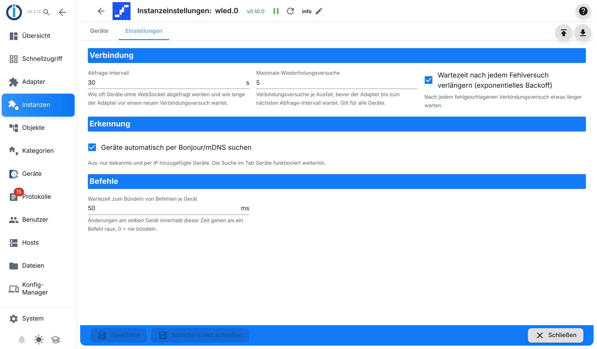

# Instanzeinstellungen

<!-- seite: gewicht=3; en=en/03.referenz/01.instanz-einstellungen.md -->

## Wo stelle ich Polling-Intervall und Auto-Erkennung ein?

<!-- abschnitt: prio=B; gewicht=1; readme=partial; cluster=discovery-connection-11; features=setting-time-sync,device-bonjour-autodiscovery,admin-add-device -->
<!-- muss beantworten: Beschreibt das einzige Intervall, seine Bedeutung bei WebSocket, und dass es keinen zyklischen Auto-Erkennungslauf gibt. -->

**Kurz:** Es gibt genau ein Intervall: „Intervall in Sekunden“ in den Instanzeinstellungen, voreingestellt sind 30 Sekunden. Eine Einstellung für die automatische Erkennung gibt es in v0.9.2 nicht. Der Adapter sucht nur beim Start der Instanz nach Geräten und wenn du die Suche von Hand startest, nicht in einem festen Takt.
<!-- quelle: code=admin/index_m.html:257-260@v0.9.2; code=io-package.json:175@v0.9.2; code=main.js:64-70@v0.9.2; interview=4 -->

### Die Einstellungen bis v0.9.3

Du findest sie im Admin unter „Instanzen“ in den Einstellungen von `wled.<Instanz>`:

| Einstellung | Voreinstellung | Wofür |
|---|---|---|
| „Intervall in Sekunden“ | 30 | Takt, in dem der Adapter jedes Gerät prüft, und Grundwert für die Wartezeit bei Wiederholungen |
| „Maximale Wiederholungsversuche“ | 5 | Fehlversuche, nach denen der Adapter ein Gerät nur noch stündlich prüft |
| „Exponentiellen Backoff aktivieren“ | an | Wartezeit nach jedem Fehlversuch verdoppeln |
<!-- quelle: code=admin/index_m.html:257-272@v0.9.2; code=admin/words.js:18-20@v0.9.2; code=io-package.json:175-177@v0.9.2; code=main.js:1164-1311@v0.9.2 -->

Die beiden Einstellungen für Wiederholungen erklärt der nächste Abschnitt: [Wie oft versucht der Adapter ein Offline-Gerät erneut zu erreichen?](#often-adapter-retry-offline-device)

### Was das Intervall bewirkt

Ob ein Gerät ständig abgefragt wird, hängt davon ab, ob es per WebSocket verbunden ist:

- **Mit WebSocket** (WLED ab 0.12, der Normalfall): Änderungen am Gerät schickt WLED sofort. Das Intervall dient nur der Überwachung. Der Adapter sendet in diesem Takt ein `ping` an das Gerät. Kommt innerhalb eines Intervalls kein `pong` zurück, gilt das Gerät als offline, und der Adapter schließt die Verbindung.
- **Ohne WebSocket** (ältere Firmware oder nach einem Verbindungsabbruch): Der Adapter fragt das Gerät in diesem Takt per HTTP ab. Änderungen, die du direkt in WLED machst, siehst du in ioBroker dann erst nach bis zu einem Intervall.
<!-- quelle: code=main.js:1164-1240@v0.9.2; code=main.js:1318-1350@v0.9.2; code=main.js:751-822@v0.9.2 -->

Ein kürzeres Intervall erkennt Ausfälle schneller, erzeugt aber mehr Netzverkehr zu jedem Gerät. Für die meisten Installationen passen die voreingestellten 30 Sekunden.
<!-- quelle: code=main.js:1164-1240@v0.9.2; code=io-package.json:175@v0.9.2 -->

> [!WARNING]
> Stell das Intervall nicht auf 0. In v0.9.2 laufen die Prüfungen dann ohne Pause hintereinander, die Last steigt stark und der Adapter reagiert nicht mehr. Das Eingabefeld lässt 0 zu.
<!-- quelle: code=admin/index_m.html:258@v0.9.2; code=main.js:1306-1310@v0.9.2; issue=#924 -->

**Ab v0.9.3:** Ein Intervall unter 1 Sekunde oder ein leeres Feld ersetzt der Adapter beim Start durch 30 Sekunden und warnt einmal: `Invalid polling interval "0", using 30 seconds` ([#924](https://github.com/DrozmotiX/ioBroker.wled/issues/924)).
<!-- quelle: issue=#924; code=main.js:66-80@v0.9.3 -->

### Auto-Erkennung

Die Suche per Bonjour (mDNS) läuft beim Start der Instanz und wenn du im „Konfig-Manager“ (in älteren Admin-Versionen „Geräte“) auf „Neue Geräte suchen“ klickst. Einen Takt dafür kannst du nicht einstellen. Schritt 3 der Anleitung in der README sprach bis v0.9.2 von „auto-detect cycles“. Das war falsch, es gab nie einen solchen Takt.
<!-- quelle: code=main.js:64-70@v0.9.2; code=lib/devicemgmt.js:76-82@v0.9.2; code=README.md:31@v0.9.2; code=README.md:31@v0.9.3; interview=4 -->

### Ab v0.10.0

**Ab v0.10.0:** Die Instanzeinstellungen sind neu aufgebaut und haben zwei Reiter: „Geräte“ mit der Geräteliste und „Einstellungen“ ([#266](https://github.com/DrozmotiX/ioBroker.wled/issues/266)). Im Reiter „Einstellungen“ stehen:
<!-- quelle: issue=#266; code=admin/jsonConfig.json:1-123@v0.10.0; code=admin/i18n/de/translations.json:1-17@v0.10.0 -->

| Bereich | Einstellung | Voreinstellung | Wofür |
|---|---|---|---|
| „Verbindung“ | „Abfrage-Intervall“ (s) | 30 | wie „Intervall in Sekunden“ oben, mindestens 1 |
| „Verbindung“ | „Maximale Wiederholungsversuche“ | 5 | wie oben, 1 bis 20 |
| „Verbindung“ | „Wartezeit nach jedem Fehlversuch verlängern (exponentielles Backoff)“ | an | wie oben |
| „Erkennung“ | „Geräte automatisch per Bonjour/mDNS suchen“ | an | aus: keine Suche beim Start, nur bekannte und per IP-Adresse hinzugefügte Geräte ([#897](https://github.com/DrozmotiX/ioBroker.wled/issues/897)) |
| „Befehle“ | „Wartezeit zum Bündeln von Befehlen je Gerät“ (ms) | 50 | Änderungen am selben Gerät innerhalb dieser Zeit gehen als ein Befehl raus, 0 = nie bündeln, höchstens 1000 ([#926](https://github.com/DrozmotiX/ioBroker.wled/issues/926)) |
<!-- quelle: code=admin/jsonConfig.json:27-123@v0.10.0; code=admin/i18n/de/translations.json:1-17@v0.10.0; code=io-package.json:172-178@v0.10.0; code=main.js:89-97@v0.10.0; code=main.js:463-488@v0.10.0; code=main.js:519-525@v0.10.0; issue=#897; issue=#926 -->

**Ab v0.10.0:** Ist die automatische Suche aus, findest du neue Geräte weiterhin von Hand, in den Instanzeinstellungen im Reiter „Geräte“ über „Geräte suchen“ ([#897](https://github.com/DrozmotiX/ioBroker.wled/issues/897)).
<!-- quelle: issue=#897; code=main.js:1108-1121@v0.10.0; code=admin/i18n/de/translations.json:13@v0.10.0 -->

**Ab v0.10.0:** Das Bündeln lässt sich zusätzlich je Gerät abschalten, über den Datenpunkt `wled.<Instanz>.<MAC>.bundleCommands` oder im Konfig-Manager unter „Gerät bearbeiten“ mit dem Haken „Kurz aufeinander folgende Befehle bündeln“. Wann das sinnvoll ist, steht unter [Warum führen mehrere Befehle kurz hintereinander zu ETIMEDOUT?](../04.fehlerbehebung/02.befehle-wirken-nicht.md#several-commands-quick-succession-lead) ([#926](https://github.com/DrozmotiX/ioBroker.wled/issues/926)).
<!-- quelle: issue=#926; interview=14; code=main.js:463-488@v0.10.0; code=main.js:671-687@v0.10.0; code=lib/devicemgmt.js:67-82@v0.10.0 -->

**Siehe auch:** [Wie und wann findet der Adapter meine WLED-Geräte automatisch?](../01.erste-schritte/02.erstes-geraet.md#adapter-wled-devices-automatically) · [Warum werden Zustände erst nach 30 Sekunden aktualisiert?](../05.hintergrund/01.verbindung-und-aktualisierung.md#states-only-updated-after-30)

## Wie oft versucht der Adapter ein Offline-Gerät erneut zu erreichen, und welche Einstellungen gibt es?

<!-- abschnitt: prio=B; gewicht=2; readme=missing; cluster=discovery-connection-04; features=setting-max-retries,setting-retry-backoff,setting-time-sync,conn-retry-logic -->
<!-- muss beantworten: Erklärt Intervall, maximale Versuche, exponentielles Backoff und die lange Wiederholung nach einer Stunde. -->

*Dieser Abschnitt wird noch geschrieben.*
