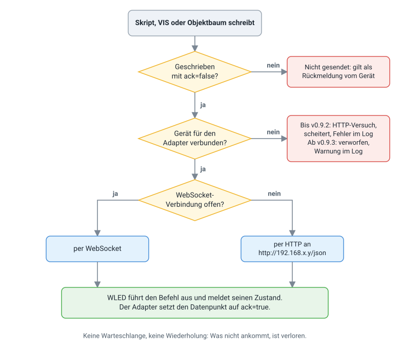
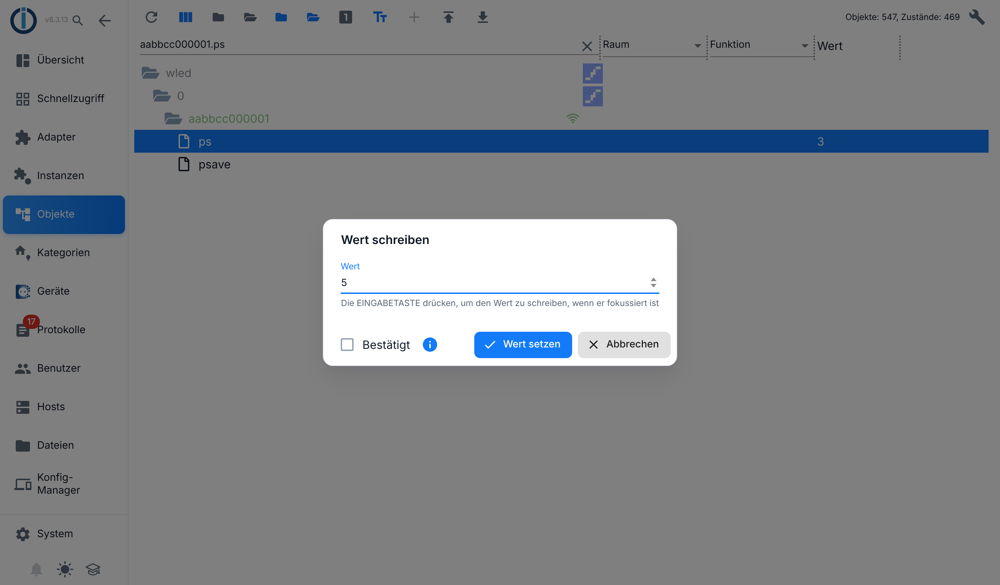
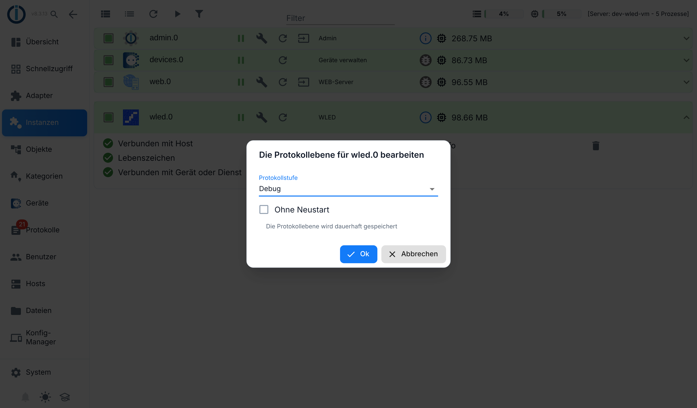

# Befehle und Skripte wirken nicht

<!-- seite: gewicht=16; en=en/04.fehlerbehebung/02.befehle-wirken-nicht.md -->

## Warum wird der Ein/Aus-Datenpunkt nicht aktualisiert?

<!-- abschnitt: prio=B; gewicht=4; readme=missing; cluster=control-basics-11; features=state-root-light,state-segments,conn-websocket,state-value-handling -->
<!-- muss beantworten: Erklärt, wann on live nachgeführt wird und wann nicht, und was bei Alexa oder Web-UI zu prüfen ist. -->

*Dieser Abschnitt wird noch geschrieben.*

## Warum setzt mein Skript ps oder on nicht, oder WLED ignoriert die Befehle?

<!-- abschnitt: prio=A; gewicht=7; readme=missing; cluster=scripts-viz-17,scripts-viz-12,effects-presets-02,effects-presets-15; features=state-write-transport,state-root-light,conn-watchdog,state-segments -->
<!-- muss beantworten: Nennt Ursachen: Gerät offline, zu schnell nach dem Einschalten, WebSocket ohne Rückmeldung, und eine Checkliste. -->

**Kurz:** Meist liegt es an einer von fünf Ursachen: Der Wert wurde als Bestätigung (`ack=true`) statt als Steuerbefehl geschrieben, das Gerät war für den Adapter gerade offline, dasselbe Preset war schon aktiv, der Datentyp stimmt nicht, oder es kamen zu viele Befehle zu schnell hintereinander. Die Checkliste unten führt dich der Reihe nach durch.
<!-- quelle: code=main.js:148@v0.9.2; code=main.js:405-427@v0.9.2; code=main.js:403@v0.9.3; extern=WLED:wled00/json.cpp:470@v0.15.0; forum=632632; forum=908024; forum=733834; forum=382563 -->

So kommt ein Befehl beim Gerät an: Der Adapter reagiert nur auf Schreibzugriffe mit `ack=false`. Er baut daraus einen JSON-Befehl, zum Beispiel `{"ps":3}` oder `{"on":true}`, und schickt ihn sofort ab: über die WebSocket-Verbindung, wenn sie steht, sonst per HTTP an `http://192.168.x.y/json`. Es gibt keine Warteschlange und keine Wiederholung.
<!-- quelle: code=main.js:148@v0.9.2; code=main.js:218-235@v0.9.2; code=main.js:405-427@v0.9.2; interview=3 -->

<!-- quelle: code=main.js:148@v0.9.2; code=main.js:405-427@v0.9.2; code=main.js:401-420@v0.9.3; issue=#904; interview=3 -->

### Checkliste

1. **Steuern statt aktualisieren.** In Blockly muss der Block „steuere“ sein, nicht „aktualisiere“. In JavaScript schreibst du `setState(id, wert)` ohne `true` als drittes Argument. Ein Wert mit `ack=true` gilt als Rückmeldung vom Gerät und wird nicht gesendet.
<!-- quelle: code=main.js:148@v0.9.2; forum=382563; extern=ioBroker.javascript:src-editor/src/Components/blockly-plugins/blocks/words.json -->

2. **Von Hand testen.** Schreib denselben Wert im Objektbaum des Admins in den Datenpunkt. Reagiert WLED darauf, liegt der Fehler im Skript, zum Beispiel an verschachtelten Auslösern oder einer falschen Objekt-ID. Die IDs der Geräte sind ihre MAC-Adressen, sie ändern sich nicht, wenn du das Gerät umbenennst.
<!-- quelle: code=main.js:899@v0.9.3; forum=632632; forum=1362574 -->

<!-- quelle: code=main.js:148@v0.9.2; extern=ioBroker.admin@v8.3.13 -->

3. **Ist das Gerät online?** Schau auf `wled.0.<MAC>._info._online`. Befehle an ein Gerät, das nicht erreichbar ist, gehen verloren. Der Adapter puffert nichts und wiederholt nichts.
   - **Bis v0.9.2:** Im Log steht ein Fehler „Sending command to WLED device … failed with error …“. Ist das Gerät dem Adapter gerade gar nicht bekannt, steht dort stattdessen ein TypeError, der auch an Sentry gemeldet wird.
   - **Ab v0.9.3:** Der Adapter verwirft den Befehl mit der Warnung `Device <MAC> (192.168.x.y) is offline, command for … discarded` ([#904](https://github.com/DrozmotiX/ioBroker.wled/issues/904)).
<!-- quelle: code=main.js:405-417@v0.9.2; code=main.js:1445@v0.9.2; code=main.js:401-405@v0.9.3; issue=#904; interview=3 -->

4. **Zu schnell nach dem Einschalten?** Bekommt WLED gerade erst Strom, zum Beispiel über eine Zwischensteckdose, ist es erst nach einigen Sekunden im WLAN erreichbar. Befehle davor gehen verloren.
   - **Ab v0.9.3** kommt hinzu: Der Adapter sendet nur an Geräte, die er als verbunden kennt ([#904](https://github.com/DrozmotiX/ioBroker.wled/issues/904)). Dass ein Gerät wieder da ist, merkt er erst bei der nächsten Prüfung. Die läuft standardmäßig alle 30 Sekunden („Intervall in Sekunden“, ab v0.10.0 „Abfrage-Intervall“). War das Gerät länger aus, prüft er seltener: Die Abstände verdoppeln sich bis höchstens 10 Minuten, und nach 5 Fehlversuchen („Maximale Wiederholungsversuche“) nur noch einmal pro Stunde. Bis dahin verwirft er Befehle.
   - **Ab v0.10.0:** Kommt ein Befehl für ein Gerät, das als offline gilt, versucht der Adapter sofort, es zu erreichen. Ist es inzwischen wieder im WLAN, geht der Befehl gleich raus, ohne dass du auf die nächste Prüfung wartest ([#939](https://github.com/DrozmotiX/ioBroker.wled/issues/939)). Nur wenn es noch nicht antwortet, verwirft er den Befehl wie oben. Einen neuen Versuch startet ein Befehl frühestens 5 Sekunden nach dem letzten.
   - Bis v0.9.3 und für Befehle in den ersten Sekunden nach dem Einschalten gilt: Lass dein Skript warten, bis `wled.0.<MAC>._info._online` auf `true` geht, und schick den Befehl erst dann.
<!-- quelle: code=main.js:401-405@v0.9.3; code=main.js:1250@v0.9.3; code=main.js:1349-1366@v0.9.3; code=main.js:1445-1452@v0.9.3; code=io-package.json:173-175@v0.9.3; code=main.js:1151@v0.9.2; issue=#904; forum=908024; issue=#939; code=main.js:428-445@v0.10.0; code=main.js:2058-2086@v0.10.0; code=main.js:34@v0.10.0 -->

5. **Dasselbe Preset schon aktiv?** Zeigt `ps` bereits die Nummer, die du schreibst, lädt WLED das Preset nicht noch einmal. Das passiert auch, wenn du das Licht zwischendurch über `on` ausgeschaltet hast. Schick dann `{"on":true,"ps":3}` an `wled.0.<MAC>.action`.
<!-- quelle: extern=WLED:wled00/json.cpp:470@v0.15.0; extern=WLED:wled00/json.cpp:449@v0.14.0; extern=WLED:wled00/led.cpp:98-99@v0.15.0; code=main.js:162-171@v0.9.2 -->

6. **Passt der Datentyp?** `on` erwartet `true` oder `false`, `ps` eine Zahl. Schreibst du `on` als Text, macht WLED etwas anderes als gedacht: Ein Text, der mit `t` beginnt (also auch `"true"`), schaltet um, und `"false"` als Text bewirkt gar nichts. ioBroker meldet einen falschen Datentyp zusätzlich als Warnung im Log.
<!-- quelle: code=lib/stateAttr.js:52-56@v0.9.2; code=main.js:1559@v0.9.2; extern=WLED:wled00/json.cpp:333-338@v0.15.0; extern=WLED:wled00/json.cpp:311-316@v0.14.0 -->

7. **Zu viele Befehle hintereinander?** Jeder geänderte Datenpunkt ist ein eigener Befehl. Schreibt dein Skript `on`, `bri`, Farbe und `ps` direkt nacheinander, kann WLED Befehle verlieren oder mit Zeitüberschreitung antworten. Fass zusammengehörende Werte in einem JSON-Befehl über `action` zusammen, zum Beispiel `{"on":true,"bri":128,"ps":3}`, oder leg sie gleich in einem Preset ab und setz nur `ps`. Wenn es einzelne Befehle sein müssen, lass zwischen ihnen eine kurze Pause.
<!-- quelle: code=main.js:162-171@v0.9.2; code=main.js:405-427@v0.9.2; forum=908024; forum=733834; interview=10; interview=14 -->
   **Ab v0.10.0:** Der Adapter bündelt selbst: Änderungen am selben Gerät, die innerhalb von 50 ms aufeinander folgen, schickt er als einen Befehl ([#926](https://github.com/DrozmotiX/ioBroker.wled/issues/926)). Die Wartezeit stellst du in den Instanzeinstellungen unter „Wartezeit zum Bündeln von Befehlen je Gerät“ ein, 0 schaltet das Bündeln ab. Mehr dazu unter [Mehrere Befehle führen zu ETIMEDOUT](#several-commands-quick-succession-lead).
<!-- quelle: issue=#926; code=main.js:452-487@v0.10.0; code=main.js:514-525@v0.10.0; code=admin/jsonConfig.json:110-124@v0.10.0; code=admin/i18n/de/translations.json:14-15@v0.10.0 -->

8. **Rückmeldung über WebSocket.** Läuft die Verbindung über WebSocket, setzt der Adapter **bis v0.9.2** selbst kein `ack=true` und meldet auch keinen Sendefehler. Das `ack` kommt erst, wenn WLED seinen neuen Zustand meldet. Bleibt ein Wert auf `ack=false`, ist der Befehl wahrscheinlich nicht angekommen. **Ab v0.9.3:** Der Adapter setzt `ack=true`, sobald der Befehl gesendet ist, und schreibt eine Warnung „Sending command for … failed“ ins Log, wenn das Senden scheitert ([#904](https://github.com/DrozmotiX/ioBroker.wled/issues/904)).
<!-- quelle: code=main.js:407-411@v0.9.2; code=main.js:408-420@v0.9.3; issue=#904; forum=1362574 -->

9. **Segment-Befehle.** Setzt du einen Wert in einem Segment, etwa `wled.0.<MAC>.seg.0.fx`, geht der Befehl nur an dieses Segment. Prüf, ob du das richtige Segment erwischt hast und ob es eingeschaltet ist.
<!-- quelle: code=main.js:376-391@v0.9.2; issue=#490 -->

10. **Debug-Log ansehen.** Stell die Instanz auf Log-Stufe „debug“: Im Reiter „Instanzen“ klappst du die Zeile von `wled.0` auf, klickst neben der Log-Stufe (`info`) auf den Stift und wählst „Debug“. Bei jedem Befehl erscheint dann „Sending state change by websocket …“ oder „Sending state change by http-API …“ mit dem gesendeten JSON. Fehlt die Zeile, ist der Befehl gar nicht beim Adapter angekommen.
<!-- quelle: code=main.js:408-412@v0.9.2 -->

<!-- quelle: extern=ioBroker.admin@v8.3.13 -->

> [!NOTE]
> Liest dein Skript `on`, beachte: **Bis v0.9.2** setzt der Adapter `on` auf `false` und `bri` auf `0`, wenn ein Gerät offline geht, und beim Adapterstart. **Ab v0.9.3:** Beide behalten ihren letzten Wert, die echten Werte kommen beim Wiederverbinden vom Gerät ([#899](https://github.com/DrozmotiX/ioBroker.wled/issues/899)).
<!-- quelle: code=main.js:1411-1412@v0.9.2; code=main.js:1820-1821@v0.9.2; issue=#899 -->

**Siehe auch:** [Presets per Datenpunkt ps schalten](../02.anleitungen/02.effekte-und-presets.md#switch-wled-presets-via-ps) · [Kompletten JSON-Befehl senden](../02.anleitungen/04.befehle-an-wled.md#send-complete-json-command-wled) · [Mehrere Befehle führen zu ETIMEDOUT](#several-commands-quick-succession-lead) · [Woran sehe ich, ob ein Gerät online ist](../05.hintergrund/01.verbindung-und-aktualisierung.md#tell-whether-device-really-online) · [Wiederholungen bei Offline-Geräten](../03.referenz/01.instanz-einstellungen.md#often-adapter-retry-offline-device) · [Warnungen zum falschen Datentyp](../03.referenz/03.log-meldungen.md#warnings-about-wrong-data-type)

## Warum führen mehrere Befehle kurz hintereinander zu ETIMEDOUT?

<!-- abschnitt: prio=B; gewicht=1; readme=missing; cluster=logs-install-12; features=state-write-transport -->
<!-- muss beantworten: Empfiehlt, Befehle über den action-Datenpunkt zu bündeln, und nennt Abstände. -->

*Dieser Abschnitt wird noch geschrieben.*

## Warum springt ps auf -1 oder zeigt nicht das gewählte Preset?

<!-- abschnitt: prio=B; gewicht=2; readme=missing; cluster=effects-presets-05; features=state-root-light,state-value-handling -->
<!-- muss beantworten: Erklärt, dass der Adapter nur den Gerätewert spiegelt, und wann -1 normal ist. -->

*Dieser Abschnitt wird noch geschrieben.*

## Warum bleiben nach dem Ausschalten einige LEDs an?

<!-- abschnitt: prio=B; gewicht=1; readme=missing; cluster=control-basics-12; features=state-root-light,state-segments -->
<!-- muss beantworten: Erklärt on am Gerät gegenüber Segment-on und wie man alle Segmente abschaltet. -->

*Dieser Abschnitt wird noch geschrieben.*

## Warum hat der Datenpunkt cct keine Wirkung?

<!-- abschnitt: prio=B; gewicht=1; readme=missing; cluster=control-basics-25; features=state-segments -->
<!-- muss beantworten: Erklärt, wann cct wirkt (Firmware, Segmenttyp). -->

*Dieser Abschnitt wird noch geschrieben.*
