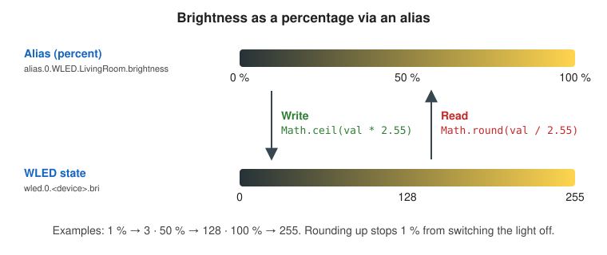
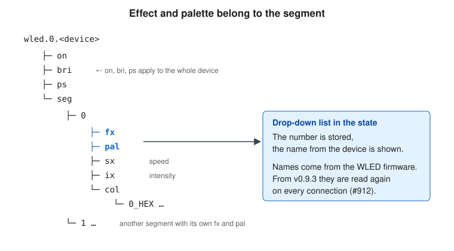

# Controlling the device for the first time

<!-- seite: gewicht=14; en=en/01.erste-schritte/03.erste-steuerung.md -->

<a id="state-use-switch-off-whole"></a>

## Which state do I use to switch on and off, the whole device or just a segment?

<!-- abschnitt: prio=B; gewicht=2; readme=missing; cluster=control-basics-17,segments-commands-11; features=state-root-light,state-segments -->
<!-- muss beantworten: Unterscheidet den Geräte-Datenpunkt on von seg.N.on und zeigt, welchen man in Skripten, Selektoren und Visualisierungen wählt. -->

*This section is still being written.*

<a id="use-brightness-percent-0-100"></a>

## How do I use brightness as a percentage (0 to 100), for example for Alexa?

<!-- abschnitt: prio=A; gewicht=6; readme=missing; cluster=control-basics-01,scripts-viz-09; features=state-root-light -->
<!-- muss beantworten: Erklärt, dass bri von 0 bis 255 läuft, und zeigt einen Alias oder eine Umrechnung auf 0 bis 100 Prozent. -->

**In short:** Like WLED itself, `bri` works with values from 0 to 255, not with percentages. For 0 to 100 % you create an alias on `bri` that divides by 2.55 when reading and multiplies by 2.55 when writing.
<!-- quelle: code=lib/stateAttr.js:57-63@v0.9.3; issue=#12; forum=1326315 -->

**From v0.10.0:** The adapter provides the percentage values itself. `wled.0.<device>.light.dimmer` holds the overall brightness in percent (0 to 100 %, role `level.dimmer`). If you write a value there, the adapter converts it to `bri`, and from 1 % upwards it also switches the light on ([#328](https://github.com/DrozmotiX/ioBroker.wled/issues/328)). You then only need the alias below for special cases, for example for the brightness of a single segment.
<!-- quelle: issue=#328; code=main.js:1878-1908@v0.10.0; code=main.js:1947-1957@v0.10.0; code=lib/stateAttr.js:16-36@v0.10.0 -->

The adapter doesn't switch `bri` to percent, because 255 steps are finer and a switch would break existing scripts and visualisations. The state has the role `level.brightness` with a minimum of 0 and a maximum of 255. This applies to the overall brightness `wled.0.<device>.bri` and in the same way to the segment brightness `wled.0.<device>.seg.<segment>.bri`.
<!-- quelle: code=lib/stateAttr.js:57-63@v0.9.3; code=main.js:1136-1141@v0.9.3; code=main.js:1731-1736@v0.9.3; issue=#12; issue=#237 -->


<!-- quelle: code=lib/stateAttr.js:57-63@v0.9.3; issue=#12; forum=1326315 -->

### Do you need a conversion at all?

For Alexa and Google Home via the iot adapter, usually not: because `bri` comes with a minimum and a maximum, the iot adapter can convert a percentage to 0 to 255 by itself. You need the alias if you want to see or write percentages in VIS, in scripts or in another integration, or if the conversion in the iot adapter doesn't work for you.
<!-- quelle: issue=#237; forum=845845 -->

### How to create a percentage alias

1. In Admin, open the "Objects" tab and create a state under `alias.0`, for example `alias.0.WLED.LivingRoom.brightness`.
2. Give it the type `number`, the role `level.dimmer`, minimum `0`, maximum `100` and the unit `%`.
3. Enter the WLED state as the alias target: `wled.0.<device>.bri`.
4. Enter the conversion. Read: `Math.round(val / 2.55)`. Write: `Math.ceil(val * 2.55)`.
5. Save, and set the alias to `50` as a test. `bri` should then jump to `128`, and the strip lights up at half brightness.
<!-- quelle: issue=#12; forum=1326315 -->

In the object, the alias part looks like this:

```json
"common": {
  "name": "Brightness living room",
  "type": "number",
  "role": "level.dimmer",
  "min": 0,
  "max": 100,
  "unit": "%",
  "read": true,
  "write": true,
  "alias": {
    "id": "wled.0.<device>.bri",
    "read": "Math.round(val / 2.55)",
    "write": "Math.ceil(val * 2.55)"
  }
}
```
<!-- quelle: issue=#12; forum=1326315 -->

<!-- bild: screenshot Objekt-Dialog eines Alias mit Ziel wled.0.<Gerät>.bri und den beiden Umrechnungen (nach Admin-Neubau) -->

> [!TIP]
> Round up when writing (`Math.ceil`). Otherwise 1 % becomes the value 0 and the light turns off, even though you only wanted it very dim.
<!-- quelle: forum=1326315 -->

> [!WARNING]
> Don't build the conversion with two scripts that trigger each other (the percentage state writes `bri`, `bri` writes the percentage state). Because of the rounding, the two values can jump back and forth. An alias doesn't have this problem, because there is only one real value.
<!-- quelle: forum=1326315 -->

**See also:** [How do I connect WLED to the iot adapter and switch effects, presets and color via Alexa or Google Home?](../02.anleitungen/07.vis-und-smarthome.md#connect-wled-iot-adapter-switch)

<a id="choose-effect-palette"></a>

## Where do I choose the effect and the palette?

<!-- abschnitt: prio=A; gewicht=6; readme=missing; cluster=effects-presets-08; features=state-effect-palette-dropdown,state-segments -->
<!-- muss beantworten: Nennt die Datenpunkte fx und pal, erklärt die Auswahllisten mit Namen und dass neue Effekte nach einem Firmware-Update erst nach Neustart erscheinen. -->

**In short:** You set the effect and the palette per segment: `wled.0.<device>.seg.<segment>.fx` for the effect and `wled.0.<device>.seg.<segment>.pal` for the palette. Both states have a drop-down list with the names your WLED device reports.
<!-- quelle: code=lib/stateAttr.js:170-174@v0.9.3; code=lib/stateAttr.js:200-204@v0.9.3; code=main.js:1798-1815@v0.9.3; issue=#4; forum=645461 -->

The first segment has the number `0`. If you have created several segments in WLED, each one has its own `fx` and `pal` states. What gets stored is the number of the effect or palette; the drop-down list shows the matching name.
<!-- quelle: code=main.js:1100-1141@v0.9.3; code=main.js:939-958@v0.9.3; forum=534831 -->


<!-- quelle: code=main.js:1100-1141@v0.9.3; code=main.js:1798-1815@v0.9.3; code=main.js:960-966@v0.9.3; issue=#912 -->

### How to do it

1. In Admin, open the "Objects" tab and go to `wled.0.<device>.seg.0`.
2. Click the value of the `fx` state. A list with the effect names of your device opens. Pick one.
3. Do the same with `pal` for the palette.
4. The strip changes right away. The state then holds the number of the selected entry.
<!-- quelle: code=main.js:1798-1815@v0.9.3; code=main.js:379-387@v0.9.3; issue=#4 -->

The effect also uses `seg.<segment>.sx` (speed) and `seg.<segment>.ix` (intensity).
<!-- quelle: code=lib/stateAttr.js:190-199@v0.9.3; forum=377748 -->

<!-- bild: screenshot Objektbaum mit seg.0.fx und geöffneter Auswahlliste der Effekte (nach Admin-Neubau) -->

In a script you write the number, for example `setState('wled.0.<device>.seg.0.fx', 9)`. Which number belongs to which name is listed in the drop-down list in the object (`common.states`).
<!-- quelle: code=main.js:1798-1815@v0.9.3; code=main.js:379-387@v0.9.3 -->

### New effects are missing from the list after a firmware update

The adapter reads the names from the device, so the list depends on your WLED firmware.
<!-- quelle: code=main.js:939-958@v0.9.3; code=main.js:860-879@v0.9.2 -->

**Up to v0.9.2:** The adapter sets the drop-down list only once per adapter run. Effects and palettes added by a firmware update only appear after you restart the adapter instance.
<!-- quelle: code=main.js:860-879@v0.9.2; code=main.js:1617-1632@v0.9.2; issue=#912 -->

**From v0.9.3:** The adapter rewrites the lists every time it connects to the device. Because WLED restarts during a firmware update and then reconnects, new effects appear without restarting the adapter ([#912](https://github.com/DrozmotiX/ioBroker.wled/issues/912)).
<!-- quelle: code=main.js:960-966@v0.9.3; code=main.js:1571@v0.9.3; issue=#912; interview=18 -->

> [!TIP]
> If the drop-down list is missing completely or out of date, restart the `wled.0` instance once. That helps in every version.
<!-- quelle: code=main.js:1798-1815@v0.9.3; code=main.js:1617-1632@v0.9.2 -->

**See also:**

- [Where do I find the numbers and names of effects and palettes for scripts?](../02.anleitungen/02.effekte-und-presets.md#numbers-names-effects-palettes-scripts)
- [How do I choose the effect and the palette in VIS as a drop-down?](../02.anleitungen/07.vis-und-smarthome.md#choose-effect-palette-vis-as)
