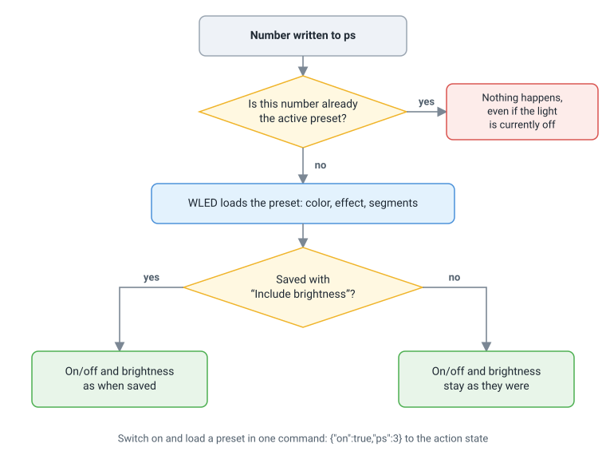

# Using effects and presets

<!-- seite: gewicht=24; en=en/02.anleitungen/02.effekte-und-presets.md -->

<a id="switch-wled-presets-via-ps"></a>

## How do I switch WLED presets via the state (ps) in VIS, Blockly or a script?

<!-- abschnitt: prio=A; gewicht=6; readme=missing; cluster=effects-presets-01,effects-presets-03; features=state-root-light,state-extra-set-commands -->
<!-- muss beantworten: Zeigt, wie man ps setzt, welche Presets man braucht, und warum das Gerät beim Preset-Wechsel an oder aus gehen kann. -->

**In short:** Create the preset in the WLED web interface and write its number as a number to `wled.0.<MAC>.ps`, as a control command (`ack=false`). Whether the light turns on or off is decided by the preset itself, not by the adapter.
<!-- quelle: code=main.js:148@v0.9.2; code=main.js:220@v0.9.2; code=lib/stateAttr.js:69@v0.9.2; forum=771230; forum=638540 -->

The adapter passes the value on to the device unchanged as `{"ps":3}`, via WebSocket or HTTP. The presets themselves live only in WLED. The adapter knows their numbers but not their names, and it doesn't create a list of presets.
<!-- quelle: code=main.js:218-222@v0.9.2; code=main.js:405-427@v0.9.2; forum=376469; forum=631812 -->

### Which presets you need

1. Open the WLED web interface of the device in your browser and set color, effect and brightness the way the preset should look.
2. Save the state with "Create Preset". The number under "Save to ID" is the number you will later write to `ps`. Allowed values are 1 to 250.
3. When saving, decide whether "Include brightness" should be on. This determines whether the preset switches the light on or off (see below).
<!-- quelle: extern=WLED-Docs:docs/features/presets.md; extern=WLED-Docs:docs/interfaces/json-api.md -->

<!-- bild: screenshot WLED-Oberfläche, Dialog „Create Preset“ mit „Save to ID“ und „Include brightness“ -->

### How to set ps

| Where | How |
|---|---|
| Object tree in Admin | Enter the number at `wled.0.<MAC>.ps` and save. |
| JavaScript | `setState('wled.0.<MAC>.ps', 3);` (without a third argument this is a control command) |
| Blockly | The "control" block with the object `ps` and the number as value. Don't use "update". |
| VIS | A widget that writes a fixed value, for example a button with the preset number, or a drop-down list with the preset numbers as values and the names as texts. |
<!-- quelle: code=main.js:148@v0.9.2; forum=382563; forum=771230; forum=638540; extern=ioBroker.javascript:src-editor/src/Components/blockly-plugins/blocks/words.json -->

<!-- bild: screenshot Objektbaum mit wled.0.<MAC>.ps, Wert eintragen (nach Admin-Neubau) -->
<!-- bild: screenshot VIS-Knopf, der eine Preset-Nummer in ps schreibt (nach Admin-Neubau) -->

The adapter only sends values with `ack=false` to the device. A value with `ack=true` ("update" in Blockly) counts as feedback from the device and is not sent.
<!-- quelle: code=main.js:148@v0.9.2; forum=382563 -->

`ps` is a state of type number. So write `3`, not `"3"`. WLED does understand the text as well, but ioBroker then logs a warning about the wrong data type.
<!-- quelle: code=main.js:1559@v0.9.2; extern=WLED:wled00/util.cpp:56-69@v0.15.0 -->

If it worked, `ps` shortly afterwards shows the number the device reports back. If you then change something by hand in WLED, WLED reports `-1`, because no preset is active any more.
<!-- quelle: code=main.js:1591@v0.9.2; extern=WLED:wled00/json.cpp:595@v0.15.0; extern=WLED:wled00/led.cpp:99@v0.15.0 -->

### Why does the light turn on or off when the preset changes?

With "Include brightness", a preset also stores the on/off state and the brightness at the moment you saved it. If it was saved while the light was off, it switches the light off when called. If it was saved while the light was on, it switches the light on. Without "Include brightness" the light stays as it is, so it also stays off if it was off before.
<!-- quelle: extern=WLED:wled00/json.cpp:586-587@v0.15.0; extern=WLED-Docs:docs/features/presets.md; forum=1310363; forum=1111167 -->


<!-- quelle: extern=WLED:wled00/json.cpp:470@v0.15.0; extern=WLED:wled00/json.cpp:586-587@v0.15.0; extern=WLED:wled00/json.cpp:333@v0.15.0 -->

This is how you get the behavior you want:

- **The preset should always switch on:** save the preset again with the light on and with "Include brightness".
- **The preset should only change effect and color:** save it without "Include brightness" and switch the light separately via `wled.0.<MAC>.on`.
- **Switch on and load a preset in one command:** write `{"on":true,"ps":3}` to the state `wled.0.<MAC>.action`. WLED evaluates `on` before `ps`.
<!-- quelle: code=main.js:162-171@v0.9.2; extern=WLED:wled00/json.cpp:333@v0.15.0; extern=WLED:wled00/json.cpp:470@v0.15.0; interview=10 -->

> [!IMPORTANT]
> WLED doesn't load a preset again if it is already the active preset. This also applies if you switched the light off via `on` in between: `ps` still shows the same number, and writing the same number again does nothing. In that case, switch on with `on` or send `{"on":true,"ps":3}` via `action`.
<!-- quelle: extern=WLED:wled00/json.cpp:470@v0.15.0; extern=WLED:wled00/json.cpp:449@v0.14.0; extern=WLED:wled00/led.cpp:98-99@v0.15.0 -->

> [!TIP]
> To save the current state as a preset from ioBroker, write the number you want to `wled.0.<MAC>.psave`.
<!-- quelle: code=main.js:883@v0.9.2; code=lib/stateAttr.js:138-142@v0.9.2; extern=WLED-Docs:docs/interfaces/json-api.md -->

**See also:** [Switch presets with a motion sensor](06.skripte.md#switch-wled-presets-automatically-example) · [Step through presets one after another](#step-through-presets-button-script) · [Start a playlist](#start-wled-playlist-through-adapter) · [Script doesn't set ps or on](../04.fehlerbehebung/02.befehle-wirken-nicht.md#script-not-ps-wled-ignores) · [ps jumps to -1](../04.fehlerbehebung/02.befehle-wirken-nicht.md#ps-jump-1-not-show)

<a id="step-through-presets-button-script"></a>

## How do I step through presets one after another with a button or a script?

<!-- abschnitt: prio=B; gewicht=4; readme=missing; cluster=effects-presets-04; features=state-root-light -->
<!-- muss beantworten: Zeigt ein Muster mit Zähler im Skript und verweist auf WLED-Playlists als Alternative. -->

*This section is still being written.*

<a id="start-wled-playlist-through-adapter"></a>

## How do I start a WLED playlist through the adapter?

<!-- abschnitt: prio=B; gewicht=2; readme=partial; cluster=effects-presets-06; features=state-root-light,state-action-json -->
<!-- muss beantworten: Erklärt, ob und wie man Playlists über ps, pl oder den action-Datenpunkt startet. -->

**In short:** In WLED, a playlist is a preset with its own number. So you start it like any preset, by writing its number to `wled.0.<MAC>.ps`. The state `pl` only shows which playlist is currently running. Writing to it doesn't start a playlist.
<!-- quelle: code=lib/stateAttr.js:69-78@v0.9.2; code=main.js:218-222@v0.9.2; extern=WLED-Docs:docs/interfaces/json-api.md; extern=WLED:wled00/json.cpp:596@v0.15.0 -->

### Start a playlist via ps

1. Create the playlist in the WLED web interface. When you save it, it gets a number like any preset.
   <!-- bild: screenshot WLED-Oberfläche, Playlist anlegen mit Presets und Dauer -->
2. Write this number to `wled.0.<MAC>.ps`, for example in JavaScript with `setState('wled.0.<MAC>.ps', 9);` or in Blockly with "control".
3. While the playlist is running, `pl` shows its number and `ps` the preset from it that is currently active. If no playlist is running, `pl` shows the value `-1`.
<!-- quelle: code=main.js:148@v0.9.2; extern=WLED-Docs:docs/interfaces/json-api.md; extern=WLED:wled00/json.cpp:595-596@v0.15.0 -->

How `ps` works in detail is described under [Switch presets via the ps state](#switch-wled-presets-via-ps).

### Start a playlist without a saved preset via action

Through the state `wled.0.<MAC>.action` you can also send a playlist directly as JSON, without saving it in WLED first. This example shows presets 1, 2 and 3 for 30 seconds each, repeats this endlessly and switches the light on:

```json
{"on":true,"playlist":{"ps":[1,2,3],"dur":[300,300,300],"transition":0,"repeat":0}}
```
<!-- quelle: code=main.js:162-171@v0.9.2; extern=WLED-Docs:docs/interfaces/json-api.md; extern=WLED:wled00/json.cpp:478-479@v0.15.0; interview=10 -->

| Key | Meaning |
|---|---|
| `ps` | The preset numbers in the order they should run |
| `dur` | How long each preset stays, in tenths of a second (`300` = 30 seconds) |
| `transition` | Transition time to the next preset, in tenths of a second |
| `repeat` | How often the whole playlist runs; `0` means endlessly |
| `end` | Preset loaded after the last run; has no effect with `repeat` = `0` |
<!-- quelle: extern=WLED-Docs:docs/interfaces/json-api.md -->

### Advance or stop a playlist

- **Jump to the next preset:** send `{"np":true}` to `action`. This is available from WLED firmware 0.15.
- **Stop:** set another preset via `ps` or change a segment directly, for example the effect. That ends the playlist.
<!-- quelle: extern=WLED-Docs:docs/interfaces/json-api.md; extern=WLED:wled00/json.cpp:494@v0.15.0; extern=WLED:wled00/presets.cpp:128@v0.15.0; extern=WLED:wled00/json.cpp:234@v0.15.0 -->

> [!NOTE]
> The adapter creates `pl` as a writable state. However, WLED ignores a written value; the WLED JSON API lists `pl` as "read-only". So use `ps` or `action` to start a playlist.
<!-- quelle: code=lib/stateAttr.js:74-78@v0.9.2; extern=WLED-Docs:docs/interfaces/json-api.md -->

**See also:** [Step through presets one after another](#step-through-presets-button-script) · [Send a complete JSON command](04.befehle-an-wled.md#send-complete-json-command-wled)

<a id="numbers-names-effects-palettes-scripts"></a>

## Where do I find the numbers and names of effects and palettes for scripts?

<!-- abschnitt: prio=B; gewicht=3; readme=missing; cluster=effects-presets-09; features=state-effect-palette-dropdown -->
<!-- muss beantworten: Zeigt, wie man die Zuordnung Nummer zu Name aus den Objekten ausliest und in welcher Reihenfolge sie erscheint. -->

*This section is still being written.*

<a id="control-percent-effect-show-value"></a>

## How do I control the "Percent" effect and show a value as a bar?

<!-- abschnitt: prio=B; gewicht=4; readme=missing; cluster=effects-presets-12,scripts-viz-15; features=state-segments -->
<!-- muss beantworten: Zeigt, welcher Datenpunkt den Balkenwert steuert, mit Beispiel für Akkustand oder Prozentwerte. -->

*This section is still being written.*

<a id="change-text-scrolling-text-effect"></a>

## How do I change the text of the "Scrolling Text" effect or the segment name?

<!-- abschnitt: prio=B; gewicht=3; readme=missing; cluster=effects-presets-13,segments-commands-08; features=state-segments -->
<!-- muss beantworten: Erklärt, dass der Lauftext der Segmentname seg.N.n ist, und ab welcher Version er beschreibbar ist. -->

*This section is still being written.*

<a id="effect-palette-survive-power-loss"></a>

## How do effect and palette survive a power loss, and how does WLED start afterwards?

<!-- abschnitt: prio=B; gewicht=2; readme=missing; cluster=effects-presets-11,logs-install-18; features=info-reset-on-disconnect,info-reset-on-start -->
<!-- muss beantworten: Trennt das Startverhalten der Firmware (Preset beim Start) von den Adapter-Datenpunkten und nennt, was der Adapter beim Start zurücksetzt. -->

*This section is still being written.*
