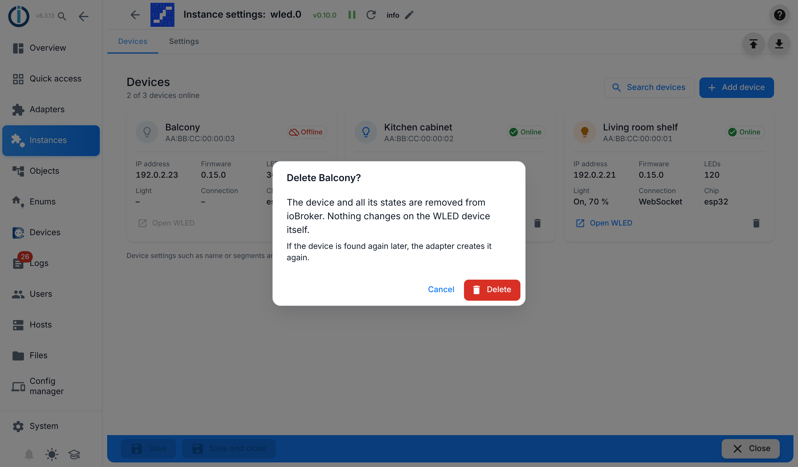
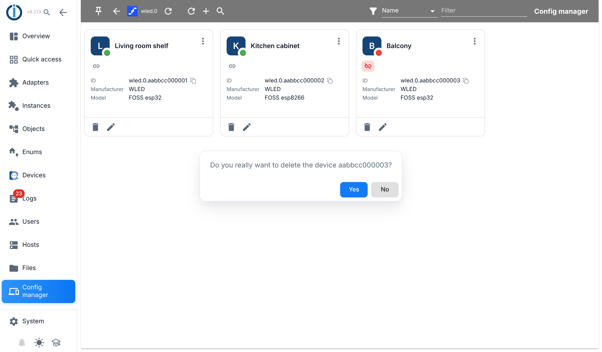

# Managing devices

<!-- seite: gewicht=16; en=en/02.anleitungen/05.geraete-verwalten.md -->

<a id="remove-wled-device-adapter"></a>

## How do I remove a WLED device from the adapter?

<!-- abschnitt: prio=A; gewicht=7; readme=missing; cluster=discovery-connection-01,discovery-connection-02; features=admin-delete-device,admin-device-table,msg-deleteDevice,dm-delete-device,conn-device-cleanup -->
<!-- muss beantworten: Zeigt Löschen in den Instanzeinstellungen und im Device Manager, erklärt Wiederauftauchen durch Bonjour und das Löschen offline Geräte ab der Fixversion. -->

**In short:** You delete a device in the instance settings with the trash can icon on its card, or in the Admin's device manager. The adapter then removes all states of the device and stops its connection and timers. Nothing changes on the WLED device itself. If the device is still running in your network, the adapter finds it again via Bonjour and creates it anew. **From v0.10.0** you can switch off the automatic search, and then it stays gone.
<!-- quelle: code=src-admin/src/DevicesApp.tsx:199-207@v0.10.0; code=lib/devicemgmt.js:318-350@v0.10.0; code=main.js:1089-1099@v0.10.0; code=main.js:2733-2751@v0.10.0; code=main.js:88-97@v0.10.0; issue=#266; issue=#897; issue=#615 -->

### How to do it: in the instance settings

**From v0.10.0:** The instance settings show every device as a card with online status, IP address and firmware ([#266](https://github.com/DrozmotiX/ioBroker.wled/issues/266)).

1. In Admin, open the settings of `wled.<instance>` under "Instances". The "Devices" tab is already open.
2. On the device's card, click the trash can icon at the bottom right ("Delete device").
3. The dialog asks "Delete <device>?" and explains: "The device and all its states are removed from ioBroker. Nothing changes on the WLED device itself." Click "Delete".
4. "<device> was deleted." appears at the bottom and the card disappears. If the device no longer exists, the dialog shows "<device> does not exist any more."; for any other error it shows "That did not work. See the instance log for details."
<!-- quelle: code=src-admin/src/DevicesApp.tsx:199-207@v0.10.0; code=src-admin/src/DevicesApp.tsx:295-360@v0.10.0; code=src-admin/src/DevicesApp.tsx:545-553@v0.10.0; code=src-admin/src/i18n/en.json:13-27@v0.10.0; code=main.js:783-787@v0.10.0; code=main.js:1089-1099@v0.10.0; issue=#266 -->



You delete a device that is offline in the same way. The instance has to be running for this. If it is stopped, the tab shows "The instance is not running" and a "Start instance" button.
<!-- quelle: code=main.js:1089-1099@v0.10.0; code=src-admin/src/DevicesApp.tsx:78-100@v0.10.0; code=src-admin/src/i18n/en.json:46-51@v0.10.0 -->

### How to do it: in the device manager

The device manager is the Admin's device overview. In Admin 8.3 the tab is called "Config manager"; in older Admin versions it is "Devices".

1. In Admin, open the "Config manager" tab (or "Devices") and select the instance `wled.<instance>`.
2. On the device's card, click the trash can icon ("Delete this device").
3. Confirm the question "Do you really want to delete the device <MAC>?" with "Yes". The question names the MAC address from the object ID, not the name.
4. The device disappears from the list. The log shows `<MAC> deleted`. If deleting fails, "Can not delete device <device>" appears.
<!-- quelle: code=lib/devicemgmt.js:318-350@v0.10.0; code=lib/devicemgmt.js:374-420@v0.10.0; code=main.js:2733-2751@v0.10.0 -->



> [!CAUTION]
> When deleting, the adapter removes the device object `wled.<instance>.<MAC>` with all states below it. Scripts, VIS views and aliases that point to these states will then point to nothing. If the adapter creates the device again later, the states are recreated under the same MAC.
<!-- quelle: code=main.js:2733-2751@v0.10.0; code=src-admin/src/i18n/en.json:16-17@v0.10.0; code=main.js:1250-1290@v0.10.0 -->

### What the adapter cleans up when you delete a device

For that device, the adapter stops the watchdog and the timers, closes the WebSocket connection and forgets the device. This also happens if you delete the device object `wled.<instance>.<MAC>` directly in the "Objects" tab. The log then shows `Device <MAC> was deleted from object tree, cleaning up backend processes and objects`.
<!-- quelle: code=main.js:2733-2751@v0.10.0; code=main.js:690-715@v0.10.0; issue=#615 -->

If the adapter doesn't know the device when you delete it in the "Objects" tab, for example because it was never connected, it reports `Device <MAC> not found in devices array, cannot clean up backend processes and objects`. The objects are deleted anyway; you can ignore the warning.
<!-- quelle: code=main.js:690-715@v0.10.0 -->

### Why does the deleted device come back?

The adapter looks for WLED devices via Bonjour (mDNS). The search starts when the adapter starts and when you click "Search devices" in the instance settings or "Discover new devices" in the device manager. After that it keeps listening until the instance stops. If a device the adapter doesn't know answers, the adapter creates it anew. A deleted device that is still switched on in your network therefore reappears. There is no list that lets you exclude individual devices from the search.
<!-- quelle: code=main.js:88-97@v0.10.0; code=main.js:2422-2468@v0.10.0; code=main.js:1108-1119@v0.10.0; code=lib/devicemgmt.js:162-168@v0.10.0; interview=4 -->

So only delete a device once you no longer use it or have taken it off the network.
<!-- quelle: code=main.js:2440-2462@v0.10.0; interview=4 -->

**From v0.10.0:** In the instance settings, on the "Settings" tab under "Discovery", switch off "Search devices automatically via Bonjour/mDNS" ([#897](https://github.com/DrozmotiX/ioBroker.wled/issues/897)). The adapter then no longer searches on start and only uses the devices it already knows or that you add by IP. A deleted device stays gone. If you start the search by hand ("Search devices"), it listens until the next restart of the instance and finds the device again.
<!-- quelle: code=main.js:88-97@v0.10.0; code=main.js:1108-1119@v0.10.0; code=main.js:2422-2468@v0.10.0; code=admin/jsonConfig.json:76-97@v0.10.0; code=admin/i18n/en/translations.json:12-13@v0.10.0; issue=#897 -->


<!-- quelle: code=main.js:2733-2751@v0.10.0; code=main.js:690-715@v0.10.0; code=main.js:88-97@v0.10.0; code=main.js:2422-2468@v0.10.0; interview=4 -->

### Delete a device from a script

With `sendTo` you delete a device by its IP address. The answer is `success` or `failed`:

```js
sendTo('wled.0', 'deleteDevice', '192.168.x.y', (result) => {
    log(`Delete device: ${result}`);
});
```
<!-- quelle: code=main.js:783-820@v0.10.0 -->

If the adapter can't find a device with this IP address, the log shows `Device with IP 192.168.x.y not found` and the answer is `failed`.
<!-- quelle: code=main.js:813-814@v0.10.0 -->

**From v0.10.0:** You can also delete the device by its MAC address, as it appears in the object ID. The answer is then an object: `{ ok: true }` or, for example, `{ ok: false, error: 'notFound' }` ([#266](https://github.com/DrozmotiX/ioBroker.wled/issues/266)).

```js
sendTo('wled.0', 'deleteDevice', { id: '<MAC>' }, (result) => {
    log(`Delete device: ${result.ok ? 'deleted' : result.error}`);
});
```
<!-- quelle: code=main.js:783-787@v0.10.0; code=main.js:1089-1099@v0.10.0; issue=#266 -->

### Older versions

**Up to v0.9.3:** The instance settings show a device table. To delete, click the red button with the trash can icon in the "Remove" column. The dialog "Delete device confirmation" shows the name and IP address; confirm with "Delete Device". Afterwards "Device deleted successfully" or "Failed to delete device" appears.
<!-- quelle: code=admin/index_m.html:28-47@v0.9.3; code=admin/index_m.html:135-167@v0.9.3; code=admin/index_m.html:312-371@v0.9.3; code=main.js:535-566@v0.9.3 -->

**Up to v0.9.2:** In the instance settings you can't delete a device that has been offline since the adapter started. "Failed to delete device" appears, and the log shows `Device with IP 192.168.x.y not found`. In that case, delete the device in the device manager or in the "Objects" tab.
<!-- quelle: code=main.js:524-551@v0.9.2; issue=#787 -->

**From v0.9.3:** Deleting in the instance settings also works for devices that are offline ([#787](https://github.com/DrozmotiX/ioBroker.wled/issues/787)). For this, the adapter also looks for the device in the object tree.
<!-- quelle: issue=#787; code=main.js:541-549@v0.9.3 -->

**Up to v0.9.2:** In the device manager, the dialog doesn't wait for the result and doesn't show an error. For instances from `wled.10` upwards, deleting fails there. Use the "Objects" tab instead.
<!-- quelle: code=lib/devicemgmt.js:254-294@v0.9.2; issue=#914 -->

**From v0.9.3:** The dialog in the device manager waits for the result, shows "Can not delete device <device>" if something goes wrong, and also works for instances from `wled.10` upwards ([#914](https://github.com/DrozmotiX/ioBroker.wled/issues/914)).
<!-- quelle: issue=#914; code=lib/devicemgmt.js:288-320@v0.9.3 -->

**From v0.9.3:** "Discover new devices" first stops the running search and then starts a new one. Searches no longer run side by side ([#905](https://github.com/DrozmotiX/ioBroker.wled/issues/905)).
<!-- quelle: issue=#905; code=main.js:1660-1669@v0.9.3 -->

**See also:** [How and when does the adapter find my WLED devices automatically?](../01.erste-schritte/02.erstes-geraet.md#adapter-wled-devices-automatically) · [How do I add a device manually by IP?](../01.erste-schritte/02.erstes-geraet.md#add-device-manually-ip-if)

<a id="deal-switched-off-offline-devices"></a>

## How do I deal with devices that are switched off or offline, and how do I get rid of the log messages?

<!-- abschnitt: prio=B; gewicht=6; readme=partial; cluster=logs-install-09,discovery-connection-03; features=conn-retry-logic,log-warn-messages,setting-max-retries,setting-retry-backoff,info-device-online-state,conn-watchdog -->
<!-- muss beantworten: Erklärt Wiederholversuche, die Logstufe nach dem Ausfall und die Einstellungen für maximale Versuche. -->

*This section is still being written.*

<a id="happens-commands-sent-switched-off"></a>

## What happens to commands sent to a device that is switched off?

<!-- abschnitt: prio=B; gewicht=3; readme=missing; cluster=logs-install-10,discovery-connection-05; features=state-write-transport,info-device-online-state,log-error-messages,log-warn-messages -->
<!-- muss beantworten: Sagt klar, dass Befehle nicht nachgeholt werden, und erklärt die Fehlermeldung beim Senden. -->

*This section is still being written.*
