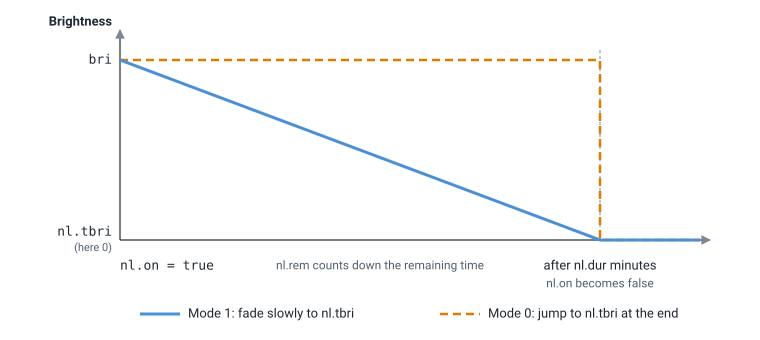
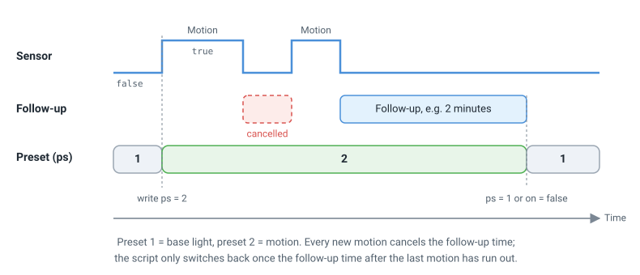

# Scripts with Blockly and JavaScript

<!-- seite: gewicht=28; en=en/02.anleitungen/06.skripte.md -->

<a id="control-wled-javascript-periodically-step"></a>

## How do I control WLED with JavaScript, periodically or step by step (for example a sunrise)?

<!-- abschnitt: prio=B; gewicht=3; readme=missing; cluster=scripts-viz-14; features=state-root-light,state-segments -->
<!-- muss beantworten: Zeigt ein Grundgerüst mit setState und Zeitsteuerung samt Hinweisen zu Mindestabständen. -->

*This section is still being written.*

<a id="wled-states-script-selector-through"></a>

## How do I find WLED states in the script selector through the role switch.light?

<!-- abschnitt: prio=B; gewicht=1; readme=missing; cluster=scripts-viz-22; features=state-root-light,state-segments -->
<!-- muss beantworten: Erklärt die Rollen der Datenpunkte und wie man Selektoren darauf aufbaut. -->

*This section is still being written.*

<a id="build-garage-door-lighting-wled"></a>

## How do I build garage door lighting with WLED presets?

<!-- abschnitt: prio=B; gewicht=10; readme=missing; cluster=scripts-viz-18; features=state-root-light,state-write-transport -->
<!-- muss beantworten: Liefert ein vollständiges Blockly- oder JavaScript-Beispiel mit Sensor, Preset und Rückfall. -->

*This section is still being written.*

<a id="switch-wled-off-automatically-after"></a>

## How do I switch WLED off automatically after a while (timer)?

<!-- abschnitt: prio=A; gewicht=7; readme=missing; cluster=scripts-viz-13; features=state-root-light,state-write-transport -->
<!-- muss beantworten: Zeigt ein Timer-Muster in Blockly und JavaScript, auch mit dem WLED-eigenen Nightlight. -->

**In short:** There are two ways. Either your script starts a timer when the light is switched on and writes `false` to `wled.0.<MAC>.on` when the time is up. Or you use the WLED nightlight (`nl`): then the device counts down by itself and switches off, even if ioBroker isn't running during that time.
<!-- quelle: code=main.js:148@v0.9.2; code=lib/stateAttr.js:52-56@v0.9.2; code=lib/stateAttr.js:79-94@v0.9.2; forum=1018283; forum=704611; extern=WLED-Docs:docs/interfaces/json-api.md -->

For the adapter, switching off is just a normal write to `on`. The timing logic belongs in the script. What matters is that you clear a running timer and start it again when it is triggered again, instead of working with pauses.
<!-- quelle: code=main.js:218-222@v0.9.2; forum=763682; forum=745693; forum=757741; forum=635140 -->

### Timer in Blockly

1. Add an "Event: if object" block and select `wled.0.<MAC>.on` as the object. Set it to "was changed".
2. Inside the block, check whether the value is `true`.
3. Inside that, add the "control" block for `wled.0.<MAC>.on` with the value `false`. Enable "with delay", enter the time (for example 10 min) and tick "clear running".
4. This way, every new switch-on starts the timer from the beginning. Switching off by hand before the time is up does no harm: the timer then writes `false` to a light that is already off.
<!-- quelle: extern=ioBroker.javascript:src-editor/src/Components/blockly-plugins/blocks/words.json; forum=1018283; forum=1080073 -->

<!-- bild: screenshot Blockly: Falls Objekt auf on, steuere on mit falsch, mit Verzögerung 10 Min, löschen falls läuft -->

### Timer in JavaScript

```javascript
const WLED = 'wled.0.<MAC>';
const DURATION_MS = 10 * 60 * 1000; // 10 minutes
let offTimer = null;

// WLED reports: light is on (no matter whether switched on via VIS, app or button)
on({ id: `${WLED}.on`, val: true, change: 'ne', ack: true }, () => {
    if (offTimer) clearTimeout(offTimer); // restart a running timer
    offTimer = setTimeout(() => {
        offTimer = null;
        setState(`${WLED}.on`, false); // control command (ack=false)
    }, DURATION_MS);
});

// If it is switched off by hand, the timer is no longer needed
on({ id: `${WLED}.on`, val: false, change: 'ne', ack: true }, () => {
    if (offTimer) clearTimeout(offTimer);
    offTimer = null;
});
```
<!-- quelle: code=main.js:148@v0.9.2; code=main.js:1591@v0.9.2; forum=704611; forum=763682 -->

`ack: true` in the trigger means: the script reacts to the feedback from the device, not to your own command. `change: 'ne'` makes sure that only a real change starts the timer.
<!-- quelle: code=main.js:1591@v0.9.2; extern=ioBroker.javascript:docs/en/javascript.md -->

> [!WARNING]
> **Up to v0.9.2** the adapter sets `on` to `false` as soon as a device goes offline, and when the adapter starts. A script that reacts to `on` is therefore triggered even without any real switching. **From v0.9.3:** `on` and `bri` keep their last value when the device goes offline and when the adapter starts; the real values come from the device when it reconnects ([#899](https://github.com/DrozmotiX/ioBroker.wled/issues/899)).
<!-- quelle: code=main.js:1411@v0.9.2; code=main.js:1820@v0.9.2; issue=#899 -->

If the device is offline when the timer runs out, the command doesn't arrive. The adapter doesn't buffer anything. **From v0.9.3** the log then shows the warning "Device … is offline, command for … discarded" ([#904](https://github.com/DrozmotiX/ioBroker.wled/issues/904)). If switching off must work reliably, use the nightlight.
<!-- quelle: code=main.js:403@v0.9.3; issue=#904; interview=3 -->

### Timer with the WLED nightlight

The nightlight runs on the device. For it, the adapter creates these states under `wled.0.<MAC>.nl`:

| State | Meaning | Writable |
|---|---|---|
| `nl.on` | Start (`true`) or cancel (`false`) the nightlight | yes |
| `nl.dur` | Duration in minutes, 1 to 255 | yes |
| `nl.tbri` | Target brightness at the end, 0 to 255; with `0` the light is off afterwards | yes |
| `nl.mode` | Mode: `0` instant, `1` fade slowly, `2` color fade, `3` sunrise | no, only via `action` |
| `nl.rem` | Remaining time in seconds, `-1` if no nightlight is running | no |
<!-- quelle: code=lib/stateAttr.js:52-56@v0.9.2; code=lib/stateAttr.js:79-94@v0.9.2; code=lib/stateAttr.js:416-420@v0.9.2; code=lib/stateAttr.js:496-499@v0.9.2; code=main.js:1130-1138@v0.9.2; code=main.js:1563@v0.9.2; extern=WLED-Docs:docs/interfaces/json-api.md -->


<!-- quelle: extern=WLED:wled00/led.cpp:216-260@v0.15.0; extern=WLED-Docs:docs/interfaces/json-api.md -->

This is how you switch the light off in 10 minutes:

1. Write `10` to `wled.0.<MAC>.nl.dur` and `0` to `wled.0.<MAC>.nl.tbri`.
2. Switch the light on if it is off, then write `true` to `wled.0.<MAC>.nl.on`.
3. When the time is up, WLED sets the brightness to `nl.tbri`, so the light is off. `nl.on` goes back to `false`.
<!-- quelle: extern=WLED:wled00/led.cpp:216-260@v0.15.0; extern=WLED-Docs:docs/interfaces/json-api.md -->

You can only set the mode via the `action` state, because `nl.mode` isn't writable in the adapter. With a single command you switch the light on and let it fade out slowly over 10 minutes:

```json
{"on":true,"nl":{"on":true,"dur":10,"mode":1,"tbri":0}}
```
<!-- quelle: code=main.js:162-171@v0.9.2; code=lib/stateAttr.js:496-499@v0.9.2; extern=WLED:wled00/json.cpp:368-372@v0.15.0; extern=WLED-Docs:docs/interfaces/json-api.md; interview=10 -->

In JavaScript: `setState('wled.0.<MAC>.action', JSON.stringify({ on: true, nl: { on: true, dur: 10, mode: 1, tbri: 0 } }));`. In Blockly, write the same text to `action` with "control".
<!-- quelle: code=main.js:162-171@v0.9.2; interview=10 -->

**See also:** [Send a complete JSON command](04.befehle-an-wled.md#send-complete-json-command-wled) · [Switch presets with a motion sensor](#switch-wled-presets-automatically-example) · [Why on becomes false when the device goes offline](../05.hintergrund/01.verbindung-und-aktualisierung.md#become-false-device-goes-offline) · [Script doesn't set ps or on](../04.fehlerbehebung/02.befehle-wirken-nicht.md#script-not-ps-wled-ignores)

<a id="show-status-countdown-strip"></a>

## How do I show a status or a countdown on the strip?

<!-- abschnitt: prio=B; gewicht=2; readme=missing; cluster=scripts-viz-16; features=state-segments,state-root-light -->
<!-- muss beantworten: Zeigt, wie man Farbe, Segmente und Effekte für Statusanzeigen kombiniert. -->

*This section is still being written.*

<a id="switch-wled-presets-automatically-example"></a>

## How do I switch WLED presets automatically, for example with a motion sensor?

<!-- abschnitt: prio=A; gewicht=2; readme=missing; cluster=scripts-viz-19; features=state-root-light -->
<!-- muss beantworten: Zeigt das allgemeine Muster: Sensor-State auslösen, Preset über ps setzen, nach Ablauf zurückschalten, mit Blockly- und JavaScript-Beispiel; das Garagentor ist nur ein Beispiel dafür. -->

**In short:** The pattern is always the same: a sensor state triggers the script, the script writes the preset number to `wled.0.<MAC>.ps`, and after a follow-up time it switches back to another preset or writes `false` to `on`. This works with motion sensors, door and gate contacts or any other state.
<!-- quelle: code=main.js:148@v0.9.2; code=main.js:218-222@v0.9.2; code=lib/stateAttr.js:52-73@v0.9.2; forum=685437; forum=1005340 -->

The adapter doesn't do anything special here: every write with `ack=false` to `ps` or `on` is sent to the device right away. The logic of which preset applies when lives entirely in the script.
<!-- quelle: code=main.js:148@v0.9.2; code=main.js:405-427@v0.9.2 -->


<!-- quelle: forum=685437; forum=1005340 -->

### What to prepare

1. Create the presets in WLED, for example number 2 for "motion" and number 1 for "base light". Save the "motion" preset with the light on and with "Include brightness", so that it also switches on when the light was off before.
2. Look up the ID of your sensor in the object tree, for example the motion state of a Zigbee or Homematic sensor. It should report `true` on motion and `false` afterwards.
3. Decide how long the light should stay on after the last motion.
<!-- quelle: extern=WLED:wled00/json.cpp:586-587@v0.15.0; extern=WLED-Docs:docs/features/presets.md; forum=685437 -->

How `ps` works in detail and why a preset switches on or off is described under [Switch presets via the ps state](02.effekte-und-presets.md#switch-wled-presets-via-ps).

### Example in JavaScript

```javascript
const WLED = 'wled.0.<MAC>';
const SENSOR = '<ID of the motion sensor>';
const PRESET_MOTION = 2;
const PRESET_BACK = 1;              // 0 means: switch off afterwards
const FOLLOW_UP_MS = 2 * 60 * 1000; // 2 minutes after the last motion

let followUp = null;

// Motion detected: set the preset right away, cancel a running follow-up time
on({ id: SENSOR, val: true, change: 'ne' }, () => {
    if (followUp) { clearTimeout(followUp); followUp = null; }
    setState(`${WLED}.ps`, PRESET_MOTION);
});

// No more motion: start the follow-up time, then switch back
on({ id: SENSOR, val: false, change: 'ne' }, () => {
    if (followUp) clearTimeout(followUp);
    followUp = setTimeout(() => {
        followUp = null;
        if (PRESET_BACK > 0) {
            setState(`${WLED}.ps`, PRESET_BACK);
        } else {
            setState(`${WLED}.on`, false);
        }
    }, FOLLOW_UP_MS);
});
```
<!-- quelle: code=main.js:148@v0.9.2; code=main.js:218-222@v0.9.2; forum=685437; forum=1005340; extern=ioBroker.javascript:docs/en/javascript.md -->

### Example in Blockly

1. An "Event: if object" block on the sensor, "was changed".
2. Inside it, a check on the value. If it is `true`: first the "clear" block from the "Timeouts" group for the timeout "followUp", then "control" `wled.0.<MAC>.ps` with `2`.
3. If it is `false`: again first "clear" for "followUp", then the "Execution" block with the name "followUp" and "in" 2 min. Inside it, "control" `wled.0.<MAC>.ps` with `1` (or `wled.0.<MAC>.on` with `false`).
4. This way, every new motion cancels the follow-up time, and every end of a motion starts it again. The "Pause" block is not suitable for this, because it can't be cancelled.
<!-- quelle: extern=ioBroker.javascript:src-editor/src/Components/blockly-plugins/blocks/words.json; extern=ioBroker.javascript:src-editor/src/Components/blockly-plugins/blocks/blocks_timeout.ts; forum=685437 -->

<!-- bild: screenshot Blockly: Falls Objekt auf den Sensor, steuere ps mit 2 bei wahr, stop und Ausführen „nachlauf“ bei falsch -->

### What to watch out for

- **One trigger per state.** Create only one trigger per sensor and let it call a shared function. Several triggers on the same state can interfere with each other.
- **Several sensors** (for example top and bottom of the stairs): in a helper function, work out from all sensors which preset should apply, and write `ps` only there. A lock variable per sensor stops one sequence from cancelling the other.
- **The same preset again:** if the preset is already active, WLED doesn't load it again. So if you switched the light off via `on` in between, it stays off. In that case, send `{"on":true,"ps":2}` to `wled.0.<MAC>.action`.
- **Device offline:** commands to a device that the adapter considers offline don't arrive. The adapter doesn't buffer anything. **From v0.9.3** the log then shows the warning "Device … is offline, command for … discarded" ([#904](https://github.com/DrozmotiX/ioBroker.wled/issues/904)).
<!-- quelle: forum=1005340; forum=685437; extern=WLED:wled00/json.cpp:470@v0.15.0; code=main.js:162-171@v0.9.2; code=main.js:403@v0.9.3; issue=#904; interview=3; interview=10 -->

> [!TIP]
> If the light should return to its previous state after the follow-up time, remember the value of `ps` when the script is triggered and write it back afterwards. This only works if a preset was active before. If `ps` shows the value `-1`, none was active.
<!-- quelle: code=main.js:1591@v0.9.2; extern=WLED:wled00/json.cpp:595@v0.15.0 -->

A detailed example for a garage door with several states is under [Garage door lighting with WLED presets](#build-garage-door-lighting-wled).

**See also:** [Switch presets via the ps state](02.effekte-und-presets.md#switch-wled-presets-via-ps) · [Switch WLED off after a while](#switch-wled-off-automatically-after) · [Script doesn't set ps or on](../04.fehlerbehebung/02.befehle-wirken-nicht.md#script-not-ps-wled-ignores)

<a id="save-state-restore-after-animation"></a>

## How do I save the state and restore it after an animation?

<!-- abschnitt: prio=B; gewicht=2; readme=missing; cluster=scripts-viz-20; features=state-extra-set-commands,state-root-light -->
<!-- muss beantworten: Zeigt, welche Datenpunkte man sichert, und alternativ den WLED-eigenen Preset-Speicher (psave). -->

*This section is still being written.*

<a id="tell-whether-wled-was-switched"></a>

## How can I tell whether WLED was switched via Telegram, VIS or the web interface?

<!-- abschnitt: prio=B; gewicht=1; readme=missing; cluster=control-basics-16; features=state-value-handling,state-write-transport -->
<!-- muss beantworten: Erklärt, dass das Quelle-Merkmal nicht verfügbar ist, und welche Umwege es gibt. -->

*This section is still being written.*
