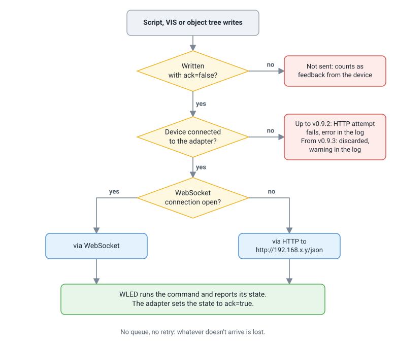

# Commands and scripts have no effect

<!-- seite: gewicht=16; en=en/04.fehlerbehebung/02.befehle-wirken-nicht.md -->

## Why isn't the on/off state updated?

<!-- abschnitt: prio=B; gewicht=4; readme=missing; cluster=control-basics-11; features=state-root-light,state-segments,conn-websocket,state-value-handling -->
<!-- muss beantworten: Erklärt, wann on live nachgeführt wird und wann nicht, und was bei Alexa oder Web-UI zu prüfen ist. -->

*This section is still being written.*

## Why doesn't my script set ps or on, or why does WLED ignore the commands?

<!-- abschnitt: prio=A; gewicht=7; readme=missing; cluster=scripts-viz-17,scripts-viz-12,effects-presets-02,effects-presets-15; features=state-write-transport,state-root-light,conn-watchdog,state-segments -->
<!-- muss beantworten: Nennt Ursachen: Gerät offline, zu schnell nach dem Einschalten, WebSocket ohne Rückmeldung, und eine Checkliste. -->

**In short:** It is usually one of five causes: the value was written as an acknowledgement (`ack=true`) instead of a control command, the device was offline for the adapter at that moment, the same preset was already active, the data type is wrong, or too many commands came too quickly one after another. The checklist below takes you through them in order.
<!-- quelle: code=main.js:148@v0.9.2; code=main.js:405-427@v0.9.2; code=main.js:403@v0.9.3; extern=WLED:wled00/json.cpp:470@v0.15.0; forum=632632; forum=908024; forum=733834; forum=382563 -->

This is how a command reaches the device: the adapter only reacts to writes with `ack=false`. It turns them into a JSON command, for example `{"ps":3}` or `{"on":true}`, and sends it right away: over the WebSocket connection if it is up, otherwise via HTTP to `http://192.168.x.y/json`. There is no queue and no retry.
<!-- quelle: code=main.js:148@v0.9.2; code=main.js:218-235@v0.9.2; code=main.js:405-427@v0.9.2; interview=3 -->

<!-- quelle: code=main.js:148@v0.9.2; code=main.js:405-427@v0.9.2; code=main.js:401-420@v0.9.3; issue=#904; interview=3 -->

### Checklist

1. **Control, don't update.** In Blockly, the block must be "control", not "update". In JavaScript, write `setState(id, value)` without `true` as the third argument. A value with `ack=true` counts as feedback from the device and is not sent.
<!-- quelle: code=main.js:148@v0.9.2; forum=382563; extern=ioBroker.javascript:src-editor/src/Components/blockly-plugins/blocks/words.json -->

2. **Test by hand.** Write the same value to the state in the Admin object tree. If WLED reacts, the error is in the script, for example nested triggers or a wrong object ID. The device IDs are their MAC addresses; they don't change when you rename the device.
<!-- quelle: code=main.js:899@v0.9.3; forum=632632; forum=1362574 -->
<!-- bild: screenshot Objektbaum, Wert von Hand in wled.0.<MAC>.ps schreiben (nach Admin-Neubau) -->

3. **Is the device online?** Look at `wled.0.<MAC>._info._online`. Commands to a device that can't be reached are lost. The adapter doesn't buffer anything and doesn't retry.
   - **Up to v0.9.2:** The log shows an error "Sending command to WLED device … failed with error …". If the adapter doesn't know the device at all at that moment, a TypeError appears there instead, which is also reported to Sentry.
   - **From v0.9.3:** The adapter discards the command with the warning `Device <MAC> (192.168.x.y) is offline, command for … discarded` ([#904](https://github.com/DrozmotiX/ioBroker.wled/issues/904)).
<!-- quelle: code=main.js:405-417@v0.9.2; code=main.js:1445@v0.9.2; code=main.js:401-405@v0.9.3; issue=#904; interview=3 -->

4. **Too soon after switching on?** If WLED has only just been powered, for example via a smart plug, it takes a few seconds before it can be reached over Wi-Fi. Commands sent before that are lost.
   - **From v0.9.3** there is one more point: the adapter only sends to devices it knows to be connected ([#904](https://github.com/DrozmotiX/ioBroker.wled/issues/904)). It only notices that a device is back at the next check. By default this runs every 30 seconds ("Intervall in seconds"). If the device was off for longer, it checks less often: the intervals double up to a maximum of 10 minutes, and after 5 failed attempts ("Max retry attempts") only once an hour. Until then it discards commands.
   - So let your script wait until `wled.0.<MAC>._info._online` becomes `true`, and only then send the command.
<!-- quelle: code=main.js:401-405@v0.9.3; code=main.js:1250@v0.9.3; code=main.js:1349-1366@v0.9.3; code=main.js:1445-1452@v0.9.3; code=io-package.json:173-175@v0.9.3; code=main.js:1151@v0.9.2; issue=#904; forum=908024 -->

5. **Same preset already active?** If `ps` already shows the number you write, WLED doesn't load the preset again. This also happens if you switched the light off via `on` in between. In that case, send `{"on":true,"ps":3}` to `wled.0.<MAC>.action`.
<!-- quelle: extern=WLED:wled00/json.cpp:470@v0.15.0; extern=WLED:wled00/json.cpp:449@v0.14.0; extern=WLED:wled00/led.cpp:98-99@v0.15.0; code=main.js:162-171@v0.9.2 -->

6. **Is the data type right?** `on` expects `true` or `false`, `ps` a number. If you write `on` as text, WLED does something other than you expect: a text starting with `t` (so `"true"` too) toggles the light, and `"false"` as text does nothing at all. ioBroker also logs a wrong data type as a warning.
<!-- quelle: code=lib/stateAttr.js:52-56@v0.9.2; code=main.js:1559@v0.9.2; extern=WLED:wled00/json.cpp:333-338@v0.15.0; extern=WLED:wled00/json.cpp:311-316@v0.14.0 -->

7. **Too many commands in a row?** Every changed state is a separate command. If your script writes `on`, `bri`, color and `ps` right after each other, WLED can lose commands or answer with a timeout. Combine values that belong together in one JSON command via `action`, for example `{"on":true,"bri":128,"ps":3}`, or store them in a preset and only set `ps`. If they have to be single commands, leave a short pause between them.
<!-- quelle: code=main.js:162-171@v0.9.2; code=main.js:405-427@v0.9.2; forum=908024; forum=733834; interview=10; interview=14 -->

8. **Feedback over WebSocket.** If the connection runs over WebSocket, the adapter **up to v0.9.2** doesn't set `ack=true` itself and doesn't report a sending error either. The `ack` only comes when WLED reports its new state. If a value stays at `ack=false`, the command probably didn't arrive. **From v0.9.3:** The adapter sets `ack=true` as soon as the command has been sent, and writes a warning "Sending command for … failed" to the log if sending fails ([#904](https://github.com/DrozmotiX/ioBroker.wled/issues/904)).
<!-- quelle: code=main.js:407-411@v0.9.2; code=main.js:408-420@v0.9.3; issue=#904; forum=1362574 -->

9. **Segment commands.** If you set a value in a segment, such as `wled.0.<MAC>.seg.0.fx`, the command only goes to that segment. Check that you picked the right segment and that it is switched on.
<!-- quelle: code=main.js:376-391@v0.9.2; issue=#490 -->

10. **Look at the debug log.** Set the instance to log level "debug". For every command, "Sending state change by websocket …" or "Sending state change by http-API …" then appears with the JSON that was sent. If the line is missing, the command never reached the adapter.
<!-- quelle: code=main.js:408-412@v0.9.2 -->
<!-- bild: screenshot Instanzen-Seite, Log-Stufe der Instanz auf debug stellen (nach Admin-Neubau) -->

> [!NOTE]
> If your script reads `on`, keep in mind: **up to v0.9.2** the adapter sets `on` to `false` and `bri` to `0` when a device goes offline, and when the adapter starts. **From v0.9.3:** Both keep their last value; the real values come from the device when it reconnects ([#899](https://github.com/DrozmotiX/ioBroker.wled/issues/899)).
<!-- quelle: code=main.js:1411-1412@v0.9.2; code=main.js:1820-1821@v0.9.2; issue=#899 -->

**See also:** [Switch presets via the ps state](../02.anleitungen/02.effekte-und-presets.md#switch-wled-presets-via-ps) · [Send a complete JSON command](../02.anleitungen/04.befehle-an-wled.md#send-complete-json-command-wled) · [Several commands lead to ETIMEDOUT](#several-commands-quick-succession-lead) · [How can I tell whether a device is online](../05.hintergrund/01.verbindung-und-aktualisierung.md#tell-whether-device-really-online) · [Retries for offline devices](../03.referenz/01.instanz-einstellungen.md#often-adapter-retry-offline-device) · [Warnings about a wrong data type](../03.referenz/03.log-meldungen.md#warnings-about-wrong-data-type)

## Why do several commands in quick succession lead to ETIMEDOUT?

<!-- abschnitt: prio=B; gewicht=1; readme=missing; cluster=logs-install-12; features=state-write-transport -->
<!-- muss beantworten: Empfiehlt, Befehle über den action-Datenpunkt zu bündeln, und nennt Abstände. -->

*This section is still being written.*

## Why does ps jump to -1 or not show the selected preset?

<!-- abschnitt: prio=B; gewicht=2; readme=missing; cluster=effects-presets-05; features=state-root-light,state-value-handling -->
<!-- muss beantworten: Erklärt, dass der Adapter nur den Gerätewert spiegelt, und wann -1 normal ist. -->

*This section is still being written.*

## Why do some LEDs stay on after switching off?

<!-- abschnitt: prio=B; gewicht=1; readme=missing; cluster=control-basics-12; features=state-root-light,state-segments -->
<!-- muss beantworten: Erklärt on am Gerät gegenüber Segment-on und wie man alle Segmente abschaltet. -->

*This section is still being written.*

## Why does the cct state have no effect?

<!-- abschnitt: prio=B; gewicht=1; readme=missing; cluster=control-basics-25; features=state-segments -->
<!-- muss beantworten: Erklärt, wann cct wirkt (Firmware, Segmenttyp). -->

*This section is still being written.*
